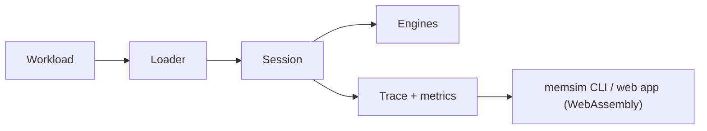

# MemForge

A deterministic simulator of an operating system's memory manager, written in C. MemForge's
simulator (working name MemSim, binary `memsim`) covers both halves of the classic OS course
material:

- **Contiguous allocation** with First-Fit, Best-Fit and Worst-Fit placement, block splitting and
  coalescing, fragmentation metrics and sliding compaction.
- **Demand paging** with per-process page tables, address translation, and FIFO, LRU and OPT page
  replacement, including a frame sweep that reproduces Belady's anomaly.

Every run is reproducible: the same workload, configuration and seed always give a byte-identical
trace, so policies can be compared fairly and every number in the report traces back to a test or a
benchmark row.

## How it works

A workload is a plain-text list of operations (allocations, frees, compaction, process spawns and page references). The loader validates it and interns process and allocation names; the `Session` applies each operation to the contiguous or paging engine, checks the engine's invariants after every step, and hands the step's events to the trace writer and the metrics collector. The same C code is built natively for the `memsim` CLI and the tests, and compiled to WebAssembly for the web app, so both produce identical traces.



## What it does

MemForge implements the memory management subsystems of an operating system in C:

- **Contiguous allocation**:
  - Placement policies: First-Fit, Best-Fit, and Worst-Fit.
  - Variable partitioning with block splitting on allocation and coalescing of adjacent free blocks on deallocation.
  - Tracking of fragmentation metrics: external fragmentation ratio, hole count, largest hole, total free memory, and hole search distance.
  - Sliding compaction relocating live blocks to eliminate external fragmentation.
- **Demand paging**:
  - Page replacement policies: FIFO, LRU, and OPT (optimal offline replacement).
  - Multi-process memory management with per-process page tables (present, referenced, and dirty status bits).
  - Virtual address translation and physical frame allocation.
  - Tracking of page faults, page hits, and dirty page write-backs.
  - Frame sweep analysis detecting Belady's anomaly.
- **CLI commands**:
  - `validate`: Check workload file syntax and parameters.
  - `run`: Execute a workload under a selected policy, with optional JSONL trace logging and JSON metrics output.
  - `compare`: Run multiple contiguous allocation policies against the same workload and display side-by-side metric tables.
  - `refs`: Simulate a reference string given on the command line, with optional step-by-step frame table output.
  - `sweep`: Execute a frame range sweep across replacement policies to identify page fault curves and Belady's anomaly points.
  - `gen`: Generate synthetic workloads (`alloc-uniform` for contiguous allocation, `refs-locality` for page references) using deterministic seeds.
- **Web app pages**:
  - Svelte and TypeScript application running the C engine compiled to WebAssembly:
    - Overview: a live run of the engine and links to six classic scenarios.
    - Contiguous memory: allocate, free, terminate and compact live under one policy or all three side by side, with step history, measurements and a fragmentation chart; or load a seeded random workload (the experiments' generator).
    - Paging: any reference string with writes, several processes and virtual addresses; the textbook frames table, page tables, address translation, and faults against frames with Belady's anomaly; or seeded random references.
    - Replay a trace: step through any `memsim run --trace` file.
- **Experiments**:
  - E1: Contiguous allocation placement policies under variable memory pressures (60%, 75%, and 90% target utilisation) with 95% confidence intervals across 30 workloads.
  - E4: Paging replacement policies (FIFO, LRU, OPT) evaluated across frame counts (1 to 16 frames) on localized reference workloads.
- **Tests**:
  - Unit tests for every module.
  - Golden fixtures for acceptance criteria AC-1 to AC-5 (`tests/fixtures/`, `tests/golden/`).
  - Integration tests for AC-6 to AC-8: byte-identical double runs, invariants on every step, the `compare` table; plus a CLI smoke test.
  - A web test that the WebAssembly build produces the same trace as the CLI on every fixture and policy.
  - Every test under AddressSanitizer, UBSan and Valgrind memcheck, plus clang-tidy.

## Quick start

Requirements: Linux or macOS (Windows through WSL), a C17 compiler (gcc or clang), CMake 3.25 or
later, Ninja, and [pre-commit](https://pre-commit.com/). Experiments also need Python 3 with
matplotlib.

```sh
pre-commit install            # once per clone: format and layer checks on every commit
cmake --preset dev            # Debug build with AddressSanitizer and UBSan
cmake --build --preset dev
ctest --preset dev
./build/dev/bin/memsim
```

| Preset | Use it for |
| --- | --- |
| `dev` | Day-to-day work: Debug with AddressSanitizer and UBSan |
| `release` | Benchmarks: optimised, and the build that catches warnings only `-O2` shows |
| `valgrind` | Running every test under Valgrind memcheck |

Warnings are errors in CI only. Locally, add `-DMEMSIM_WERROR=ON` to the configure step to see
exactly what CI will reject.

### Web app

The labs at `web/` run the same C engine in the browser, compiled to WebAssembly. Extra
requirements: Node 20+, `clang` with `wasm-ld`, and wasi-libc (`pacman -S wasi-libc
wasi-compiler-rt`, or `apt install wasi-libc libclang-rt-18-dev-wasm32 lld` on Ubuntu).

```sh
bash scripts/build_wasm.sh    # writes web/public/memsim.wasm
cd web && npm ci
npm run dev                   # http://localhost:5173
npm test                      # the WebAssembly build must match the CLI trace for trace
```

## Using memsim

Validate a workload file:

```sh
./build/dev/bin/memsim validate tests/fixtures/ac1_silberschatz.wl
```

Run a workload with Best-Fit placement and record a JSONL trace:

```sh
./build/dev/bin/memsim run tests/fixtures/ac1_silberschatz.wl --policy best-fit --trace ac1.trace.jsonl
```

Compare First-Fit, Best-Fit, and Worst-Fit placement policies side by side:

```sh
./build/dev/bin/memsim compare tests/fixtures/ac1_silberschatz.wl --policies first-fit,best-fit,worst-fit
```

Simulate page replacement on a reference string and print the frames table:

```sh
./build/dev/bin/memsim refs "7 0 1 2 0 3 0 4 2 3 0 3 2 1 2 0 1 7 0 1" --frames 3 --policy fifo --table
```

Sweep frame counts from 1 to 6 to detect Belady's anomaly:

```sh
./build/dev/bin/memsim sweep tests/fixtures/ac4_belady.wl --policy fifo --frames 1..6
```

Generate a synthetic workload with memory locality using a fixed seed:

```sh
./build/dev/bin/memsim gen refs-locality --seed 7 -o refs.wl
```

Regenerate every experiment CSV, figure and summary table, and the acceptance verification table:

```sh
cmake --preset release && cmake --build --preset release
bash scripts/experiments/run_all.sh     # results/ and docs/report/figures, docs/report/tables
bash scripts/report/verify_report.sh    # docs/report/tables/verification.md
```

## Results

- **Acceptance criteria verification**: All eight acceptance criteria scenarios (AC-1 through AC-8) pass in CI, confirming expected placement on Silberschatz partitions, sliding compaction, page replacement counts, Belady's anomaly reproduction, invariant checks, error rejections, and deterministic trace generation across repeated runs. See [docs/report/tables/verification.md](docs/report/tables/verification.md).
- **E1 placement policies**: Under 90% memory utilisation across 30 workloads (10 seeds), Best-Fit achieves the highest allocation success rate at 91.4% ± 0.4% with mean external fragmentation of 0.473 ± 0.006. First-Fit achieves 90.0% ± 0.6% success while scanning fewer holes per allocation (3.21 ± 0.09 vs 5.24 ± 0.15 for Best-Fit). Worst-Fit achieves 87.2% ± 0.7% success with 0.629 ± 0.010 external fragmentation. See [docs/report/tables/e1_summary.md](docs/report/tables/e1_summary.md).
- **E4 page replacement policies**: Across frame counts from 2 to 16 on 2,000-reference workloads (10 seeds), page faults strictly follow the theoretical ordering OPT < LRU < FIFO across all evaluated frame counts (for example, at 8 frames: OPT 103.2 ± 5.9 < LRU 138.9 ± 10.1 < FIFO 253.1 ± 16.5 faults). See [docs/report/tables/e4_summary.md](docs/report/tables/e4_summary.md).

## Repository layout

```text
src/<module>/          one static library per module: exported headers in include/, private ones beside the code
  common/              shared kernel: types, config, errors (MS_ASSERT), events
  contiguous/          memory model, placement policies, fragmentation, compaction
  paging/              MMU, page and frame tables, replacement policies, Belady sweep
  trace/, session/     trace writer, snapshots, and the Session facade every client uses
  workloads/, metrics/, bench/   loader, generators, metrics collector, and the run pipeline (`ms_bench_run`)
  cli/                 the memsim command
tests/                 unit tests per module, golden fixtures and integration tests
web/                   web application: Svelte and TypeScript frontend running the C engine compiled to WebAssembly
analysis/              Python scripts for statistical analysis and plotting of experiment results
results/               (generated) simulation traces, CSV outputs, and experiment benchmark data
scripts/               build, layer check, test runner, and experiment driver scripts
third_party/           vendored libraries
docs/                  architecture, conventions, research notes, and the project report (docs/report/)
```

Modules can only use what they link, so the layering in the architecture is checked by the
compiler, and `scripts/check_layers.sh` covers what the compiler can't.

## Documentation

- [System architecture](docs/ARCHITECTURE.md): requirements, acceptance criteria, module design,
  formats, test strategy, decision log and milestones. Start with sections 1 to 6.
- [C conventions](docs/CONVENTIONS.md): module layout, naming, interfaces, ownership and
  determinism rules.
- [Research notes](docs/RESEARCH.md)
- [Project report](docs/report/sections/): 30 sections with diagrams, pseudocode and results;
  figures and tables in [docs/report/figures](docs/report/figures) and
  [docs/report/tables](docs/report/tables), all regenerated by the scripts above.

## Team

Ten owners, one per area, recorded in [CODEOWNERS](.github/CODEOWNERS). Ownership is provisional until
the team settles, so GitHub does not yet require the owner's review; ask the owner to review anyway.

| Role | Area |
| --- | --- |
| P1 | Lead: shared kernel, `Session`, trace format, architecture |
| P2 | Memory model and contiguous engine |
| P3 | Placement policies |
| P4 | Fragmentation and compaction |
| P5 | Paging and address translation |
| P6 | Replacement policies and Belady analysis |
| P7 | Workloads, metrics and benchmarks |
| P8 | QA and correctness |
| P9 | CLI and web app |
| P10 | Repository, CI and docs |

## Contributing

- Branch from `main` as `feat/<module>-<topic>` and keep branches short-lived; `main` stays green.
- Use [Conventional Commits](https://www.conventionalcommits.org/) (`feat:`, `fix:`, `docs:` and so
  on).
- Each pull request needs one approval, ideally from the module's owner. Changes to `src/common/`, a shared header, an
  event or a file format also need P1.
- Follow [the conventions](docs/CONVENTIONS.md).
- Every pull request runs CI. Merging needs the single **CI passed** check, which waits for all of
  these:
  - the pre-commit hooks
  - gcc and clang builds in `dev` and `release`, with warnings as errors
  - the tests under ASan, UBSan and Valgrind
  - clang-tidy
  - the web app: WebAssembly build, typecheck, tests and production build

  Run `pre-commit run --all-files` and `ctest --preset dev` first and most PRs pass on the first
  try.

## License

[MIT](LICENSE)
