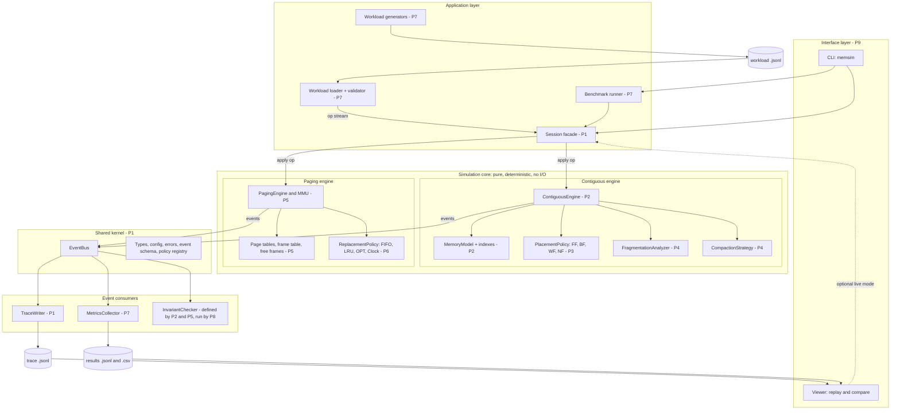
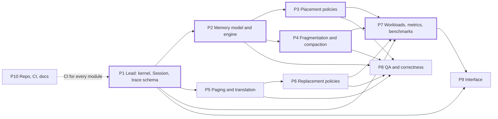
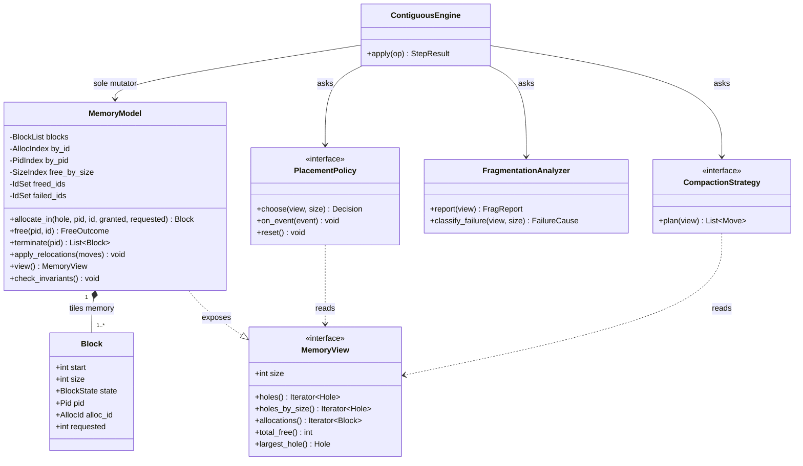
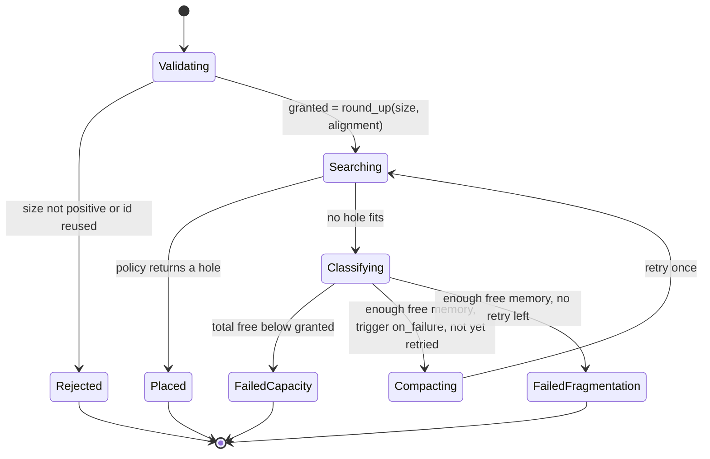
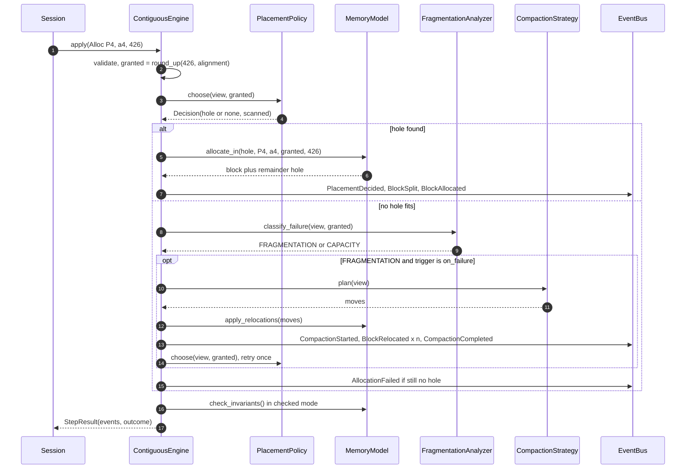
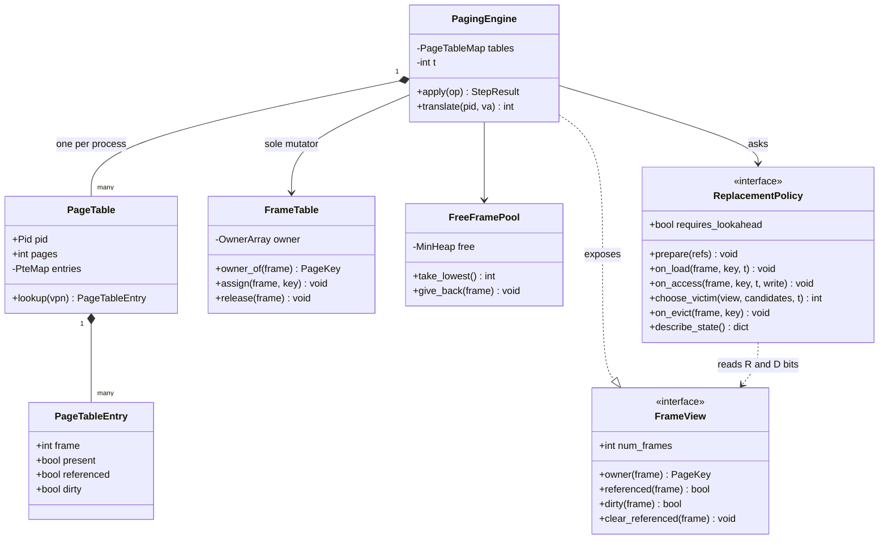
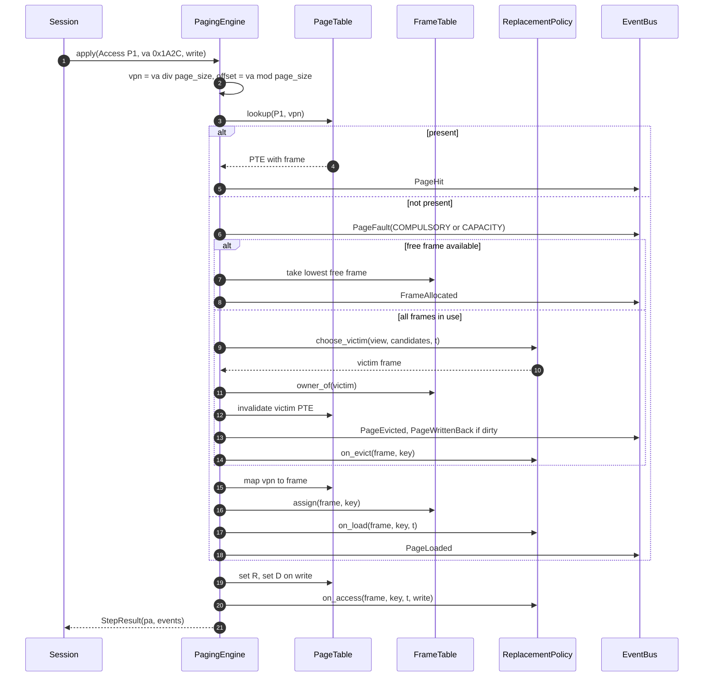
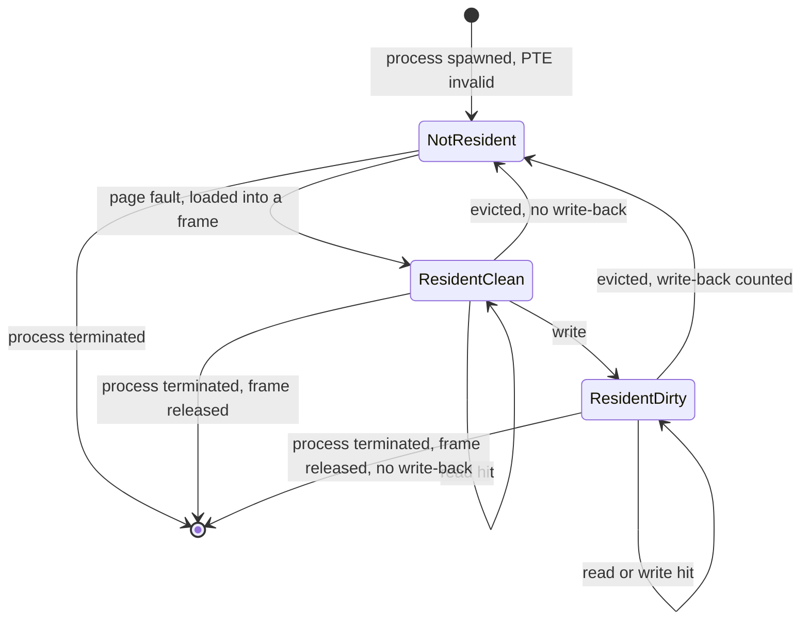
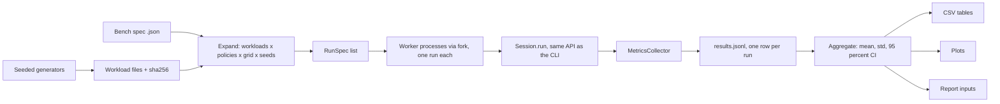

# MemForge — System Architecture v0.2 (draft for team review)

Oct 25, 2026 · @Arya Gupta

v0.2 sets the implementation language to C (ADR-001). Code samples, data structures, tooling and
the repository layout follow from that; the behaviour, formats and acceptance criteria are unchanged.

## 0. Status and how to review

This is P1's proposal for the whole system, open to challenge until the kickoff meeting ratifies it. Every decision carries one of three labels; most are Proposed, so push back with a concrete alternative and a reason.

| Label | Meaning | How to change it |
| --- | --- | --- |
| Accepted | Ratified at kickoff; other modules build on it | Open an `interface-change` RFC issue; P1 and every affected owner approve |
| Proposed | P1's default (most of this doc) | Comment inline with your alternative and why |
| Open | The owner must propose the answer | Answer your questions in section 19 |

How to review:

1. Everyone reads sections 1 to 6: scope, acceptance criteria, architecture, ownership and the shared kernel.
2. Owners read their module sections and answer their questions in section 19, proposing changes rather than only raising concerns.
3. P8 (QA) challenges every invariant and expected number, because each one becomes a test.
4. After kickoff, shared types and interfaces (section 6), events and traces (section 11) and the workload format (section 12) change only through an RFC plus a schema-version bump.

## 1. Problem, goals and non-goals

MemSim (working name) is a deterministic simulator of an OS memory manager: contiguous allocation with First-Fit, Best-Fit and Worst-Fit, plus demand paging with FIFO, LRU and OPT replacement. The assignment asks for a user-space memory manager built on First-Fit and Best-Fit with fragmentation testing, optionally extended with simulated paging and replacement policies.

| ID | Goal | Proven by |
| --- | --- | --- |
| G1 | Correct contiguous allocation: split, coalesce, fragmentation metrics, compaction | AC-1, AC-2, invariants I1 to I8 |
| G2 | Correct paging: translation, page faults, FIFO, LRU, OPT, Belady's anomaly reproduced | AC-3, AC-4, invariants V1 to V6 |
| G3 | Fair, repeatable policy comparison on identical workloads | Experiments E1 to E5 regenerate from committed specs |
| G4 | Every number in the final report traces to a test or a benchmark row | Correctness matrix (section 14) |
| G5 | A usable interface to configure, run, step through and compare runs | AC-8 |

Non-goals for v1 (each can be promoted by RFC):

- Replacing `malloc` for real programs (`sbrk`, `mmap`, `LD_PRELOAD`). MemSim manages an abstract address space; FR-S1 adds a real-arena backend if the instructor expects one.
- Segmentation and slab allocators; multi-level page tables, the TLB and a buddy allocator are stretch items FR-S2 to FR-S4.
- Concurrency: one simulated CPU applies one operation at a time.
- Real disk I/O: page-ins and write-backs are counted and costed, never performed.

## 2. Requirements

v1 commits to 18 MUST requirements; the 8 SHOULD items are planned work and the 8 COULD items start only after milestone M2. Owners can re-prioritise from the Priority dropdown; demoting a MUST needs P1's agreement.

| ID | Requirement | Priority | Owner |
| --- | --- | --- | --- |
| FR-C1 | One contiguous memory of `memory_size` units, half-open addressing \[0, M) | MUST | P2 |
| FR-C2 | Operations: `alloc(pid, id, size)`, `free(pid, id)`, `terminate(pid)`, `compact()` | MUST | P2 |
| FR-C3 | Split on allocation: place at the hole's low end, remainder stays free | MUST | P2 |
| FR-C4 | Immediate coalescing of adjacent free blocks on every free | MUST | P2 |
| FR-C5 | Invalid requests rejected with a reason and no state change: bad size, duplicate id, unknown id, double free, wrong owner | MUST | P2 |
| FR-C6 | First-Fit and Best-Fit placement | MUST | P3 |
| FR-C7 | Worst-Fit placement | SHOULD | P3 |
| FR-C8 | Next-Fit placement | COULD | P3 |
| FR-C9 | Fragmentation metrics: total free, largest hole, hole count, external and internal fragmentation, failure cause | MUST | P4 |
| FR-C10 | Sliding compaction (explicit op and on-failure trigger), emitted as events with its cost | SHOULD | P4 |
| FR-C11 | Alignment and minimum split size, the sources of internal fragmentation | COULD | P2 |
| FR-P1 | Config: page size (power of 2), frame count, per-process address space in pages | MUST | P5 |
| FR-P2 | Single-level page table per process; PTE holds frame, present, referenced, dirty | MUST | P5 |
| FR-P3 | VA to PA translation; references given as virtual address or as page number | MUST | P5 |
| FR-P4 | Fault handling: lowest free frame, else the policy's victim; dirty victims count as write-backs | MUST | P5 |
| FR-P5 | FIFO and LRU replacement | MUST | P6 |
| FR-P6 | OPT replacement (offline: needs the whole reference string) | SHOULD | P6 |
| FR-P7 | Frame sweep (faults vs frames) with Belady anomaly detection | SHOULD | P6 |
| FR-P8 | Clock (second chance) and LFU replacement | COULD | P6 |
| FR-P9 | Multiple processes under global replacement | SHOULD | P5 |
| FR-P10 | Local replacement with per-process frame quotas | COULD | P5 |
| FR-W1 | Versioned JSONL workload format with a validator | MUST | P7 |
| FR-W2 | Seeded generators for allocation and page-reference workloads | MUST | P7 |
| FR-W3 | Benchmark runner over workload x policy x config x seed, exporting result rows | MUST | P7 |
| FR-W4 | Aggregates (mean, std, 95% CI) and plots | SHOULD | P7 |
| FR-U1 | CLI commands `run`, `compare`, `refs`, `sweep`, `bench` | MUST | P9 |
| FR-U2 | CLI commands `validate`, `gen`, `replay` | SHOULD | P9 |
| FR-U3 | Viewer: step-through replay and side-by-side comparison | SHOULD | P9 |
| FR-Q1 | Golden, property, differential, integration and determinism tests gate every merge | MUST | P8 |
| FR-R1 | CI pipeline, contribution guide, API docs, release checklist | MUST | P10 |
| FR-S1 | Real-arena backend: same placement policies over an `mmap`'d arena, differential-tested against the simulator | COULD | P2, P3 |
| FR-S2 | TLB with hit ratio and effective access time | COULD | P5 |
| FR-S3 | Two-level page table | COULD | P5 |
| FR-S4 | Buddy allocator | COULD | P3 |

| ID | Non-functional requirement | Target or enforcement |
| --- | --- | --- |
| NFR-1 | Determinism: same workload, config and seed give a byte-identical trace | CI job runs every golden workload twice and diffs |
| NFR-2 | Engine purity: no I/O, wall clock or global state in the core; clients use only `Session` and events | Per-module link visibility plus `scripts/check_layers.sh` in CI |
| NFR-3 | Checked mode: every invariant verified after every step | On in all tests and CI benchmark smoke runs |
| NFR-4 | Extensibility: a new policy is one class, one registry line, one golden test | Zero engine edits |
| NFR-5 | Performance: 100k-op workload at trace level 0 | Under 30 s on a team laptop; re-tune after first measurement |
| NFR-6 | Reproducibility: every report figure regenerates from a bench spec plus a git SHA | Both stored in every result row |
| NFR-7 | Code quality: no warnings under `-Wall -Wextra -Wpedantic -Werror` with gcc and clang, clang-tidy clean, engine line coverage (gcovr) | At least 90% (Proposed) |
| NFR-8 | Memory safety: no leaks, overflows or undefined behaviour | ASan and UBSan on every CI test run, Valgrind nightly, zero reports |

## 3. Acceptance criteria

v1 is done when the eight scenarios below pass in CI. Every expected number was hand-calculated and cross-checked with a throwaway script; P8 must re-derive them independently before code exists.

AC-1 uses the five-partition exercise from Silberschatz, Operating System Concepts. Memory is 1740 units: holes of 100, 500, 200, 300 and 600 separated by four 10-unit blocks owned by `SYS`. The fixture builds this by allocating the nine blocks in order, then freeing the five holes; this setup is policy-independent because memory has a single hole while it runs. Requests then arrive in order: 212, 417, 112, 426.

| AC-1 request | First-Fit | Best-Fit | Worst-Fit |
| --- | --- | --- | --- |
| 212 | 500-hole, start 110 | 300-hole, start 830 | 600-hole, start 1140 |
| 417 | 600-hole, start 1140 | 500-hole, start 110 | 500-hole, start 110 |
| 112 | 288 remainder, start 322 | 200-hole, start 620 | 388 remainder, start 1352 |
| 426 | Fails: FRAGMENTATION (free 959, largest hole 300) | 600-hole, start 1140 | Fails: FRAGMENTATION (free 959, largest hole 300) |

| ID | Scenario | Expected |
| --- | --- | --- |
| AC-2 | Continue AC-1 First-Fit: `compact`, then retry the 426 request | 7 blocks relocated, 781 units moved, 426 placed at 781, one hole \[1207, 1740) of 533; external fragmentation 0.687 before, 0 after |
| AC-3 | Reference string 7 0 1 2 0 3 0 4 2 3 0 3 2 1 2 0 1 7 0 1 with 3 frames | FIFO 15, LRU 12, OPT 9 faults |
| AC-4 | Reference string 1 2 3 4 1 2 5 1 2 3 4 5 with 3, then 4 frames | FIFO 9 → 10 (Belady's anomaly), LRU 10 → 8, OPT 7 → 6; FIFO sweep over 1 to 6 frames gives 12, 12, 9, 10, 5, 5 |
| AC-5 | Double free, wrong owner, unknown id, access beyond the address space | Rejected as DOUBLE\_FREE, WRONG\_OWNER, UNKNOWN\_ID, OUT\_OF\_RANGE; state identical before and after |
| AC-6 | Run every golden workload twice | Byte-identical traces |
| AC-7 | Checked mode on every test and CI benchmark run | Invariants I1 to I8 and V1 to V6 hold after every step |
| AC-8 | `memsim compare` on the AC-1 workload with all three policies | Prints the AC-1 table |

## 4. Architecture overview

MemSim is a pure simulation core wrapped by thin clients: operations flow in from workload files, events flow out to the trace, metrics and invariant checker, and nothing else touches engine state.



Design principles (Proposed):

- Pure core, clients at the edges: the CLI, viewer and benchmark runner all use one `Session` API; none has a private path into an engine.
- Commands in, events out: every operation yields an ordered list of events, and that event log is the contract between modules.
- Policies decide, engines mutate: placement and replacement policies return decisions; only engines change state, so every piece of state has one owner.
- Pluggable strategies: a new policy is one source file plus one registry line.
- File contracts at the edges: workloads, traces and results are versioned JSONL, so P8 and P9 build against sample files on day one.
- Determinism by construction: integer state, logical clocks, fixed tie-breaks, seeded randomness only inside generators.
- Bugs fail loudly, domain failures are recorded (the error model in section 6).

One run, end to end:

1. Load: the loader parses the workload, checks schema and semantics (unique ids, positive sizes, known ops) and rejects bad input with file and line before anything runs.
2. Build: `Session.create(config)` resolves policy names through the registry and wires engine, policy, sinks and checked mode.
3. Apply: per op, the engine validates it, asks the policy for a decision, applies the state change and buffers events stamped with `step` and `seq`.
4. Observe: at the end of each step the bus flushes events in `seq` order to the TraceWriter, MetricsCollector and InvariantChecker; a violated invariant aborts the run.
5. Finish: the session returns a `RunResult` (metrics, final snapshot, trace path) and writes a `RunSummary` line.
6. Consume: the CLI prints it, the benchmark runner stores it as a result row, the viewer replays the trace.

## 5. Module map and ownership

Each module has exactly one owner; owners review every change to their module, and P1 also reviews anything that crosses a module boundary.

| Module | Owner | Provides | Consumes |
| --- | --- | --- | --- |
| `src/common` | P1 | Types, config, errors, event schema, `EventBus`, registry lookup, seeded RNG | Nothing |
| `src/session`, `src/trace` | P1 | `Session`, `RunResult`, `TraceWriter`, snapshots | Engines, loader, sinks |
| `src/contiguous` (model, view, invariants, engine) | P2 | `MemoryModel`, `MemoryView`, `ContiguousEngine`, invariants I1 to I8 | `common`, placement, fragmentation, compaction |
| `src/contiguous/policies`, `placement.h` | P3 | First-, Best-, Worst-, Next-Fit | `MemoryView` only |
| `src/contiguous/fragmentation`, `compaction` | P4 | `FragmentationAnalyzer`, `CompactionStrategy` | `MemoryView`, `apply_relocations` |
| `src/paging` (mmu, tables, frames, engine, invariants) | P5 | `PagingEngine`, `FrameView`, invariants V1 to V6 | `common`, replacement |
| `src/paging/policies`, `replacement.h`, `belady` | P6 | FIFO, LRU, OPT, Clock, frame sweep | `FrameView`, `PagingEngine` |
| `src/workloads`, `src/metrics`, `src/bench` | P7 | Loader, generators, `MetricsCollector`, runner, exports | `Session`, events |
| `tests/golden`, `property`, `oracle`, `integration` | P8 | Independent verification | Exported headers only |
| `src/cli`, `viewer/` | P9 | CLI, viewer | `Session`, trace and result files |
| Repo root, `.github/`, `docs/`, `scripts/`, `cmake/`, `third_party/` | P10 | Build, CI, templates, docs, release checklist | Everything |

An arrow A → B means B builds on A's contract; B starts early against A's interface and a fake. Thick borders mark the critical path.



Boundary clarifications to the team split (Proposed):

- Shared kernel: `common`, `Session` and the `TraceWriter` had no implementer. P1 owns them and keeps them deliberately small, so P1 coordinates without becoming the sole developer.
- Metrics: P4 defines fragmentation metrics and P5 and P6 define what paging counters mean; P7 implements the single `MetricsCollector` that computes every reported number from events.
- Testing: owners unit-test their own code; P8 writes independent golden, property, differential and end-to-end tests from this spec; P10 runs all of it in CI.
- Engines: P2 owns the contiguous step loop and wires P4's compaction trigger into it; P5 owns the paging step loop.
- Formats: P1 owns the event and trace schema; P7 owns the workload and result-row schemas; changes to either need P1's sign-off.
- Belady: P6 owns the sweep and anomaly detector, which drive `PagingEngine` directly because `paging` may not depend on `Session`; P7 calls it from the benchmark runner.
- Interface: P9 consumes `Session`, trace files and result files only; the viewer renders snapshots and never re-implements allocation or replacement.

Layering rules, enforced by link visibility (a module sees only the exported headers of the modules it links) and by `scripts/check_layers.sh` in CI: `common` includes nothing from MemSim; `contiguous` and `paging` include only `common` and never each other; policies never include engines; only the CLI uses `bench`; and the core (`common`, `contiguous`, `paging`) includes no I/O or clock headers.

## 6. Shared kernel

The kernel fixes the vocabulary every module shares: units, ranges, identifiers, clocks, errors and the event envelope. P1 owns it, and after kickoff it changes only by RFC.

| Concept | Decision |
| --- | --- |
| Memory unit | Integer abstract unit stored as `int64_t` (the UI may label it KB); no floats in engine state |
| Ranges | Half-open \[start, end) with end = start + size, everywhere |
| Process id | String such as `P1` in files, interned to an `ms_pid` integer at load (ADR-013); `SYS` is reserved for fixtures |
| Allocation id | String chosen by the workload, unique across the whole workload, never reused (ADR-003); interned to a dense `ms_alloc_id` at load |
| Frames and pages | Integers: frame 0 to F − 1, vpn 0 to pages − 1 |
| Clocks | `step` = index of the op; `t` = index of the reference among accesses (paging); `seq` = global event index; no wall clock in engines |
| Tie-breaks | Placement: lowest address. Free frames: lowest index. Replacement: per policy, section 10 |
| Randomness | Only in generators and the Random policy, through an injected `ms_rng` (xoshiro256\*\*); never libc `rand()`, whose sequence differs between platforms |

Core types, in C (ADR-001). The loader interns every string id (`"P1"`, `"a4"`) into a dense integer, so the engine never hashes or compares strings and every per-id index is a plain array; strings come back only in the trace writer, through the run's symbol table (ADR-013).

```c
/* src/common/include/memsim/common/types.h */
typedef uint32_t ms_pid;            /* interned "P1", "SYS" */
typedef uint32_t ms_alloc_id;       /* interned, workload-assigned, never reused */
#define MS_NONE UINT32_MAX          /* no pid / no id */

typedef struct { ms_pid pid; uint32_t vpn; } ms_page_key;

typedef struct { int64_t start, size; } ms_hole;    /* half-open [start, start + size) */
static inline int64_t ms_hole_end(ms_hole h) { return h.start + h.size; }

typedef enum { MS_BLOCK_FREE, MS_BLOCK_ALLOCATED } ms_block_state;

typedef struct {
    int64_t start;                  /* changes only through compaction */
    int64_t size;                   /* granted size, >= requested */
    ms_block_state state;
    ms_pid pid;                     /* MS_NONE iff FREE */
    ms_alloc_id alloc_id;           /* MS_NONE iff FREE */
    int64_t requested;              /* internal fragmentation = size - requested */
} ms_block;

typedef struct {
    uint64_t seq;                   /* global, gapless, from 0 */
    uint64_t step;                  /* the op that caused it */
    ms_event_type type;             /* catalogue in section 11 */
    union {                         /* one member per event type */
        struct { ms_pid pid; ms_alloc_id id; int64_t start, size, requested; } block_allocated;
        struct { ms_pid pid; uint32_t vpn, frame; bool write; } page_hit;
        /* ... */
    } data;
} ms_event;

/* Commands: a tagged union; on ACCESS exactly one of vpn / va is set (the loader checks) */
typedef enum { MS_OP_ALLOC, MS_OP_FREE, MS_OP_TERMINATE, MS_OP_COMPACT,
               MS_OP_SPAWN, MS_OP_ACCESS } ms_op_kind;

typedef struct {
    ms_op_kind kind;
    union {
        struct { ms_pid pid; ms_alloc_id id; int64_t size; } alloc;
        struct { ms_pid pid; ms_alloc_id id; } free;
        struct { ms_pid pid; } terminate;
        struct { ms_pid pid; uint32_t pages; } spawn;
        struct { ms_pid pid; bool by_va; uint64_t vpn_or_va; bool write; } access;
    } u;
} ms_op;
```

Configuration and the application facade. Every object with state is opaque and comes in a `_create` / `_destroy` pair, and every interface is a `const` table of function pointers plus a `void *` context:

```c
typedef enum { MS_COMPACT_NEVER, MS_COMPACT_ON_FAILURE, MS_COMPACT_THRESHOLD } ms_compaction_trigger;

typedef struct {
    int64_t memory_size;
    int64_t alignment;                  /* 1; granted = round_up(requested, alignment) */
    int64_t min_split;                  /* 1; a remainder below this is given away (internal fragmentation) */
    const char *policy;                 /* "first-fit" */
    ms_compaction_trigger compaction;   /* MS_COMPACT_NEVER */
    uint32_t compaction_threshold_ppm;  /* 500000 = 0.5 ext_frag, threshold mode; integer, so no float state */
} ms_contiguous_config;

typedef enum { MS_SCOPE_GLOBAL, MS_SCOPE_LOCAL } ms_replacement_scope;

typedef struct {
    uint32_t page_size;                 /* power of 2 */
    uint32_t frames;
    const char *policy;                 /* "fifo" */
    ms_replacement_scope scope;         /* MS_SCOPE_GLOBAL */
    uint64_t t_mem_ns;                  /* 200; effective-access-time inputs */
    uint64_t t_fault_ns;                /* 8000000 */
    uint64_t t_writeback_ns;            /* 8000000 */
} ms_paging_config;

/* Defaults come from ms_contiguous_config_default() and ms_paging_config_default(). */

typedef struct {
    void *ctx;
    void (*on_events)(void *ctx, const ms_event *events, size_t n);  /* once per step, seq order */
    void (*close)(void *ctx, const ms_run_summary *summary);
} ms_event_sink;

typedef struct ms_session ms_session;   /* opaque */

ms_status ms_session_create(const ms_run_config *config, const ms_event_sink *sinks,
                            size_t n_sinks, ms_session **out);
ms_status ms_session_apply(ms_session *s, const ms_op *op, ms_step_result *out);        /* one step (live UI) */
ms_status ms_session_run(ms_session *s, const ms_op *ops, size_t n, ms_run_result *out); /* whole workload */
ms_status ms_session_snapshot(const ms_session *s, ms_snapshot *out);                   /* read-only copy */
void ms_session_destroy(ms_session *s);

/* src/contiguous/policies/registry.c: registries map CLI names to vtables, one line per policy */
static const ms_cont_placement_policy *const placement_registry[] = {
    &ms_cont_first_fit, &ms_cont_best_fit, &ms_cont_worst_fit,
};
```

The error model has three tiers, so a bug can never pass as a fragmentation result:

| Tier | Examples | Handling |
| --- | --- | --- |
| Input error | Malformed JSON, unknown op, alloc id reused in a file, page size not a power of 2 | Loader rejects before the run; exit code 2 with file and line |
| Domain outcome | Allocation fails, double free, wrong owner, access out of range | Recorded as an event, state unchanged, run continues, counted in metrics |
| Contract violation | Policy returns a hole that is not free or too small; an invariant breaks | `MS_ASSERT` calls the contract handler: the run aborts, the CLI exits with code 3, a test fails |

`MS_ASSERT` stays on in release builds. It calls a handler that the client installs: the CLI's prints the message and exits with code 3, the test harness's records a failure, and the default calls `abort()`. The core itself never prints.

## 7. Contiguous allocation subsystem

Memory is an address-ordered list of blocks that exactly tiles \[0, M). Per-id arrays make frees O(1), a size-ordered index makes Best-Fit and Worst-Fit O(log h), and eight invariants define what a valid layout is.



| Structure | Purpose | Proposed implementation | Cost |
| --- | --- | --- | --- |
| `blocks` | Canonical layout in address order, tiles \[0, M) | Doubly linked list of `Block` nodes | Split, coalesce O(1) given a node; scan O(n) |
| `by_id` | Find the block to free | Array indexed by `ms_alloc_id` → node | O(1) |
| `by_pid` | Free everything on `terminate` | Array indexed by `ms_pid` → intrusive list of live blocks | O(k) |
| `free_by_size` | Best-Fit and Worst-Fit lookup | Balanced tree keyed by (size, start) | O(log h) |
| `freed_ids` | Tell DOUBLE\_FREE apart from UNKNOWN\_ID | State byte per `ms_alloc_id`: UNSEEN, LIVE, FREED or FAILED | O(1) |
| `failed_ids` | Skip frees of allocations that failed under this policy | Same state byte | O(1) |
| `rover` (P3) | Next-Fit resume point | Integer address | O(1) |

Here n = blocks, h = holes and k = live blocks of one process. A sorted array of (size, start) is acceptable for v1 if P2 prefers it (O(h) insert): other modules only ever see the `MemoryView` interface (ADR-002). One state byte per id makes the live, freed and failed sets disjoint by construction, so I7 holds structurally.

| ID | Invariant, checked after every step in checked mode |
| --- | --- |
| I1 | Coverage: blocks are in address order, the first starts at 0, each ends where the next starts, the last ends at M |
| I2 | Every block has size > 0 |
| I3 | Coalesced: no two adjacent blocks are both FREE |
| I4 | Ownership: ALLOCATED ⇔ pid and alloc\_id are set; FREE ⇔ both are empty |
| I5 | Index consistency: `by_id`, `by_pid` and `free_by_size` match the block list exactly |
| I6 | Accounting: used + free = M; for every allocated block, requested ≤ size ≤ requested + (alignment − 1) + (min\_split − 1) |
| I7 | Live, freed and failed id sets are pairwise disjoint |
| I8 | Alignment: every block's start and size are multiples of `alignment` (M must be one too) |

| Op | Precondition | Effect | Events | Domain outcomes |
| --- | --- | --- | --- | --- |
| `alloc(pid, id, size)` | size > 0, id never seen | granted = round\_up(size, alignment); the policy picks a hole; split if the remainder ≥ `min_split` | `PlacementDecided`, `BlockSplit`, `BlockAllocated` | `AllocationFailed` (CAPACITY or FRAGMENTATION); `AllocRejected` (INVALID\_SIZE, DUPLICATE\_ID) |
| `free(pid, id)` | id live and owned by pid | Mark FREE, merge with free neighbours | `BlockFreed`, `BlocksCoalesced` | `FreeRejected` (UNKNOWN\_ID, DOUBLE\_FREE, WRONG\_OWNER); `FreeSkipped` |
| `terminate(pid)` | None | Free every live block of pid in address order | `ProcessTerminated`, then free events per block | None |
| `compact()` | None | Apply the compaction plan (section 8) | `CompactionStarted`, `BlockRelocated` per move, `CompactionCompleted` | None |

`FreeSkipped` exists because one workload replays under every policy: an allocation that fits under Best-Fit may fail under First-Fit, and its later free must be a deterministic no-op, not an error (ADR-003).



With full sliding compaction the retry always succeeds when total free ≥ granted, so `FailedFragmentation` after a retry appears only with partial compaction strategies.

## 8. Placement, fragmentation and compaction

Policies are pure selectors over a read-only view: given the holes and a size they return one hole or none, and the engine validates and applies the choice. Compaction follows the same split: a strategy plans moves, the model applies them, and every move is an event.

```c
typedef struct {
    bool found;             /* false = nothing fits */
    ms_hole hole;
    uint32_t scanned;       /* holes examined: the search-cost metric */
} ms_cont_decision;

typedef struct {
    const char *name;
    void *(*create)(void);                  /* policy state; NULL for stateless policies */
    void (*destroy)(void *state);
    ms_cont_decision (*choose)(void *state, const ms_cont_view *view, int64_t size);
    void (*on_event)(void *state, const ms_event *event);   /* NULL except Next-Fit */
    void (*reset)(void *state);
} ms_cont_placement_policy;
```

| Policy | Picks | Tie-break | v1 cost | Indexed cost |
| --- | --- | --- | --- | --- |
| First-Fit | Lowest-address hole with size ≥ s | None needed | O(h) scan | O(log h) with a max-size augmented tree |
| Best-Fit | Smallest hole with size ≥ s | Lowest address | O(h) scan | O(log h): first (size, start) ≥ (s, 0) |
| Worst-Fit | Largest hole, if it is ≥ s | Lowest address | O(h) scan | O(log h): order by (−size, start) |
| Next-Fit (COULD) | First hole ≥ s at or after the rover, wrapping once | None needed | O(h) scan | Not planned |

Placement rules: the block always goes at the hole's low end; policies never mutate the model; a decision naming a hole that is not free or too small is a contract violation. Next-Fit's rover is an address, so after a coalesce or a compaction the search starts at the hole containing or following it. At trace level 2, `PlacementDecided` also lists every hole examined, so the viewer can show why a hole won.

| Fragmentation metric (P4 defines, P7 computes) | Definition |
| --- | --- |
| `total_free` | Sum of FREE block sizes |
| `largest_hole` | Size of the largest FREE block, 0 if none |
| `hole_count` | Number of FREE blocks; by I3 each is a maximal free run |
| `ext_frag` (headline) | 1 − largest\_hole / total\_free; 0 when total\_free = 0 |
| `unusable_free(s)` | Share of free memory sitting in holes smaller than a reference request size s |
| `int_frag` | Sum of (size − requested) over allocated blocks |
| Failure cause | FRAGMENTATION if total\_free ≥ granted, else CAPACITY |

Worked example: AC-1 First-Fit fails the 426 request with 959 units free but a largest hole of 300, so ext\_frag = 1 − 300/959 = 0.687 and the cause is FRAGMENTATION.

```c
typedef struct {
    ms_alloc_id alloc_id;
    int64_t src;            /* old start */
    int64_t dst;            /* new start */
} ms_cont_move;

typedef struct {
    const char *name;
    /* Pure: never mutates. Writes at most view->allocated_count moves into out, returns the count. */
    size_t (*plan)(const ms_cont_view *view, ms_cont_move *out);
} ms_cont_compaction_strategy;
```

Compaction design (P4, Proposed):

- Sliding strategy (v1): visit allocated blocks in address order and move each to the end of the previous one. Order is preserved, one hole remains at the top, and applying moves in ascending order never overwrites an unmoved block.
- Triggers: an explicit `compact` op; `on_failure` (FRAGMENTATION cause only: compact, then retry once); `threshold` after a free when ext\_frag ≥ the configured value (COULD).
- Guarantees, each a property test: the set of (alloc\_id, pid, size, requested) is unchanged; total free is unchanged; at most one hole remains; relative order holds; cost is reported as units and blocks moved.
- Never silent: `apply_relocations` validates the whole plan first, and the engine emits one `BlockRelocated` per move.
- Stable ids make this safe: a real OS needs dynamic relocation (a base register) to move a process, and our alloc ids play that role, so later frees still find their block.

One allocation, including the compaction retry:



## 9. Paging subsystem

Each process has a sparse single-level page table, and one inverted frame table maps every physical frame back to its (pid, vpn). That makes eviction O(1) and gives the six paging invariants one place to check.



| Structure | Purpose | Proposed implementation | Cost |
| --- | --- | --- | --- |
| Page table, one per process | vpn → PTE | Array of `pages` PTEs, allocated at spawn | O(1) |
| PTE | frame, present, referenced (R), dirty (D) | Struct: `uint32_t` frame plus three flag bits | O(1) |
| Frame table | frame → (pid, vpn), needed to evict | Array of F `ms_page_key`, pid `MS_NONE` when free | O(1) |
| Free frame pool | Hand out the lowest free frame first (deterministic) | Binary min-heap of frame indexes | O(log F) |
| Seen pages | Classify a fault as COMPULSORY or CAPACITY | One bit per vpn, kept beside each page table | O(1) |

R and D bits live in the PTE, where hardware would set them. Policies read them through `FrameView` and may only clear R, through `clear_referenced`, which emits an event; queues, timestamps and counters live inside the policy.

Translation, with k = log2(page\_size) offset bits:

```latex
\text{vpn} = \left\lfloor \frac{va}{\text{page\_size}} \right\rfloor, \quad \text{offset} = va \bmod \text{page\_size}, \quad pa = \text{frame} \cdot \text{page\_size} + \text{offset}
```

Worked example: with 4096-byte pages, va 0x1A2C (6700) is vpn 1, offset 0xA2C (2604); if vpn 1 sits in frame 5, pa = 5 × 4096 + 2604 = 23084 (0x5A2C). Textbook reference strings give vpn directly and skip translation.

One access, step by step:

1. Validate: an unknown pid gives `AccessViolation(NO_SUCH_PROCESS)` and vpn ≥ pages gives `AccessViolation(OUT_OF_RANGE)`; state is unchanged.
2. Hit: the PTE is present, so emit `PageHit`.
3. Fault: emit `PageFault` with kind COMPULSORY on the page's first-ever reference, else CAPACITY.
4. Frame: take the lowest free frame (`FrameAllocated`); if none, the policy picks a victim from the candidates (all resident frames under global scope, the process's own under local scope), its PTE is invalidated, and `PageEvicted` plus `PageWrittenBack` (if dirty) are emitted.
5. Load: map the PTE (present, frame, D cleared), update the frame table, emit `PageLoaded`.
6. Complete: set R, set D on a write, call `on_access`. Every reference ends here, hit or fault.

Hook order is part of the contract: a fault calls `on_evict` (when there is a victim), then `on_load`, then `on_access`; a hit calls only `on_access`. `terminate(pid)` releases each of the process's frames with `on_evict` and no write-back.



| ID | Paging invariant, checked after every step |
| --- | --- |
| V1 | Frame table and page tables agree: frame f holds (p, v) ⇔ PTE(p, v) is present with frame f |
| V2 | The free pool and the occupied frames are disjoint and together cover 0 to F − 1 |
| V3 | A PTE that is not present has no frame, R = 0 and D = 0 |
| V4 | Resident pages ≤ F; under local scope, resident pages of p ≤ quota(p) |
| V5 | hits + faults = references; faults = frames taken from the pool + evictions; write-backs ≤ evictions |
| V6 | The policy tracks exactly the resident frames (checked through a debug hook) |



A fault caused by a write loads the page clean, and the same access then makes it dirty.

## 10. Page replacement and Belady analysis

Replacement policies own only their bookkeeping and answer one question: which frame to evict. OPT alone needs the future, so it declares `requires_lookahead` and `Session` refuses it in live sessions.

```c
typedef struct {
    const char *name;
    bool requires_lookahead;            /* true only for OPT */
    void *(*create)(uint32_t frames);
    void (*destroy)(void *state);
    void (*prepare)(void *state, const ms_page_key *refs, size_t n);   /* whole reference list, before the run */
    void (*on_load)(void *state, uint32_t frame, ms_page_key key, uint64_t t);
    void (*on_access)(void *state, uint32_t frame, ms_page_key key, uint64_t t, bool write);
    uint32_t (*choose_victim)(void *state, const ms_page_frame_view *view,
                              const uint32_t *candidates, size_t n, uint64_t t);  /* must be in candidates */
    void (*on_evict)(void *state, uint32_t frame, ms_page_key key);
    void (*describe_state)(const void *state, const ms_kv_writer *out);  /* FIFO queue, LRU order, OPT distances */
    void (*reset)(void *state);
} ms_page_replacement_policy;
```

`ms_kv_writer` is a small callback table in `common` that the trace writer implements, so a policy can describe its state at level 2 without doing I/O.

Here `t` is the reference index (it counts accesses only), not `step`.

| Policy | Evicts | State | Cost | Tie-break |
| --- | --- | --- | --- | --- |
| FIFO | Earliest-loaded resident page | Ring buffer of frames in load order | O(1) per reference | None needed |
| LRU | Least recently used page | Intrusive doubly linked list over frames, moved to the tail on access | O(1) per reference | None needed |
| OPT | Page whose next use is farthest; never used again counts as infinity | `next_use` array from one backward pass, plus next use per frame | O(n) prep; O(F) scan or O(log F) heap per fault | Among never-used pages: lowest frame index |
| Clock (COULD) | First frame with R = 0, sweeping from the hand and clearing R as it passes | Hand index; R bits through `FrameView` | Amortised O(1) | Hand order |
| LFU (COULD) | Smallest use count | Count per frame | O(F) per fault | LRU among equal counts |

OPT's fault counts never depend on its tie-break, because every tied page is never used again; its traces do, which is why the tie-break is fixed.

Belady analysis (P6, Proposed):

- `sweep(refs, policy, frames=1..F_max)` returns faults per frame count; an anomaly point is any f where faults(f + 1) > faults(f).
- FIFO can show the anomaly. LRU and OPT are stack algorithms (the resident set with f frames is always a subset of the set with f + 1), so their curves never rise; that is property PT7.
- AC-4 is the canonical demonstration. A quick check found one anomaly point in 3,000 random strings (up to 30 references, 7 pages, 1 to 8 frames), so E5 must search deliberately rather than expect anomalies by chance.
- Independent oracle: Mattson's stack-distance algorithm yields LRU fault counts for every frame count in one pass; P8 uses it to cross-check LRU (PT8).

## 11. Events and trace format

A trace is one JSONL file: a header line, one line per event in `seq` order, optional snapshot lines, and a closing summary. It is the single integration surface for metrics, the viewer and golden tests.

| Trace level | Contains | Used by |
| --- | --- | --- |
| 0 | Header and `RunSummary` only | Benchmarks |
| 1 | Level 0 plus every event | Golden tests, debugging, CLI replay |
| 2 | Level 1 plus a `Snapshot` after every step and verbose details (holes scanned, policy state) | Viewer |

| Event | Key fields | Emitted by |
| --- | --- | --- |
| `PlacementDecided` | policy, requested, granted, hole or null, scanned; candidates at level 2 | P2 |
| `BlockSplit` | hole, allocated part, remainder (start and size each) | P2 |
| `BlockAllocated` | pid, id, start, size, requested | P2 |
| `AllocationFailed` | pid, id, requested, granted, cause, total\_free, largest\_hole | P2 |
| `AllocRejected` | pid, id, reason: INVALID\_SIZE or DUPLICATE\_ID | P2 |
| `BlockFreed` | pid, id, start, size | P2 |
| `BlocksCoalesced` | merged ranges, resulting range | P2 |
| `FreeRejected` | pid, id, reason: UNKNOWN\_ID, DOUBLE\_FREE or WRONG\_OWNER | P2 |
| `FreeSkipped` | pid, id whose allocation failed earlier | P2 |
| `ProcessTerminated` | pid, freed ids or released frames | P2, P5 |
| `CompactionStarted` | trigger, holes\_before, largest\_before | P2 with P4 |
| `BlockRelocated` | id, pid, src, dst, size | P2 with P4 |
| `CompactionCompleted` | blocks\_moved, units\_moved, holes\_after, largest\_after | P2 with P4 |
| `ProcessSpawned` | pid, pages | P5 |
| `PageHit` | pid, vpn, frame, write | P5 |
| `PageFault` | pid, vpn, kind: COMPULSORY or CAPACITY, write | P5 |
| `FrameAllocated` | frame, pid, vpn | P5 |
| `VictimSelected` | policy, frame, victim pid and vpn; policy state at level 2 | P5 |
| `PageEvicted` | frame, pid, vpn, dirty | P5 |
| `PageWrittenBack` | frame, pid, vpn | P5 |
| `PageLoaded` | frame, pid, vpn | P5 |
| `ReferenceBitCleared` | frame | P5, on a policy's request |
| `AccessViolation` | pid, vpn or va, reason: NO\_SUCH\_PROCESS or OUT\_OF\_RANGE | P5 |
| `AddressTranslated` | pid, va, vpn, offset, frame, pa (level 2 only) | P5 |

Example: the AC-1 First-Fit failure at level 1 (seq values illustrative; the 426 request is step 17 after 14 setup ops and three requests):

```json
{"type":"TraceHeader","schema":1,"engine":"0.1.0","git":"a1b2c3d","workload":"silberschatz_5_holes","workload_sha256":"<hash>","policy":"first-fit","config":{"memory_size":1740,"alignment":1,"min_split":1,"compaction":"never"},"trace_level":1}
{"seq":52,"step":17,"type":"PlacementDecided","data":{"policy":"first-fit","requested":426,"granted":426,"hole":null,"scanned":5}}
{"seq":53,"step":17,"type":"AllocationFailed","data":{"pid":"P4","id":"a4","requested":426,"granted":426,"cause":"FRAGMENTATION","total_free":959,"largest_hole":300}}
{"type":"RunSummary","metrics":{"alloc_requests":13,"alloc_failures":1,"failures_fragmentation":1,"ext_frag_final":0.687}}
```

A level-2 snapshot line (block list cut short here):

```json
{"type":"Snapshot","step":17,"contiguous":{"memory_size":1740,"blocks":[{"start":0,"size":100,"state":"free"},{"start":100,"size":10,"state":"allocated","pid":"SYS","id":"s1","requested":10}],"frag":{"total_free":959,"largest_hole":300,"hole_count":5,"ext_frag":0.687}}}
```

Format rules (Proposed):

- Serialisation is canonical, which is what makes NFR-1 testable: fixed key order, ratios computed from integers and printed with `%.6f`, no timestamps or wall-clock fields.
- Event names are past-tense PascalCase facts; data fields are snake\_case.
- `schema` is an integer bumped on any breaking change; consumers reject a schema they do not know.
- Paging snapshots carry `frames` (frame, pid, vpn, R, D), `page_tables` per process and the policy's `describe_state()` output.

## 12. Workloads

A workload is a JSONL file: a header with the scenario's config (never the policy), then one op per line. The same file therefore replays under every policy, and fixtures diff cleanly in git.

Contiguous, from the AC-1 fixture (abridged: the full file has 9 setup allocations, 5 frees and 4 requests):

```json
{"type":"header","schema":1,"kind":"contiguous","name":"silberschatz_5_holes","config":{"memory_size":1740,"alignment":1}}
{"op":"alloc","pid":"SYS","id":"h1","size":100}
{"op":"alloc","pid":"SYS","id":"s1","size":10}
{"op":"free","pid":"SYS","id":"h1"}
{"op":"alloc","pid":"P1","id":"a1","size":212}
{"op":"alloc","pid":"P4","id":"a4","size":426}
```

The AC-2 fixture appends `{"op":"compact"}` and a fresh request with id `a4-retry`, because ids are never reused; a separate test covers the same scenario with `compaction = on_failure`.

Paging, a format illustration rather than a fixture:

```json
{"type":"header","schema":1,"kind":"paging","name":"format_example","config":{"page_size":4096,"frames":3},"processes":{"P0":{"pages":8}}}
{"op":"access","pid":"P0","vpn":7}
{"op":"access","pid":"P0","va":6700,"rw":"w"}
{"op":"spawn","pid":"P1","pages":16}
{"op":"terminate","pid":"P1"}
```

| Op | Fields | Subsystem |
| --- | --- | --- |
| `alloc` | pid, id, size | Contiguous |
| `free` | pid, id | Contiguous |
| `compact` | None | Contiguous |
| `spawn` | pid, pages | Paging |
| `access` | pid, exactly one of vpn or va, rw (`r` by default, or `w`) | Paging |
| `terminate` | pid | Both |
| `mark` | label: forces a labelled snapshot for the viewer and metrics | Both |

The validator runs in strict mode by default and rejects, with file and line, a missing header, an unknown schema or op, an op that does not match `kind`, a reused alloc id, a non-positive size, or a free of an id never allocated earlier in the file. Negative-test fixtures set `"negative_test": true` in the header, which lets semantic misuse through so AC-5 can check that it is recorded as a domain outcome.

| Generator | Shape | Key parameters |
| --- | --- | --- |
| `alloc-uniform` | Sizes uniform in \[a, b\]; each step allocates with probability p, else frees a random live block | ops, a, b, p\_alloc |
| `alloc-steady` | Fill to a target utilisation, then alternate frees and allocations around it | ops, size distribution, target\_util |
| `alloc-bimodal` | Mostly small requests with occasional large ones, a fragmentation stress test | ops, p\_large, small and large ranges |
| `alloc-lifetime` | Each allocation draws an exponential lifetime; its free is scheduled to match | ops, mean\_lifetime, size distribution |
| `refs-uniform` | Uniform over P pages | n, P |
| `refs-locality` | Working set of W pages that shifts every T references, with occasional jumps | n, P, W, T, p\_out |
| `refs-loop` | Cyclic scan over L pages; worst case for LRU and FIFO when L > frames | n, L |
| `refs-zipf` | Zipf-distributed page popularity | n, P, s |
| `refs-belady` | Known anomaly strings plus a seeded random search | n, P, budget |

Provenance rules: generator output is written to disk and that file is the artifact, so benchmarks never regenerate on the fly. Headers record generator name, version, seed and parameters, and every result row records the file's sha256. Generators draw from their own `ms_rng` seeded from the header's seed; the engine never draws random numbers except through a seeded Random policy.

## 13. Metrics and benchmarking

One `MetricsCollector` (P7) computes every reported number from events, and one benchmark runner executes committed specs through the same `Session` API as the CLI. No number in the report has a private code path. Fragmentation metrics are defined in section 8; run-level and paging metrics are below.

| Metric | Definition |
| --- | --- |
| `alloc_success_rate` | Successful / attempted allocations |
| `frag_failure_rate` | FRAGMENTATION failures / attempted allocations |
| `ext_frag_mean`, `hole_count_mean`, `utilization_mean` | Means of per-step samples (step-weighted, not time-weighted) |
| `scanned_mean` | Mean holes examined per allocation |
| `first_failure_step` | Step of the first failed allocation, if any |
| `compactions`, `units_moved` | Count and total cost of compaction |
| `hits`, `faults` | Counts; hits + faults = references |
| `fault_rate` | faults / references |
| `compulsory_faults` | Faults on a page's first-ever reference; a lower bound for every policy |
| `evictions`, `write_backs` | Faults that needed a victim; evictions of dirty pages |
| `eat_ns` | Effective access time, formula below |
| `anomaly_points` | Frame counts f where faults(f + 1) > faults(f) in a sweep |

```latex
\text{EAT} = (1 - p)\, t_{\text{mem}} + p\, t_{\text{fault}} + \frac{\text{write\_backs}}{\text{references}}\, t_{\text{wb}}, \qquad p = \text{fault\_rate}
```

A benchmark spec is a committed JSON file, read with the same parser as workloads (ADR-012); the runner expands it into runs:

```json
{
  "name": "e1-placement",
  "subsystem": "contiguous",
  "workloads": [
    {
      "generator": "alloc-steady",
      "params": {"ops": 20000, "size_dist": "lognormal", "mean": 64, "sigma": 1.0, "target_util": 0.85},
      "seeds": [1, 2, 3, 4, 5, 6, 7, 8, 9, 10]
    },
    {"file": "tests/golden/fixtures/silberschatz_5_holes.jsonl"}
  ],
  "policies": ["first-fit", "best-fit", "worst-fit"],
  "grid": {"memory_size": [4096, 16384], "compaction": ["never", "on_failure"]},
  "trace_level": 0,
  "check_invariants": true
}
```



The runner writes rows and CSV tables only. Plots are drawn from the CSV by scripts in `analysis/`, so no plotting code lives in the simulator; the tool is P7's choice (gnuplot proposed).

One result row (metric values illustrative; `wall_ms` is the only non-deterministic field and is excluded from determinism checks):

```json
{"run_id":"e1-placement/0042","git_sha":"a1b2c3d","engine":"0.3.0","workload_id":"alloc-steady seed=3","workload_sha256":"<hash>","subsystem":"contiguous","policy":"best-fit","config":{"memory_size":4096,"compaction":"never"},"seed":3,"metrics":{"alloc_success_rate":0.962,"frag_failure_rate":0.031,"ext_frag_mean":0.41,"scanned_mean":36.9},"wall_ms":812}
```

Every policy runs on the same workload file per seed, so comparisons use paired differences per seed, reported as mean ± 95% t-interval across seeds.

| ID | Question | Design | Output | Owner |
| --- | --- | --- | --- | --- |
| E1 | Which placement policy fragments least, at what search cost? | FF, BF, WF (NF if built) × 4 allocation generators × target utilisation 0.6, 0.75, 0.9 × 10 seeds | Success rate, fragmentation-failure rate, ext\_frag over time, scanned\_mean | P7 with P3, P4 |
| E2 | Is compaction worth its cost? | never vs on\_failure vs threshold on E1's hardest workloads | Success-rate gain against units moved | P4 with P7 |
| E3 | Does Knuth's 50-percent rule hold? | First-Fit at steady state: holes per allocated block | Measured ratio against the predicted 0.5 | P4 |
| E4 | How do FIFO, LRU and OPT (and Clock) compare by workload shape? | 4 reference generators × 1 to 16 frames × 10 seeds | Fault rate against frames, EAT | P6 with P7 |
| E5 | How often does Belady's anomaly occur? | AC-4 string plus a seeded random search | Anomaly points per 10,000 strings; LRU and OPT stay monotone | P6 |
| E6 (stretch) | Contiguous vs paging waste | One process-size distribution: external fragmentation vs last-page internal fragmentation | Wasted units per process | P4, P5 |

## 14. QA and correctness

Correctness is checked four independent ways: hand-calculated golden scenarios, invariants after every step, property-based tests over random inputs, and differential tests against deliberately naive oracles. P8 writes the golden and property tests from this spec, before the implementations exist.

| Layer | Written by | Covers | Runs |
| --- | --- | --- | --- |
| Unit | Module owner | Classes and functions in isolation | Every push |
| Golden | P8, from this spec | AC-1 to AC-5 plus edge fixtures: exact fit, three-way coalesce, freeing the first and last block | Every push |
| Invariant (checked mode) | P2 and P5 define, P8 enforces | I1 to I8 and V1 to V6 after every step of every test | Every push |
| Property-based | P8 with owners (seeded random harness in `tests/property/`) | PT1 to PT10 below | Every push (fast profile), nightly (deep profile) |
| Differential | P8 | Engine against naive oracles on random workloads | Every push (small), nightly (large) |
| End-to-end | P8 with P9 | CLI on fixture files compared against golden traces | Every push |
| Determinism | P10 in CI | Each golden workload run twice, traces diffed byte for byte | Every push |
| Release validation | P8 | Correctness matrix complete, benchmark smoke run | Each release |

| ID | Property |
| --- | --- |
| PT1 | For any op sequence under any placement policy, I1 to I8 hold after every step |
| PT2 | First-Fit picks the lowest-address fitting hole, Best-Fit the smallest, Worst-Fit the largest (lowest address on ties), checked by brute force over `view.holes()` |
| PT3 | Compaction preserves the allocation set and total free, leaves at most one hole and keeps relative order |
| PT4 | The engine's layout equals the unit-array oracle's layout after every step |
| PT5 | hits + faults = references; faults ≥ distinct pages; with frames ≥ distinct pages, faults = distinct pages |
| PT6 | OPT faults ≤ FIFO, LRU and Clock faults for the same string and frame count |
| PT7 | LRU and OPT faults never increase as frames increase |
| PT8 | LRU faults equal Mattson stack-distance counts for every frame count |
| PT9 | Same workload, config and seed give a byte-identical trace |
| PT10 | V1 to V6 hold after every access under every replacement policy |

The FIFO, LRU and OPT parts of PT5 to PT8 were spot-checked while writing section 3: zero violations across 3,000 random reference strings at 1 to 8 frames.

Oracles, each slow but obviously correct:

- Unit-array memory: one owner cell per memory unit, allocation by scanning for free runs; used on small M only.
- Brute-force placement: apply each policy's rule directly to the full hole list.
- Mattson stack distances: LRU fault counts for every frame count in one pass.
- Brute-force OPT: scan the remaining references at every fault.

The correctness matrix is P8's release deliverable; the first rows show its shape:

| Requirement | Tests | Status |
| --- | --- | --- |
| FR-C3 split | U-C-010 to U-C-014, AC-1, PT1, PT4 | Not started |
| FR-C4 coalesce | U-C-020 to U-C-023, PT1, PT4 | Not started |
| FR-P5 FIFO and LRU | AC-3, AC-4, PT6 to PT8 | Not started |

Test ids follow layer, subsystem and number: U-C-010 is a contiguous unit test. Property tests draw op sequences from `ms_rng` and print the failing seed, so any failure replays exactly; `MEMSIM_PROPERTY_RUNS` sets the fast (CI) and deep (nightly) budgets. Golden expectations change only through `MEMSIM_UPDATE_GOLDENS=1 ctest` in a PR that explains the behaviour change and has P8's approval.

## 15. Interface

v1's interface is a CLI that covers every requirement; the viewer replays level-2 traces and renders their snapshots, so it can never disagree with the engine. P9 chooses the viewer stack (ADR-004 is Open).

| Command | Purpose | Example |
| --- | --- | --- |
| `validate` | Check a workload file | `memsim validate w.jsonl` |
| `run` | One workload, one policy | `memsim run w.jsonl --policy best-fit --trace t.jsonl --level 2` |
| `compare` | One workload, several policies, metrics side by side | `memsim compare w.jsonl --policies first-fit,best-fit,worst-fit` |
| `refs` | Textbook shortcut: a reference string typed on the command line | `memsim refs "7 0 1 2 0 3 0 4" --frames 3 --policy lru --table` |
| `sweep` | Faults against frame count, Belady points flagged | `memsim sweep refs.jsonl --policy fifo --frames 1..8` |
| `bench` | Run a benchmark spec | `memsim bench benchmarks/specs/e1.json --jobs 8` |
| `gen` | Generate a workload | `memsim gen refs-locality --seed 7 -o w.jsonl` |
| `replay` | Step through a trace in the terminal | `memsim replay t.jsonl` |

Global flags: `--set key=value` overrides header config, `--check` and `--no-check` toggle invariants (on by default), and `--json` prints machine-readable output. Exit codes: 0 for success (failed allocations are normal results), 2 for invalid input, 3 for a contract violation or internal error. `refs --table` prints the classic frames × references grid with faults marked, the layout OS courses use, so anyone can check homework against it.

| Viewer option (ADR-004) | Strength | Weakness |
| --- | --- | --- |
| A. Static HTML replay of level-2 traces | No server, shareable, cannot diverge from the engine | No live what-if edits |
| B. ncurses terminal UI linked against `Session` | Live what-if runs in the same C build, no second runtime | Weak for the report and the demo; terminal layout work |
| C. Local web server in C serving option A plus a live `Session` endpoint | Live and shareable | An HTTP layer to build and secure, for a demo feature |

P1 suggests A for v1: it is HTML and JavaScript reading trace files, so it needs nothing from the C build. B is the cheap upgrade if the demo needs live what-if runs. Either way the viewer renders snapshots and holds no allocation or replacement logic.

Viewer screens (Proposed, P9 to refine):

- Memory map: a bar across \[0, M) with blocks coloured by pid and holes hatched; hover shows start, size and id; a panel shows the step's events and the policy's reason, such as "Best-Fit chose the 300-hole at 830 out of 5 holes".
- Fragmentation panel: ext\_frag, hole count, largest hole and utilisation plotted over steps.
- Paging grid: the textbook frames × references table with faults marked, per-process page tables with present, R and D bits, and the policy's state (FIFO queue, LRU order, OPT next-use distances).
- Compare: two traces on one step slider, with metric deltas.
- Controls: step back and forward, play, jump to a step or to the next failure or fault, reset; past runs listed from the results folder.

## 16. Repository, tooling and CI

One CMake project in one repo: each module is a static library with exported headers in its own `include/` and private headers beside its sources, CODEOWNERS mirrors section 5, and a CI pipeline blocks merges on format, layering, build, tests, determinism and a benchmark smoke run. `docs/CONVENTIONS.md` holds the coding rules.

```text
memforge/
  CMakeLists.txt, CMakePresets.json   build, dev (ASan + UBSan) and release presets     P10, P1
  cmake/MemsimModule.cmake            memsim_module(): one library per module           P10, P1
  src/
    common/                           types, config, errors, events, bus, registry, rng  P1
    session/, trace/                                                                   P1
    contiguous/
      model, view.h, invariants, engine                                               P2
      placement.h, policies/          first_fit, best_fit, worst_fit, next_fit         P3
      fragmentation, compaction                                                        P4
    paging/
      mmu, tables, frames, engine, invariants                                          P5
      replacement.h, policies/, belady  fifo, lru, opt, clock                          P6
    workloads/, metrics/, bench/                                                       P7
    cli/                                                                               P9
  tests/
    test.h                            dependency-free harness                          P8
    unit/<module>/                    may use that module's private headers            owners
    golden/, property/, oracle/, integration/   exported headers only                  P8
  benchmarks/
    specs/                            committed bench specs (JSON)                     P7
    results/                          gitignored run outputs                           P7
  analysis/                           plot scripts over result CSVs                    P7
  viewer/                                                                              P9
  third_party/                        vendored libraries, pinned                       P10, P1
  scripts/check_layers.sh             layering and core-purity check                   P10
  docs/                               architecture, conventions, ADRs, formats         P10 + owners
  .github/                            CI workflow, CODEOWNERS, issue and PR templates  P10
```

Each module directory looks the same:

```text
src/<module>/
  CMakeLists.txt                  memsim_module(<module> DEPS ... SOURCES ...)
  include/memsim/<module>/*.h     exported: seen by every module that links this one
  *.h, *.c                        private to the module and its unit tests
```

`DEPS` is the layering contract: a module that does not link another cannot even find its headers. CODEOWNERS (in `.github/`) gives each module's folder, including its `CMakeLists.txt`, to its owner; `scripts/check_layers.sh` keeps an allowed-dependency table, so widening `DEPS` also needs a reviewed change to that script.

Checks run in two places. `pre-commit` runs on every local commit: file hygiene, clang-format at a pinned version, and the layer check. CI runs the same hooks and then everything else on every push to `main` and every pull request:

1. Lint: `pre-commit run --all-files`, with the same hooks and pinned versions as local.
2. Build and test: gcc and clang × `dev` (Debug, ASan and UBSan) and `release` (`-O2`), warnings as errors, then `ctest`.
3. Valgrind: every test under memcheck, failing on errors and definite or indirect leaks.
4. Static analysis: `clang-tidy` over `compile_commands.json`, warnings as errors.
5. Determinism (once there are golden workloads): every golden workload run twice and the traces diffed.
6. Coverage (once engines exist): gcovr applies the engine coverage gate.
7. Benchmark smoke (once the runner exists): a tiny spec in checked mode.

A final `CI passed` job depends on all the others, and it is the only check that branch protection on `main` requires, so jobs can be added without changing repository settings. Merging into `main` needs a pull request, that check, one approval and resolved conversations. Code-owner review is not enforced while ownership is provisional; P1 turns it on once the owner list is final. Dependabot keeps the pinned GitHub Actions current.

Nightly jobs run the deep property budget, large differential runs and libFuzzer on the workload loader; a release tag runs full validation and builds the changelog.

Conventions (Proposed, P10 to refine):

- Trunk-based: short-lived branches named `feat/<module>-<topic>`, merged at least weekly; `main` is protected and always green.
- Reviews: one owner approval; P1 also reviews any change to `src/common/`, an exported header that other modules use, an event or a file format, and the PR template asks for the RFC link.
- Conventional Commits and SemVer (0.x until v1.0); workload and trace schemas carry their own version numbers.
- Toolchain: C17, CMake 3.25 or later, Ninja, gcc and clang, clang-format (pinned through pre-commit), clang-tidy, gcovr, Valgrind; vendored libraries only, no system packages beyond the toolchain.
- Warnings are errors in CI (`-DMEMSIM_WERROR=ON`) but not by default, so a newer local compiler never blocks someone's build.

## 17. Architecture decision log

Thirteen decisions shape the system; one is Accepted, eleven are Proposed and one (the viewer stack) is Open. The kickoff meeting moves each to Accepted or Rejected; anything Accepted later changes only by RFC.

| ID | Decision | Status | Alternatives considered | Decides |
| --- | --- | --- | --- | --- |
| ADR-001 | C17 with CMake, Ninja, gcc and clang, sanitizers, clang-format and clang-tidy | Accepted (P1, Oct 25, 2026) | Python: fastest to write, with the best plotting and property-testing tools, but further from a real allocator. C++: same speed with RAII and containers, but a larger language for a ten-person team. Java: strong typing, weaker plotting. TypeScript: runs in the browser, weaker analysis stack | P1 |
| ADR-002 | Contiguous layout: address-ordered linked list, hash indexes by id and pid, size-ordered free index | Proposed | Sorted array; bitmap of units; balanced tree | P2 |
| ADR-003 | Workloads refer to allocations by logical id, never by address; ids are never reused | Proposed | Address-based frees, which break cross-policy replay and compaction | P1, P7 |
| ADR-004 | Viewer technology | Open | Static HTML replay, ncurses TUI, local web server (section 15) | P9 |
| ADR-005 | The event log is the integration contract; metrics, viewer and golden tests consume events | Proposed | Each module computes its own statistics | P1 |
| ADR-006 | Three-tier error model: input error, domain outcome, contract violation | Proposed | Abort on everything; silent error codes | P1 |
| ADR-007 | Determinism: integer state, logical clocks, fixed tie-breaks, canonical serialisation, seeded randomness only in generators | Proposed | None viable for golden tests | P1 |
| ADR-008 | Global replacement over one frame pool in v1 | Proposed | Local replacement with quotas (FR-P10) | P5 |
| ADR-009 | Half-open ranges and abstract integer units | Proposed | Inclusive ranges; byte-addressed memory | P2 |
| ADR-010 | Policies decide, engines mutate | Proposed | Policies mutate state directly | P1 |
| ADR-011 | Full, order-preserving sliding compaction | Proposed | Minimal-move compaction (stretch) | P4 |
| ADR-012 | JSON through vendored cJSON, for workloads, traces, results and bench specs | Proposed | jsmn (tokeniser only, no writer); a hand-written parser; YAML for specs, which needs a second library | P7, P1 |
| ADR-013 | String ids interned to dense integers at load; the engine never sees strings | Proposed | Hash tables keyed by strings inside the engine | P1, P2 |

ADR-001 chose C so the simulator is written in the language of the systems it models, and so the real-arena backend (FR-S1) needs no second language. The cost is memory safety and tooling, paid for by sanitizers on every CI run, Valgrind nightly, invariants checked after every step, and a few vendored libraries. Workloads, traces and results stay files, so the viewer and the plots can use whatever tool suits them.

ADR-003 is the decision most worth defending: different policies place the same request at different addresses, compaction moves blocks, and an allocation may fail under one policy only. Logical ids keep one workload file valid under all of them.

## 18. Milestones, critical path and risks

v1.0 ships six weeks after kickoff through six milestones and two gates: contracts are ratified at kickoff, and interfaces freeze after week 3.

&#91;embedded content: Delivery plan · 6 milestones, 2 gates\]

Each box states its milestone's exit criteria; a milestone is done only when all of them pass in CI on `main`.

The critical path runs contracts (P1) → memory model (P2) → placement and compaction (P3, P4) → experiments E1 and E2 (P7) → report. The paging path (P5 → P6 → E4, E5) runs in parallel and is shorter. P3, P4 and P6 start in week 1 against the frozen interfaces and fakes, while P8 and P9 start against committed sample files.

M0 exit checklist:

- [ ] Every owner has commented on their sections and answered their questions in section 19
- [x] ADR-001 (language) decided: C
- [ ] ADR-004 (viewer) decided, ADR statuses updated in section 17
- [ ] `common/` types and events, `MemoryView`, `FrameView` and both policy vtables merged (P1)
- [ ] Repo skeleton, CODEOWNERS and CI green on an empty build (P10); CI green on PR #1, CODEOWNERS still has placeholder handles
- [ ] Sample workload files and a level-2 trace committed for P8 and P9 (P1, P7)
- [ ] AC-1 to AC-5 golden fixtures written from this spec (P8)
- [ ] Weeks mapped to calendar dates against the submission deadline (P1)

| Risk, most severe first | Mitigation | Owner |
| --- | --- | --- |
| P2 or P5 slips, and the critical path with them | Interfaces and fakes at M0; P3 pairs with P2 and P6 with P5 in week 1 | P1 |
| Interfaces churn after M2 | RFC process, schema versions, freeze gate after M2 | P1 |
| Memory-safety bugs corrupt state and make results wrong without failing | Sanitizers on every CI run, Valgrind nightly, invariants after every step in checked mode | P10, P8 |
| Hidden non-determinism from uninitialised memory, pointer-order iteration or float accumulation | Integer state, sorted iteration on output, determinism job in CI | P10, P8 |
| Integration crunch in the last week | Trunk-based development, weekly merges, CI gate on `main` | P10 |
| Report numbers disagree across sections | One `MetricsCollector`; section 13 definitions are the source of truth | P7 |
| Viewer scope creep starves correctness work | Replay-only v1; viewer work starts at M3 | P9 |
| A golden expectation is wrong | P8 re-derives each by hand and the oracles cross-check | P8 |
| OPT used in a live session | `requires_lookahead` flag; `Session` refuses it | P6 |

## 19. Open questions per owner

Each owner answers their three questions in a comment before kickoff and ticks them off. An answer that changes this doc becomes an edit; after kickoff, an answer that changes a shared contract becomes an RFC.

- [x] P1: ADR-001 (language) decided: C.
- [ ] P1: Put ADR-004 (viewer) to a vote at kickoff and update its status.
- [ ] P1: Map weeks 1 to 6 onto the submission date; if fewer than six weeks remain, decide which SHOULD items drop first.
- [ ] P1: Are E6 and FR-S1 (real-arena backend) in scope, or explicitly out?
- [ ] P2: Linked list or sorted array for the block layout (ADR-002)?
- [ ] P2: Default `alignment` (1 or 8) and `min_split` for the experiments?
- [ ] P2: Do we need `reserve(start, size)` to pin a fixed region, such as an OS area at address 0?
- [ ] P3: Is Next-Fit in v1?
- [ ] P3: Build the O(log h) indexed versions now, or only if E1 runs exceed the NFR-5 budget?
- [ ] P3: Should high-end placement inside a hole be a config option, or stay low-end only?
- [ ] P4: Accept ext\_frag = 1 − largest/total as the headline metric, or propose another?
- [ ] P4: Which compaction trigger is the default for E1, and is minimal-move compaction worth a stretch slot?
- [ ] P4: Should compaction cost also be expressed in time units for the report?
- [ ] P5: Support both vpn-level and va-level references in v1?
- [ ] P5: Local replacement with quotas (FR-P10) and the TLB (FR-S2): in or out?
- [ ] P5: Confirm R and D are cleared on eviction and D starts at 0 on load.
- [ ] P6: Clock and LFU in v1?
- [ ] P6: OPT through a heap or a plain scan?
- [ ] P6: Search budget for E5, and what counts as a reportable anomaly?
- [ ] P7: Final generator list and parameters; are 10 seeds per configuration enough?
- [ ] P7: Sample time series every step, or every k steps on long runs?
- [ ] P7: Which plots does the report need, so E1 to E5 export exactly those, and which plotting tool draws them?
- [ ] P7: Accept cJSON for every JSON file (ADR-012), or propose another library?
- [ ] P8: Confirm the oracle set and the property-test budgets for CI and nightly runs; keep the in-house harness or adopt a C property-testing library?
- [ ] P8: Is a 90% engine coverage gate right, and do we add mutation testing?
- [ ] P8: Re-derive AC-1 to AC-4 by hand and flag any disagreement in a comment.
- [ ] P9: Pick viewer option A, B or C (ADR-004).
- [ ] P9: Cap viewer traces at a step count (proposal: 5,000) to bound level-2 file size?
- [ ] P9: Which comparison views matter most for the demo?
- [ ] P10: Confirm CMake, Ninja and the warning set; Doxygen for API docs, or plain Markdown?
- [ ] P10: Branch-protection rules and required checks.
- [ ] P10: Release checklist contents.
