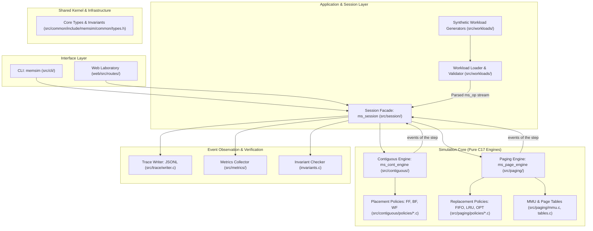

# 6. Introduction

Operating system memory management represents one of the most critical abstractions in systems software engineering. It bridges the gap between the execution requirements of concurrent processes and the physical constraints of finite system memory. Modern computer science curricula and systems research typically partition memory management into two classical paradigms: dynamic contiguous allocation and virtual demand paging. Despite the ubiquity of these concepts in standard textbooks, students and researchers frequently encounter substantial difficulty in analyzing the empirical trade-offs and runtime dynamics of these subsystems when examining production operating system kernels.

MemForge was engineered to address these pedagogical and analytical challenges. It provides a deterministic, rigorous, and modular memory management simulation environment developed in ISO C17, complemented by an interactive WebAssembly compilation. This section details the pedagogical and systems motivations behind MemForge, formalizes the core problem statement, outlines the contributions of the platform, presents the high-level system architecture, and delineates the organizational structure of this thirty-section report.

---

## 6.1 Motivation: Theory Versus Real-World Opacity

In theoretical operating systems literature—most notably the foundational texts by Silberschatz, Galvin, and Gagne—memory management algorithms are introduced through stylized, small-scale examples. Contiguous allocation is commonly demonstrated through static snapshots of memory with fixed partition holes, evaluating how heuristics such as First-Fit, Best-Fit, and Worst-Fit place incoming requests. Similarly, demand paging algorithms, including First-In First-Out (FIFO), Least Recently Used (LRU), and Belady's Optimal (OPT) replacement, are illustrated using short, hand-calculated reference strings consisting of ten to twenty memory accesses.

While these textbook treatments effectively communicate algorithmic intuition, they obscure the complex dynamic behaviors that emerge in live systems:
- Under continuous allocation and deallocation workloads, memory spaces undergo complex fragmentation lifecycles where external fragmentation fluctuates non-linearly with memory pressure.
- The relative search overhead of placement heuristics varies widely: First-Fit terminates upon finding the first valid hole, whereas Best-Fit and Worst-Fit must exhaustively scan all available holes in the free list unless indexed structures are maintained.
- In virtual memory subsystems, the frequency of page faults and disk writeback cycles is heavily governed by temporal and spatial access locality, page working sets, and frame allocation thresholds.
- Anomalies such as Belady's anomaly—where increasing physical frame allocation paradoxically increases page fault counts under FIFO replacement—require exact reference patterns and specific frame intervals to observe.

Direct observation of these behaviors within production general-purpose operating systems, such as Linux or FreeBSD, is extraordinarily difficult. Production kernels intertwine memory management logic with multi-level hardware MMU details, physical address translation caches (Translation Lookaside Buffers), asynchronous kernel threads (such as `kswapd`), NUMA memory policies, interrupt context restrictions, and complex locking hierarchies. Consequently, students and experimental researchers cannot isolate algorithmic mechanisms or conduct byte-for-byte reproducible evaluations.

---

## 6.2 Problem Statement

Existing pedagogical memory simulators suffer from architectural limitations that impair their utility for rigorous systems evaluation:

1. **Non-Determinism and Concurrency Artifacts:** Simulators relying on wall-clock timers, asynchronous threads, or unseeded pseudo-random generators introduce non-deterministic execution schedules, preventing fair comparative benchmarking across allocation or replacement algorithms.
2. **Conflation of Policy and Mechanism:** Many implementations couple policy heuristics (selecting which hole or frame to allocate) with engine mutation (splitting blocks, pointer manipulation, updating page tables). This lack of separation prevents clean extensibility and complicates formal verification.
3. **Absence of Strict Invariant Checking:** Simulators often report final summary metrics without verifying internal structural consistency after every step. Invariant violations, such as uncoalesced adjacent free blocks or desynchronized page table bits, frequently go undetected.
4. **Pedagogical Incompleteness:** Available tools typically implement either contiguous allocation or demand paging in isolation, rather than presenting a unified architectural model sharing consistent tracing and event contracts.

To provide genuine scientific value, a simulator must guarantee complete determinism, enforce clean architectural boundaries between policy decisions and state mutations, provide fine-grained execution logging, and support verification against analytical ground truth.

---

## 6.3 The MemForge Contribution

MemForge resolves these challenges through a deterministic, decoupled simulation framework. The key contributions of MemForge are:

- **Strict Algorithmic Determinism:** Simulation runs operate on discrete logical time steps. All state transitions are governed by integer operations, deterministic tie-breaking, and seeded workload generators. For any given workload, configuration, and seed, MemForge produces byte-identical traces across platforms.
- **Formal Decoupling of Policy and Engine Mechanism:** Placement policies (`src/contiguous/policies/*.c`) and replacement policies (`src/paging/policies/*.c`) operate as pure decision functions over immutable snapshots (`MemoryView` and `FrameView`). State mutations are strictly confined to dedicated engine modules (`ms_cont_engine` in `src/contiguous/engine.c` and `ms_page_engine` in `src/paging/engine.c`).
- **Event-Driven Observability:** State transitions emit strongly typed event structures through a centralized bus (`src/common/bus.c`). Sinks—including JSONL trace writers (`src/trace/writer.c`), runtime invariant verifiers (`src/contiguous/invariants.c`, `src/paging/invariants.c`), and metrics collectors (`src/metrics/`)—passively observe execution without side effects on core engine state.
- **Comprehensive Functional Coverage:**
  - *Contiguous Allocation:* First-Fit, Best-Fit, and Worst-Fit placement; split-on-allocation at the lower bound; immediate bidirectional coalescing upon deallocation or termination; external/internal fragmentation tracking; and explicit sliding compaction.
  - *Demand Paging:* Single-level per-process page tables; virtual address translation with bounds checking; page-fault dispatching; lowest-free-frame allocation; victim eviction under FIFO, LRU, and offline Optimal replacement with forward lookahead; dirty page writeback accounting; and automated frame sweeps detecting Belady's anomaly.
- **Dual CLI and WebAssembly Interface:** MemForge provides a native command-line binary (`memsim`) for automated batch benchmarking, and an interactive web laboratory (`web/`) compiling the identical C17 engine to WebAssembly (`memsim.wasm`) for real-time browser inspection.

---

## 6.4 High-Level System Architecture

The architecture of MemForge is structured into four distinct, strictly layered tiers: the Interface Layer, Application Layer, Simulation Core, and Event Observation Sinks. Communication between layers follows an unidirectional contract: clients submit operations via the `Session` facade, engines validate and execute operations, and results are broadcast outward as structured events.

As illustrated in the diagram, no client interface has direct access to the internal data structures of either the contiguous or paging engines. All operations pass through `ms_session_step`, which orchestrates validation, policy invocation, state mutation, event dispatching, and invariant checks.

---

## 6.5 Organization of the Report

This technical report is organized into thirty sequential sections grouped into eight thematic parts:

1. **Part I: Front Matter and Foundations (Sections 1–8):** Establishes institutional metadata, author declarations, table of contents, executive abstract, project motivation, formal scope boundaries, and core operating system memory management principles.
2. **Part II: System Architecture and Modular Design (Sections 9–11):** Details the overarching architecture, module ownership, dependency constraints, and the internal representation of dynamic memory states.
3. **Part III: Contiguous Memory Allocation (Sections 12–14):** Formalizes First-Fit, Best-Fit, and Worst-Fit placement algorithms, dynamic fragmentation metrics, sliding compaction mechanisms, and verification against standard textbook benchmarks (AC-1, AC-2).
4. **Part IV: Virtual Demand Paging (Sections 15–18):** Explores page table management, address translation, eviction policies (FIFO, LRU, OPT), worked execution traces (AC-3), and empirical frame sweeps replicating Belady's anomaly (AC-4).
5. **Part V: Empirical Evaluation and Benchmarking (Sections 19–20):** Defines synthetic workload parameters, statistical aggregation methodologies (mean, standard deviation, 95% confidence intervals), and presents experimental findings for placement under memory pressure (E1) and paging performance (E4).
6. **Part VI: Verification, Testing, and Correctness (Sections 21–22):** Reviews the multi-tier testing strategy, AddressSanitizer and Valgrind workflows, mathematical engine invariants (I1–I8, V1–V6), and acceptance verification results.
7. **Part VII: User Interfaces, Engineering, and Deployment (Sections 23–27):** Details the CLI syntax, WebAssembly compilation, development conventions, CMake presets, CI pipelines, and environment setup instructions.
8. **Part VIII: Synthesis, References, and Appendices (Sections 28–30):** Synthesizes project outcomes, discusses future research directions, lists academic citations, and compiles supplementary data tables.
