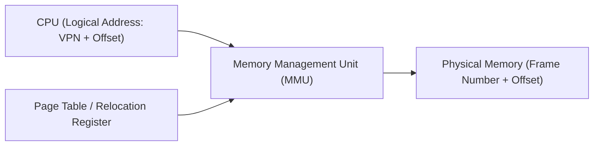
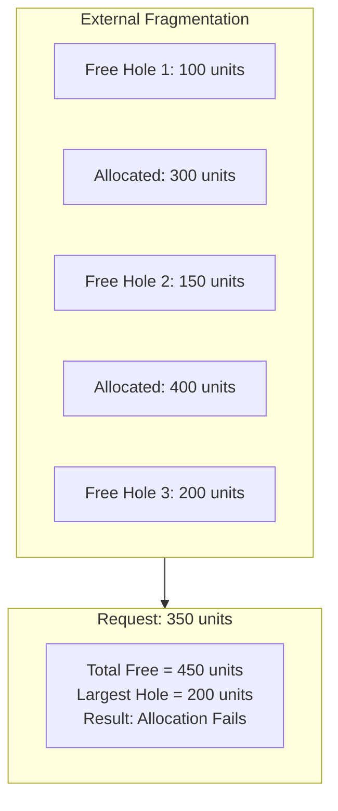
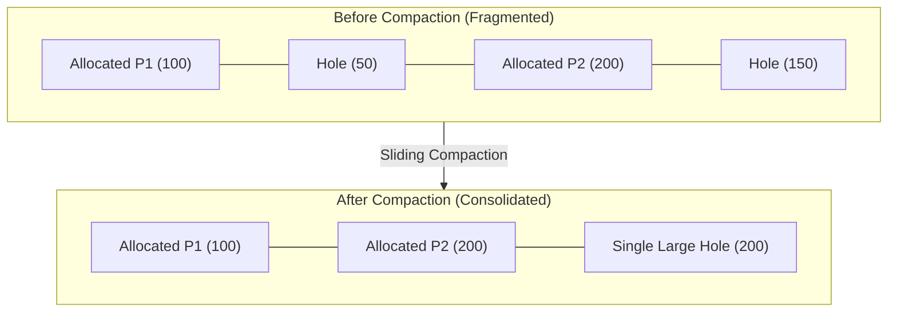
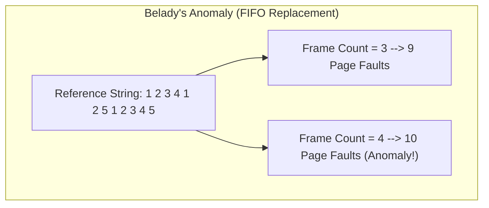

# 8. Memory Management Concepts

Memory management constitutes a fundamental pillar of modern multiprogrammed operating systems. The operating system must provide concurrent execution contexts for multiple processes while enforcing strict hardware protection, memory isolation, and efficient utilization of physical storage resources. Foundational treatments by Silberschatz et al. (2018) and Tanenbaum and Bos (2015) formalize the primary models through which memory is structured, addressed, and virtualized: contiguous memory allocation and paged virtual memory. MemForge implements discrete-event simulation models for both paradigms to examine their algorithmic mechanics, fragmentation characteristics, and performance limits.

## 8.1 Logical versus Physical Address Spaces

In an operating system executing without memory virtualization, programs issue addresses referring directly to physical memory locations. This design precludes concurrent processes from residing safely in memory simultaneously without mutual interference or costly software relocation. Modern architectures decouple program addresses from physical storage by distinguishing between the logical (or virtual) address space and the physical address space (Silberschatz et al., 2018).

A *logical address* is generated by the central processing unit (CPU) during program execution, representing memory relative to the program's perceived address space starting at zero. A *physical address* identifies an actual storage cell within the physical memory unit (such as dynamic RAM or the simulated storage arena). The mapping between logical and physical domains is managed dynamically by hardware known as the Memory Management Unit (MMU).

In rudimentary contiguous systems, address translation relies on a *base register* (or relocation register) combined with a *limit register* (Tanenbaum and Bos, 2015). The base register holds the starting physical address assigned to the process partition, while the limit register defines the partition's physical extent. The MMU verifies that every logical address falls strictly below the limit value before adding the base register value to derive the physical bus address; attempts to reference addresses outside this interval trigger an addressing trap. In modern paged architectures, this single-register translation is superseded by multi-entry translation tables.

## 8.2 Contiguous Memory Allocation and Holes

Contiguous memory allocation assigns each active process a single, unbroken block of physical memory addresses. As processes spawn, allocate dynamic memory, terminate, and exit, the physical address space transitions from a single monolithic free space into an alternating arrangement of occupied partitions and unallocated memory intervals, commonly termed *holes* (Silberschatz et al., 2018).

When a process requests an allocation of size $s$, the allocator must identify a hole whose size is greater than or equal to $s$. The decision of which candidate hole to select constitutes the *dynamic storage-allocation problem*. The classical strategies examined in operating systems literature include:

1. **First-Fit:** Scans the list of available holes from the lowest memory address and allocates within the first hole whose capacity satisfies the request ($size \ge s$). First-Fit terminates the search immediately upon finding a valid partition, offering low computational overhead.
2. **Best-Fit:** Evaluates all available holes in the entire memory space and allocates within the smallest hole that satisfies the request ($size \ge s$). Best-Fit attempts to preserve larger contiguous intervals for subsequent massive requests, but leaves behind small, often unusable remnant fragments.
3. **Worst-Fit:** Evaluates all available holes and selects the largest hole in memory ($size = \max(size_h)$). Worst-Fit aims to leave the largest possible remainder after allocation, theorizing that the remaining fragment will remain large enough to accommodate subsequent requests.

In MemForge, contiguous placement policies evaluate an ordered view of maximal holes and return a placement decision. Variations such as Next-Fit (which retains a roving pointer to avoid repeatedly scanning the beginning of memory) were excluded from MemForge's primary engine scope to maintain a lean, fully deterministic evaluation contract.

## 8.3 Internal versus External Fragmentation

Dynamic memory systems inevitably suffer from *fragmentation*, wherein portions of physical capacity become unusable. Operating systems literature distinguishes two canonical forms of this phenomenon:

### 8.3.1 External Fragmentation
*External fragmentation* occurs when the cumulative unallocated space across all free holes is sufficient to satisfy an incoming request, but no individual contiguous hole is large enough. Memory is broken into scattered, non-adjacent fragments.

Silberschatz et al. (2018) describe the statistical *50-percent rule*: for First-Fit allocation, if $N$ blocks are actively allocated, approximately $0.5 N$ additional blocks are lost to fragmentation, meaning one-third of total available memory may remain unusable. In MemForge, external fragmentation is quantified as the fraction of free memory unavailable to a single monolithic allocation:
$$E = 1 - \frac{\text{largest\_hole}}{\text{total\_free}}$$
When all free memory is unified into a single contiguous hole, $\text{largest\_hole} = \text{total\_free}$ and $E = 0$. Conversely, as free memory fragments into many tiny partitions, $\text{largest\_hole} \ll \text{total\_free}$, driving $E$ toward 1.

### 8.3.2 Internal Fragmentation
*Internal fragmentation* occurs when memory is allocated in fixed granularities (such as power-of-two boundaries, cache-line alignments, or fixed-size pages) that exceed the exact size requested by a process. The unassigned memory internal to the partition remains dedicated to the process but unused. In MemForge's contiguous simulation model, memory is managed in discrete abstract integer units with an alignment factor and minimum split threshold of 1; thus, granted size exactly equals requested size, rendering internal fragmentation zero by construction in the contiguous subsystem.

## 8.4 Memory Compaction

When external fragmentation prevents allocation despite sufficient total free memory, the operating system can perform *compaction* (or defragmentation). Compaction involves relocating active memory blocks across physical memory to consolidate all separate holes into a single continuous free region (Tanenbaum and Bos, 2015).

Compaction is feasible only when execution-time dynamic relocation is supported, allowing the operating system to update the base registers or internal address descriptors of relocated programs without breaking application pointer references. MemForge utilizes a deterministic, order-preserving *sliding compaction* algorithm (`ms_cont_compaction_plan_sliding`). In sliding compaction, allocated blocks are traversed in ascending physical address order and shifted toward address zero immediately adjacent to the preceding block. This ensures that:
1. The relative address order of active blocks is preserved.
2. Memory moves proceed monotonically downwards, avoiding destructive overlaps during copy operations.
3. All available free space is consolidated into one contiguous hole at the upper boundary of physical memory ($E = 0$).

The primary cost of compaction is memory bus utilization and processor stall time, modeled in MemForge by tracking total blocks moved and total units relocated.

## 8.5 Paging and Address Translation

To eliminate external fragmentation entirely and relieve the allocator from requiring contiguous physical allocations, modern operating systems implement *paging* (Silberschatz et al., 2018). Paging partitions a program's logical address space into uniform fixed-size units termed *pages*, while partitioning physical memory into equal-sized units called *frames*. Page and frame dimensions are strictly powers of two (e.g., 4096 bytes or $2^{12}$).

A logical address consisting of bit width $m$ with page size $2^k$ is divided into two structural components:
1. **Virtual Page Number ($p$ or VPN):** The high-order $m - k$ bits, identifying the specific page within the process logical space.
2. **Page Offset ($d$):** The low-order $k$ bits, identifying the exact byte within the selected page.

Physical address generation performs no arithmetic modification on the offset $d$. Instead, the MMU uses the VPN as an index into a per-process data structure known as the *page table*. The page table entry (PTE) supplies the corresponding physical frame number ($f$). The physical address is constructed by concatenating $f$ with offset $d$:
$$\text{Physical Address} = (f \times 2^k) + d$$

Page table entries contain architectural status bits:
- **Present/Valid Bit:** Indicates whether the corresponding virtual page currently resides in a physical memory frame (1) or resides exclusively on secondary backing store (0).
- **Referenced (R) Bit:** Set by hardware whenever the page is read or written; utilized by replacement heuristics to assess temporal activity.
- **Dirty/Modified (D) Bit:** Set by hardware whenever a write operation occurs on the page; indicates whether the frame contents must be written back to backing store upon eviction.

MemForge implements flat, single-level page tables per active process. Hierarchical multi-level page tables, inverted page tables, and hardware Translation Lookaside Buffers (TLBs) were excluded to focus simulation fidelity directly on page replacement and translation fault dynamics.

## 8.6 Demand Paging and Page Faults

In a pure demand-paging architecture, virtual pages are loaded into physical frames only when referenced during program execution (Tanenbaum and Bos, 2015). When a process attempts to access a logical address whose PTE valid bit is 0, the hardware MMU cannot translate the address and raises an execution exception termed a *page fault*.

Page fault handling proceeds through a defined operating system sequence:
1. **Trap to Kernel:** The CPU traps to the operating system's page fault interrupt handler, recording the faulting virtual address.
2. **Validity Check:** The operating system verifies whether the referenced virtual address falls within the legal allocation bounds of the target process. If invalid, the process is terminated with an addressing violation (segmentation fault).
3. **Frame Acquisition:** The allocator inspects physical memory for an available free frame. If all frames are occupied, the page replacement subsystem selects an existing resident frame as a *victim*.
4. **Eviction and Writeback:** If the victim page's dirty bit is asserted, its contents are serialized back to secondary backing store. The victim's PTE is cleared ($\text{present} = 0$).
5. **Page Loading:** The requested page contents are fetched from backing store into the allocated frame.
6. **Table Update and Restart:** The faulting process's PTE is updated with the physical frame number, the present bit is set to 1, and the CPU instruction that triggered the fault is re-executed transparently.

Page faults are classified into *compulsory faults* (cold-start misses, where the page is referenced for the very first time) and *capacity faults* (where the working set exceeds available physical frame capacity, requiring prior resident pages to be evicted).

## 8.7 Page Replacement and the Principle of Locality

The performance of demand paging relies heavily on the *principle of locality* (Denning, 1970; Silberschatz et al., 2018). Empirical observation reveals that program execution demonstrates both *temporal locality* (memory locations accessed recently are likely to be accessed again in the near future) and *spatial locality* (memory locations adjacent to recently accessed addresses are likely to be accessed soon).

When physical memory is exhausted, the operating system must apply a *page replacement algorithm* to decide which frame to surrender:
- **First-In, First-Out (FIFO):** Associates each frame with the logical time stamp when the page was loaded into memory. When an eviction occurs, FIFO selects the oldest resident page. While simple to implement via a FIFO queue or timestamp array, FIFO fails to leverage temporal locality: a heavily referenced utility page loaded during system initialization is evicted ahead of a seldom-used recent page.
- **Least Recently Used (LRU):** Associates each frame with the timestamp of its most recent reference. LRU selects the page that has remained unreferenced for the longest interval of time, directly exploiting the principle of temporal locality.
- **Optimal Replacement (OPT / MIN):** Formulated by Belady (1966), OPT replaces the page that will not be referenced for the longest period in the future. Because OPT requires clairvoyant prescience of future reference strings, it cannot be implemented in general-purpose operating systems; however, it serves as an indispensable theoretical lower bound against which all practical replacement policies are evaluated.

## 8.8 Belady's Anomaly and Stack Algorithms

Intuitively, providing an application with additional physical memory frames should decrease, or at worst maintain, the total number of page faults incurred over a fixed reference string. However, in 1969, László Bélády, Robert Nelson, and Gerald Shedler proved that under certain replacement policies—specifically FIFO—increasing the allocation of physical frames can paradoxically result in an *increase* in the number of page faults. This phenomenon is known as *Belady's anomaly* (Silberschatz et al., 2018; Tanenbaum and Bos, 2015).

To explain this counter-intuitive behaviour, Mattson et al. (1970) formulated the concept of *stack algorithms*. A page replacement policy is classified as a stack algorithm if and only if it satisfies the *inclusion property*:
$$M(m, r) \subseteq M(m + 1, r)$$
where $M(m, r)$ denotes the set of virtual pages resident in a memory of $m$ frames after processing reference string prefix $r$. For any stack algorithm, adding physical frames guarantees that every page that would have been resident under $m$ frames remains resident under $m+1$ frames; consequently, a stack algorithm can never exhibit Belady's anomaly.

LRU is a canonical stack algorithm because the resident set under $m$ frames consists strictly of the $m$ most recently referenced unique pages, which is always a subset of the $m+1$ most recently referenced pages. OPT is likewise a stack algorithm. Conversely, FIFO is not a stack algorithm because the oldest loaded page under $m$ frames bears no necessary relationship to the oldest loaded page under $m+1$ frames.

In MemForge's test suite, acceptance criterion AC-4 verifies Belady's anomaly using the canonical 12-reference string:
$$1, 2, 3, 4, 1, 2, 5, 1, 2, 3, 4, 5$$
When evaluated under FIFO replacement, physical frame allocation yields 12 faults at 1 frame, 12 at 2 frames, 9 at 3 frames, and increases to 10 faults at 4 frames (marking the anomaly point), before dropping to 5 faults at 5 and 6 frames. In contrast, evaluation under LRU yields 10 faults at 3 frames and 8 faults at 4 frames, while OPT yields 7 faults at 3 frames and 6 faults at 4 frames, exhibiting strictly monotonic non-increasing fault profiles.

