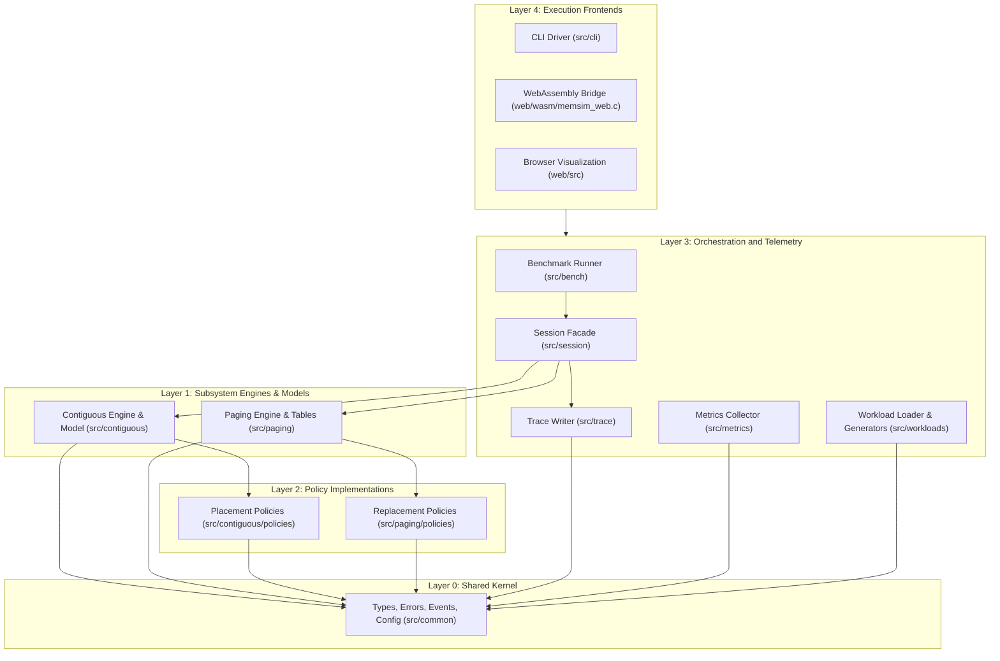
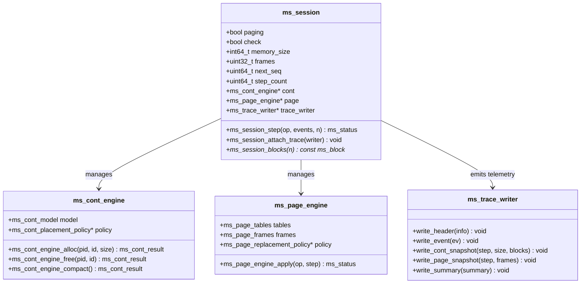
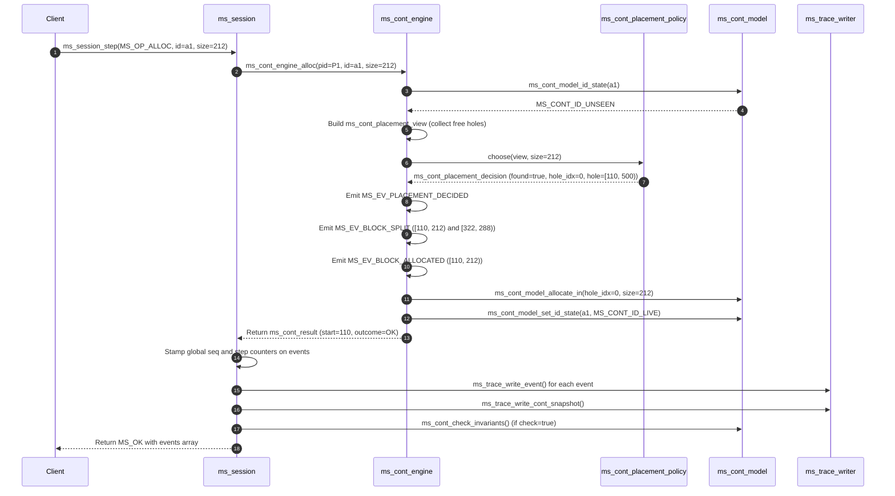
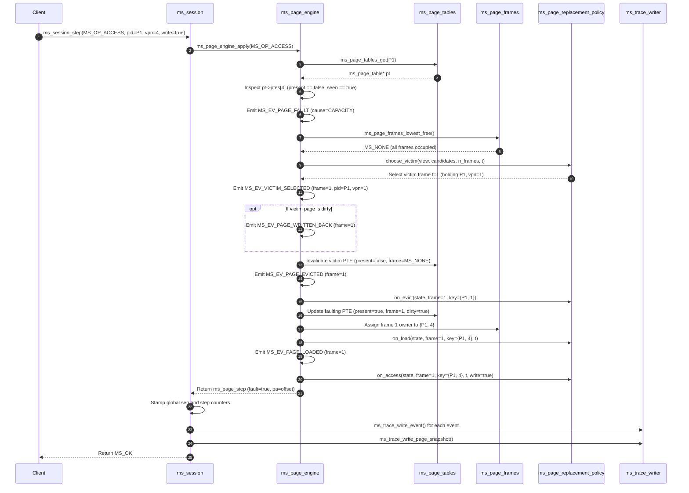

# 9. System Architecture and Design

The primary architectural objective of MemForge is to provide an exact, reproducible, and verifiable discrete-event simulation environment for operating system memory management algorithms. To satisfy the conflicting demands of algorithmic transparency, absolute determinism, and multi-platform deployment (spanning Linux command-line tools and browser-based client interfaces), the system is organized as a layered, modular architecture. At the center of the architecture sits an isolated, pure C core surrounded by orchestration facades, serialization sinks, and client frontends.

## 9.1 Layered Architecture

MemForge enforces strict unidirectional architectural layering. Higher-level layers consume the services of lower-level layers through well-defined header boundaries, while lower layers possess no syntactic or semantic awareness of their callers. This structure is partitioned into five distinct layers:

The layers operate under strict structural rules verified automatically by `scripts/check_layers.sh` during compilation and continuous integration:
1. **Layer 0 (Shared Kernel - `src/common`):** Contains primitive types (`ms_pid`, `ms_alloc_id`, `ms_block`, `ms_hole`, `ms_op`), the error enum (`ms_status`), configuration records (`ms_paging_config`), and the event envelope (`ms_event`). It depends on zero external libraries and includes no files outside `src/common`.
2. **Layer 1 (Engines and State Models - `src/contiguous`, `src/paging`):** Implements internal memory partitions, page tables, physical frame states, address validation, and invariant check routines. The contiguous and paging subsystems are strictly isolated: neither module may include the headers of the other.
3. **Layer 2 (Policy Implementations):** Concrete strategies for placement (`first-fit`, `best-fit`, `worst-fit`) and page replacement (`fifo`, `lru`, `opt`). As mandated by ADR-010, policies decide while engines mutate; a policy interacts with its engine exclusively via read-only views and is prohibited from including engine mutation headers.
4. **Layer 3 (Orchestration, Workloads, and Telemetry):** The [`Session`](file:///home/cyberknight/memforge-agy/rep-concepts/src/session/include/memsim/session.h) facade coordinates simulation steps, stamps global event sequences, invokes invariant validators, and dispatches snapshots to the [`TraceWriter`](file:///home/cyberknight/memforge-agy/rep-concepts/src/trace/include/memsim/trace/writer.h). The [`MetricsCollector`](file:///home/cyberknight/memforge-agy/rep-concepts/src/metrics/include/memsim/metrics.h) consumes the event stream to accumulate summary statistics without polluting the core state.
5. **Layer 4 (Execution Frontends):** The command-line binary `memsim` and the WebAssembly bridge `web/wasm/memsim_web.c`. These consumers parse inputs, invoke benchmarks or sessions, and serialize results for end users.

## 9.2 The Deterministic Core versus External Clients

A critical non-functional requirement of MemForge is complete cross-platform execution determinism (NFR-2). Two runs of any workload under identical policy configurations must yield byte-for-byte identical event traces, metric summaries, and invariant states, regardless of whether executed on an x86_64 Linux developer workstation, a GitHub Actions continuous integration worker, or an Emscripten-compiled WebAssembly runtime in a browser.

To enforce this guarantee, the architecture establishes a sharp demarcation between the *deterministic simulation core* (`src/common`, `src/contiguous`, `src/paging`) and *external clients*:
- **Purity of the Core:** The core operates entirely free of system I/O, network sockets, environment variables, and operating system wall clocks. The inclusion of `<stdio.h>`, `<time.h>`, `<unistd.h>`, `<fcntl.h>`, and `<sys/*.h>` is strictly banned within core code directories and checked statically by CI.
- **Discrete Clocks:** Time is measured exclusively in discrete integral counters:
  - `step`: Incremented monotonically for every top-level workload operation processed by the session.
  - `t`: Incremented on each memory reference within the paging subsystem to track temporal access recency.
  - `seq`: Monotonically increasing sequence number assigned to every discrete semantic event emitted across the entire run.
- **Fixed Tie-Breaking:** Ambiguities in algorithmic choices (e.g., equidistant candidate holes in Best-Fit or identically stamped candidate frames in replacement policies) are resolved by deterministic tie-breaking rules, such as choosing the lowest physical memory address or lowest frame index.
- **Purity of Floating-Point Calculations:** Physical memory sizes, block offsets, and frame numbers are modeled as 64-bit signed integers (`int64_t`) or 32-bit unsigned integers (`uint32_t`). Where fractional values occur (such as external fragmentation ratios), the core records them as integer parts-per-million (`ppm`), eliminating floating-point architecture divergence across hardware platforms.

## 9.3 The Session Facade

Clients never manipulate the underlying [`ms_cont_engine`](file:///home/cyberknight/memforge-agy/rep-concepts/src/contiguous/include/memsim/contiguous/engine.h) or [`ms_page_engine`](file:///home/cyberknight/memforge-agy/rep-concepts/src/paging/include/memsim/paging/engine.h) directly. Instead, all interactions flow through the [`ms_session`](file:///home/cyberknight/memforge-agy/rep-concepts/src/session/include/memsim/session.h) facade defined in [`src/session/include/memsim/session.h`](file:///home/cyberknight/memforge-agy/rep-concepts/src/session/include/memsim/session.h).

The `ms_session` structure acts as a stateful coordinator that encapsulates:
1. Subsystem configuration and engine lifecycle instantiation (`ms_session_create`, `ms_session_destroy`).
2. Two-phase workload preparation: for demand paging under clairvoyant policies like `opt`, [`ms_session_create`](file:///home/cyberknight/memforge-agy/rep-concepts/src/session/session.c#L52-L130) pre-scans operations via `ms_page_engine_prepare` to supply full lookahead reference strings before execution begins.
3. Step execution dispatch: [`ms_session_step`](file:///home/cyberknight/memforge-agy/rep-concepts/src/session/session.c#L206-L250) receives an abstract operation [`ms_op`](file:///home/cyberknight/memforge-agy/rep-concepts/src/common/include/memsim/common/types.h#L50-L76), dispatches it to either `step_cont` or `step_page`, retrieves the unsequenced events generated during the transition, assigns gapless global `seq` and `step` values, writes trace events to attached sinks, and triggers a full physical memory snapshot.
4. Continuous invariant checking: if configured with `.check = true`, the session executes comprehensive structural invariant audits ([`ms_cont_check_invariants`](file:///home/cyberknight/memforge-agy/rep-concepts/src/contiguous/invariants.c#L33-L66) or [`ms_page_engine_check`](file:///home/cyberknight/memforge-agy/rep-concepts/src/paging/include/memsim/paging/engine.h#L50)) after every step, aborting immediately upon contract violation.

## 9.4 Event Stream and Trace System

The primary integration contract across MemForge is the discrete semantic event log. Rather than querying engine internals through ad-hoc accessor methods, simulation engines emit typed, structured [`ms_event`](file:///home/cyberknight/memforge-agy/rep-concepts/src/common/include/memsim/common/events.h) records whenever memory state transitions occur.

Events capture specific physical actions, such as:
- `MS_EV_BLOCK_ALLOCATED`, `MS_EV_BLOCK_FREED`, `MS_EV_BLOCK_SPLIT`, `MS_EV_BLOCKS_COALESCED`.
- `MS_EV_COMPACT_STARTED`, `MS_EV_BLOCK_RELOCATED`, `MS_EV_COMPACT_FINISHED`.
- `MS_EV_PAGE_HIT`, `MS_EV_PAGE_FAULT`, `MS_EV_FRAME_ALLOCATED`, `MS_EV_VICTIM_SELECTED`, `MS_EV_PAGE_EVICTED`, `MS_EV_PAGE_LOADED`, `MS_EV_PAGE_WRITTEN_BACK`.
- `MS_EV_ALLOC_REJECTED`, `MS_EV_ALLOCATION_FAILED`, `MS_EV_ACCESS_VIOLATION`.

The [`TraceWriter`](file:///home/cyberknight/memforge-agy/rep-concepts/src/trace/include/memsim/trace/writer.h) module formats these events into canonical JSON Lines (JSONL) records. Following every step, the session commands the trace writer to serialize a complete structural snapshot:
- Contiguous snapshots record every block partition's start address, extent, allocation state (`FREE` or `ALLOCATED`), owning process ID, and logical allocation ID.
- Paging snapshots record every physical frame's resident virtual page key (`pid` and `vpn`), referenced bit, and dirty bit.

This event stream provides complete historical transparency, enabling the [`MetricsCollector`](file:///home/cyberknight/memforge-agy/rep-concepts/src/metrics/include/memsim/metrics.h) to compute summary statistics (e.g., external fragmentation over time, hit rates, compaction costs) and the web visualizer to implement forward and backward step replay.

## 9.5 The WebAssembly Bridge

To deliver an interactive, zero-installation educational demonstration without maintaining a secondary JavaScript simulator implementation, MemForge compiles its native C codebase directly to WebAssembly using Emscripten. The WebAssembly bridge is implemented in [`web/wasm/memsim_web.c`](file:///home/cyberknight/memforge-agy/rep-concepts/web/wasm/memsim_web.c).

The bridge exports three minimal C functions using the `__attribute__((export_name(...)))` macro:
1. `memsim_alloc(size_t n)`: Allocates dynamic memory within the WebAssembly linear heap for passing workload text from JavaScript.
2. `memsim_free(void *p)`: Releases memory previously allocated in the WebAssembly heap.
3. `memsim_run(const char *text, size_t len, const char *policy)`: Executes a complete workload simulation run.

The execution workflow inside `memsim_run` mirrors the native CLI pipeline:
1. The raw workload text is parsed into structured memory operations via [`ms_wl_parse`](file:///home/cyberknight/memforge-agy/rep-concepts/src/workloads/include/memsim/workloads/loader.h#L32). If syntax or semantic errors occur, an error string formatted as `!<line>:<message>` is immediately returned.
2. A POSIX in-memory stream buffer is opened via `open_memstream(&out, &out_len)`.
3. The benchmark runner [`ms_bench_run`](file:///home/cyberknight/memforge-agy/rep-concepts/src/bench/include/memsim/bench.h#L40) is invoked with the parsed workload, chosen policy name, and trace sink configured to the in-memory stream.
4. The simulation runs to completion, emitting the canonical JSONL trace (header, events, step snapshots, and run summary) directly into the dynamic memory buffer.
5. `memsim_run` closes the stream and returns the null-terminated trace string pointer back to the browser runtime.

Because the browser executes the exact C17 source files compiled to WebAssembly, behavioral divergence between the native binary and the web application is mathematically impossible.

## 9.6 Architecture Decision Log

The system design was governed by thirteen foundational Architecture Decision Records (ADRs) defined in Section 17 of the architecture specification. Table 9.1 documents these decisions, their implementation status, alternative designs considered, and architectural impact.

Table 9.1: MemForge Architecture Decision Records (ADRs)

| ID | Decision | Status | Alternatives Considered | Deciding Factor & Architectural Impact |
| --- | --- | --- | --- | --- |
| ADR-001 | C17 standard with CMake, Ninja, gcc, clang, and sanitizers | Accepted | Python, C++, Java, TypeScript | Native language of systems programming; direct memory alignment control; high performance and sanitizer support. |
| ADR-002 | Contiguous layout modeled via address-ordered block array | Accepted | Doubly linked list; bitmap of allocation units; interval tree | Contiguous arrays provide superior cache locality, predictable iteration, and straightforward contiguous partition invariant checks. |
| ADR-003 | Stable logical allocation IDs (`ms_alloc_id`) never reused | Accepted | Address-based freeing; process-local non-unique IDs | Enables cross-policy workload replay and sliding compaction; physical addresses change during compaction while IDs remain constant. |
| ADR-004 | Web visualizer replays canonical JSONL traces via plain JavaScript | Accepted | React/Vite web application; full live what-if engine in C | Simple static browser client; decouples UI rendering from engine state mutation; zero frontend build toolchain required. |
| ADR-005 | Event log acts as primary integration contract | Accepted | Ad-hoc module statistics query APIs | Downstream consumers (metrics, CLI, trace writer, web visualizer) consume uniform event streams without coupling to internal engine pointers. |
| ADR-006 | Three-tier error model (input error, domain outcome, contract abort) | Accepted | Unchecked error return codes; global `abort()` on every failure | Distinguishes workload syntax errors from runtime domain failures (e.g., fragmentation) and internal simulation contract bugs. |
| ADR-007 | Absolute determinism via integer state and discrete clocks | Accepted | Wall-clock profiling; unseeded system `rand()` | Eliminates cross-platform divergence, race conditions, and floating-point non-determinism, guaranteeing byte-identical traces. |
| ADR-008 | Global page replacement over a single unified frame pool | Accepted | Local per-process replacement quotas | Simplified scope suitable for university OS requirements; models foundational replacement algorithms cleanly. |
| ADR-009 | Half-open intervals $[start, start+size)$ and abstract integer units | Accepted | Inclusive ranges $[start, end]$; byte-addressed physical memory | Half-open ranges avoid boundary arithmetic off-by-one errors; abstract units permit arbitrary capacity scaling. |
| ADR-010 | Strict policy-engine separation (policies decide, engines mutate) | Accepted | Policies directly mutate engine pointer lists and tables | Enforces modular isolation; policies remain pure decision functions that can be tested against synthetic views. |
| ADR-011 | Full, order-preserving sliding compaction | Accepted | Minimal-move compaction; boundary-swapping compaction | Preserves chronological process order; moves blocks strictly downwards to prevent destructive overwriting. |
| ADR-012 | Plain-text workload format with `printf`-based trace serialization | Accepted | Vendored cJSON library; YAML configuration parser | Eliminates heavy third-party JSON parser dependencies; parsing remains robust, simple, and self-contained. |
| ADR-013 | String identifiers interned to dense integers at workload load | Accepted | String hashing inside internal engine lookup tables | Replaces string comparisons with direct array indexing in performance-critical simulation loops. |

## 9.7 Component Interaction Workflows

To illustrate the concrete interaction dynamics between the session facade, engines, policies, and telemetry sinks, the following sequence diagrams depict a contiguous allocation and a demand-paging memory access.

### 9.7.1 Contiguous Allocation Workflow
Figure 9.1 illustrates the execution trace when [`ms_cont_engine_alloc`](file:///home/cyberknight/memforge-agy/rep-concepts/src/contiguous/engine.c#L125-L240) processes an allocation request within the contiguous subsystem.

### 9.7.2 Demand-Paged Memory Access Workflow
Figure 9.2 details the execution flow of a paged memory reference ([`ms_page_engine_apply`](file:///home/cyberknight/memforge-agy/rep-concepts/src/paging/engine.c#L300-L347) with `MS_OP_ACCESS`) that encounters a capacity page fault requiring page replacement.

