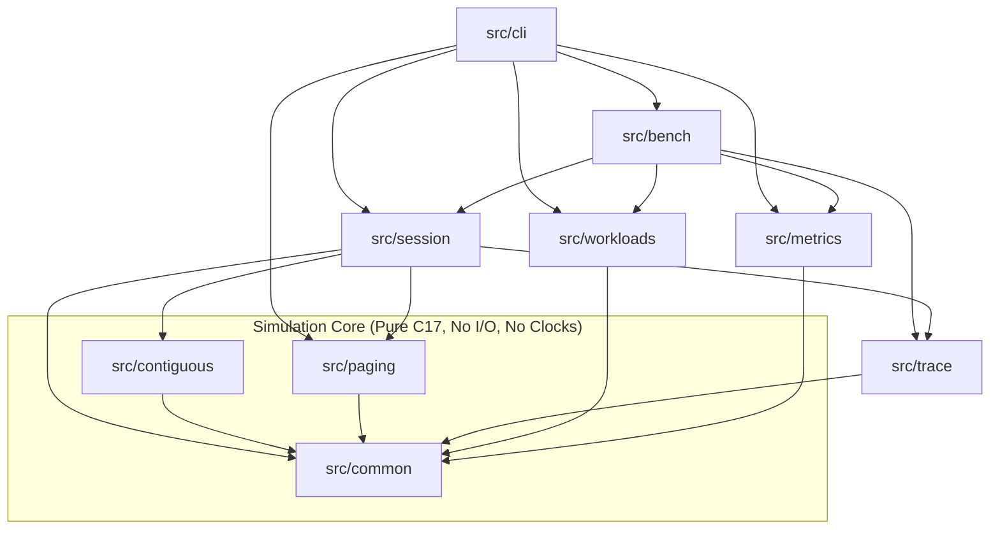

# 10. Module Description and Dependencies

MemForge is structured as a collection of modular C17 libraries organized under `src/`. Each module possesses a single clear responsibility, an explicit owner role responsible for its design and code review, and a strictly delineated exported Application Programming Interface (API). Unidirectional dependency constraints prevent circular coupling, isolate algorithmic policies from engine mutations, and preserve the engine's absolute determinism.

## 10.1 Module Catalog and Ownership

The repository is partitioned into nine distinct modules under `src/`. Table 10.1 summarizes the ownership structure, purpose, and exported interfaces across the entire codebase.

Table 10.1: MemForge Subsystem Modules and Ownership

| Module Path | Owner Role | Primary Purpose | Exported Public Headers |
| --- | --- | --- | --- |
| `src/common` | P1 (Lead Architect) | Defines core types, errors, events, and configuration records shared across all subsystems. | [`memsim/common/types.h`](file:///home/cyberknight/memforge-agy/rep-concepts/src/common/include/memsim/common/types.h), [`errors.h`](file:///home/cyberknight/memforge-agy/rep-concepts/src/common/include/memsim/common/errors.h), [`events.h`](file:///home/cyberknight/memforge-agy/rep-concepts/src/common/include/memsim/common/events.h), [`config.h`](file:///home/cyberknight/memforge-agy/rep-concepts/src/common/include/memsim/common/config.h), [`bus.h`](file:///home/cyberknight/memforge-agy/rep-concepts/src/common/include/memsim/common/bus.h), [`registry.h`](file:///home/cyberknight/memforge-agy/rep-concepts/src/common/include/memsim/common/registry.h) |
| `src/contiguous` | P2 (Engine), P3 (Policies), P4 (Metrics/Compaction) | Simulates variable-partition contiguous allocation, placement heuristics, block splitting/coalescing, fragmentation analysis, and sliding compaction. | [`memsim/contiguous/engine.h`](file:///home/cyberknight/memforge-agy/rep-concepts/src/contiguous/include/memsim/contiguous/engine.h) |
| `src/paging` | P5 (Engine/MMU), P6 (Replacement/Belady) | Simulates demand paging, per-process page tables, physical frame tracking, page fault dispatch, replacement heuristics, and Belady frame sweeps. | [`memsim/paging/engine.h`](file:///home/cyberknight/memforge-agy/rep-concepts/src/paging/include/memsim/paging/engine.h), [`memsim/paging/belady.h`](file:///home/cyberknight/memforge-agy/rep-concepts/src/paging/include/memsim/paging/belady.h) |
| `src/trace` | P1 (Lead Architect) | Formats and serializes discrete simulation events and physical memory layout snapshots to JSON Lines (JSONL). | [`memsim/trace/writer.h`](file:///home/cyberknight/memforge-agy/rep-concepts/src/trace/include/memsim/trace/writer.h), [`memsim/trace/snapshot.h`](file:///home/cyberknight/memforge-agy/rep-concepts/src/trace/include/memsim/trace/snapshot.h) |
| `src/workloads` | P7 (Workloads & Metrics) | Parses plain-text simulation workloads and generates synthetic workloads under uniform or locality distributions. | [`memsim/workloads/loader.h`](file:///home/cyberknight/memforge-agy/rep-concepts/src/workloads/include/memsim/workloads/loader.h), [`memsim/workloads/generators.h`](file:///home/cyberknight/memforge-agy/rep-concepts/src/workloads/include/memsim/workloads/generators.h) |
| `src/metrics` | P7 (Workloads & Metrics) | Collects, aggregates, and computes statistical performance metrics from simulation event streams and block snapshots. | [`memsim/metrics.h`](file:///home/cyberknight/memforge-agy/rep-concepts/src/metrics/include/memsim/metrics.h) |
| `src/session` | P1 (Lead Architect) | Serves as the unified facade orchestrating engines, invariant verifiers, and trace serialization sinks. | [`memsim/session.h`](file:///home/cyberknight/memforge-agy/rep-concepts/src/session/include/memsim/session.h) |
| `src/bench` | P7 (Workloads & Metrics) | Executes end-to-end benchmark workloads across policies, accumulating summary metrics and placement results. | [`memsim/bench.h`](file:///home/cyberknight/memforge-agy/rep-concepts/src/bench/include/memsim/bench.h) |
| `src/cli` | P9 (User Interface) | Command-line driver providing user subcommands (`run`, `compare`, `refs`, `sweep`, `gen`). | CLI executable (`bin/memsim`) |

### 10.1.1 Common Kernel (`src/common`)
The common kernel fixes the foundational data types and contracts across all modules:
- **Types (`types.h`):** Defines abstract integer types [`ms_pid`](file:///home/cyberknight/memforge-agy/rep-concepts/src/common/include/memsim/common/types.h#L13) and [`ms_alloc_id`](file:///home/cyberknight/memforge-agy/rep-concepts/src/common/include/memsim/common/types.h#L14) (`uint32_t`), half-open hole intervals [`ms_hole`](file:///home/cyberknight/memforge-agy/rep-concepts/src/common/include/memsim/common/types.h#L22-L27), physical partitions [`ms_block`](file:///home/cyberknight/memforge-agy/rep-concepts/src/common/include/memsim/common/types.h#L31-L38), and the tagged union operation record [`ms_op`](file:///home/cyberknight/memforge-agy/rep-concepts/src/common/include/memsim/common/types.h#L50-L76).
- **Errors (`errors.h`):** Establishes status codes ([`ms_status`](file:///home/cyberknight/memforge-agy/rep-concepts/src/common/include/memsim/common/errors.h)) including `MS_OK`, `MS_ERR_INVALID`, `MS_ERR_NOMEM`, and `MS_ERR_IO`, alongside the defensive contract macro `MS_ASSERT`.
- **Events (`events.h`):** Specifies the exhaustive tagged union [`ms_event`](file:///home/cyberknight/memforge-agy/rep-concepts/src/common/include/memsim/common/events.h) carrying sequence metadata (`seq`, `step`) and payload structs for all semantic state transitions.

### 10.1.2 Contiguous Memory Module (`src/contiguous`)
The contiguous module models physical memory as a dynamic set of variable-sized partitions:
- **Public API:** [`ms_cont_engine_create`](file:///home/cyberknight/memforge-agy/rep-concepts/src/contiguous/engine.c#L95), [`ms_cont_engine_destroy`](file:///home/cyberknight/memforge-agy/rep-concepts/src/contiguous/engine.c#L117), [`ms_cont_engine_alloc`](file:///home/cyberknight/memforge-agy/rep-concepts/src/contiguous/engine.c#L125), [`ms_cont_engine_free`](file:///home/cyberknight/memforge-agy/rep-concepts/src/contiguous/engine.c#L242), [`ms_cont_engine_terminate`](file:///home/cyberknight/memforge-agy/rep-concepts/src/contiguous/engine.c#L282), [`ms_cont_engine_compact`](file:///home/cyberknight/memforge-agy/rep-concepts/src/contiguous/engine.c#L330), [`ms_cont_engine_blocks`](file:///home/cyberknight/memforge-agy/rep-concepts/src/contiguous/engine.c#L378), [`ms_cont_engine_events`](file:///home/cyberknight/memforge-agy/rep-concepts/src/contiguous/engine.c#L383), and [`ms_cont_engine_check`](file:///home/cyberknight/memforge-agy/rep-concepts/src/contiguous/engine.c#L389).
- **Internal Subsystems:**
  - `model.{h,c}`: Manages the sorted block array and allocation ID state table.
  - `placement.h`: Defines the placement policy vtable.
  - `policies/`: Houses concrete implementations of First-Fit, Best-Fit, and Worst-Fit.
  - `fragmentation.{h,c}`: Calculates external fragmentation ratios and classifies failure causes (`CAPACITY` vs `FRAGMENTATION`).
  - `compaction.{h,c}`: Computes sliding relocation plans and relocation costs.
  - `invariants.{h,c}`: Enforces structural invariants I1 through I7.

### 10.1.3 Paging Subsystem (`src/paging`)
The paging module simulates a demand-paged virtual memory architecture:
- **Public API:** [`ms_page_engine_create`](file:///home/cyberknight/memforge-agy/rep-concepts/src/paging/engine.c#L60), [`ms_page_engine_destroy`](file:///home/cyberknight/memforge-agy/rep-concepts/src/paging/engine.c#L101), [`ms_page_engine_prepare`](file:///home/cyberknight/memforge-agy/rep-concepts/src/paging/engine.c#L114), [`ms_page_engine_apply`](file:///home/cyberknight/memforge-agy/rep-concepts/src/paging/engine.c#L300), [`ms_page_engine_stats`](file:///home/cyberknight/memforge-agy/rep-concepts/src/paging/engine.c#L338), [`ms_page_engine_frames`](file:///home/cyberknight/memforge-agy/rep-concepts/src/paging/engine.c#L342), [`ms_page_engine_check`](file:///home/cyberknight/memforge-agy/rep-concepts/src/paging/invariants.c#L26), and Belady sweep tools [`ms_page_sweep`](file:///home/cyberknight/memforge-agy/rep-concepts/src/paging/belady.c#L50).
- **Internal Subsystems:**
  - `tables.{h,c}`: Maintains per-process flat page tables containing page table entries (`ms_page_pte`).
  - `frames.{h,c}`: Tracks physical frame assignments and identifies the lowest free frame.
  - `mmu.{h,c}`: Translates virtual addresses to VPN and offset components.
  - `replacement.h`: Defines the page replacement vtable and frame inspection view.
  - `policies/`: Concrete replacement implementations for FIFO, LRU, and OPT.
  - `belady.c`: Implements multi-frame parameter sweeps and anomaly detection.

### 10.1.4 Trace Serializer (`src/trace`)
The trace module formats simulation events and memory states:
- **Public API:** [`ms_trace_writer_open`](file:///home/cyberknight/memforge-agy/rep-concepts/src/trace/writer.c#L33), [`ms_trace_writer_close`](file:///home/cyberknight/memforge-agy/rep-concepts/src/trace/writer.c#L46), [`ms_trace_write_header`](file:///home/cyberknight/memforge-agy/rep-concepts/src/trace/writer.c#L53), [`ms_trace_write_event`](file:///home/cyberknight/memforge-agy/rep-concepts/src/trace/writer.c#L77), [`ms_trace_write_cont_snapshot`](file:///home/cyberknight/memforge-agy/rep-concepts/src/trace/snapshot.c#L8), [`ms_trace_write_page_snapshot`](file:///home/cyberknight/memforge-agy/rep-concepts/src/trace/snapshot.c#L32), and [`ms_trace_write_summary`](file:///home/cyberknight/memforge-agy/rep-concepts/src/trace/writer.c#L210).

### 10.1.5 Workload Management (`src/workloads`)
The workloads module ingests and synthesizes input instruction streams:
- **Public API:** [`ms_wl_parse`](file:///home/cyberknight/memforge-agy/rep-concepts/src/workloads/include/memsim/workloads/loader.h#L32) and [`ms_wl_free`](file:///home/cyberknight/memforge-agy/rep-concepts/src/workloads/include/memsim/workloads/loader.h#L34) for plain-text workload ingestion; [`ms_wl_gen_alloc_uniform`](file:///home/cyberknight/memforge-agy/rep-concepts/src/workloads/include/memsim/workloads/generators.h#L18) and [`ms_wl_gen_refs_locality`](file:///home/cyberknight/memforge-agy/rep-concepts/src/workloads/include/memsim/workloads/generators.h#L30) for synthetic generation.

### 10.1.6 Metrics Collector (`src/metrics`)
The metrics module provides telemetry aggregation:
- **Public API:** [`ms_metrics_create`](file:///home/cyberknight/memforge-agy/rep-concepts/src/metrics/include/memsim/metrics.h#L21), [`ms_metrics_destroy`](file:///home/cyberknight/memforge-agy/rep-concepts/src/metrics/include/memsim/metrics.h#L22), [`ms_metrics_on_events`](file:///home/cyberknight/memforge-agy/rep-concepts/src/metrics/include/memsim/metrics.h#L23), [`ms_metrics_on_blocks`](file:///home/cyberknight/memforge-agy/rep-concepts/src/metrics/include/memsim/metrics.h#L24), and [`ms_metrics_summary`](file:///home/cyberknight/memforge-agy/rep-concepts/src/metrics/include/memsim/metrics.h#L26).

### 10.1.7 Session Coordinator (`src/session`)
The session module exposes the top-level execution facade:
- **Public API:** [`ms_session_create`](file:///home/cyberknight/memforge-agy/rep-concepts/src/session/include/memsim/session.h#L23), [`ms_session_destroy`](file:///home/cyberknight/memforge-agy/rep-concepts/src/session/include/memsim/session.h#L26), [`ms_session_attach_trace`](file:///home/cyberknight/memforge-agy/rep-concepts/src/session/include/memsim/session.h#L29), [`ms_session_step`](file:///home/cyberknight/memforge-agy/rep-concepts/src/session/include/memsim/session.h#L33), and [`ms_session_blocks`](file:///home/cyberknight/memforge-agy/rep-concepts/src/session/include/memsim/session.h#L36).

### 10.1.8 Benchmark Pipeline (`src/bench`)
The benchmark module executes complete end-to-end evaluations:
- **Public API:** [`ms_bench_run`](file:///home/cyberknight/memforge-agy/rep-concepts/src/bench/include/memsim/bench.h#L40) and [`ms_bench_result_free`](file:///home/cyberknight/memforge-agy/rep-concepts/src/bench/include/memsim/bench.h#L43).

### 10.1.9 Command-Line Interface (`src/cli`)
The CLI frontend parses command-line arguments and dispatches to subcommands:
- `memsim run`: Executes a workload file under a specified policy and optionally writes JSONL traces.
- `memsim compare`: Evaluates multiple contiguous placement policies side-by-side against a shared workload.
- `memsim refs`: Simulates page replacement on inline reference strings, outputting ASCII resident-frame grids.
- `memsim sweep`: Sweeps physical frame counts to detect Belady's anomaly points under FIFO, LRU, or OPT.
- `memsim gen`: Generates seeded synthetic workloads.

## 10.2 Dependency Graph and Layer Verification

System modularity is enforced through compile-time linker visibility and validated by [`scripts/check_layers.sh`](file:///home/cyberknight/memforge-agy/rep-concepts/scripts/check_layers.sh). The script enforces three mandatory layering guarantees:
1. **Module Whitelisting:** Each module may include headers only from an explicit whitelist matching its CMake target dependencies (`DEPS`).
2. **Policy Isolation (ADR-010):** Placement policies (`src/contiguous/policies`) and replacement policies (`src/paging/policies`) must never include `engine.h`. Policies receive immutable state views and return algorithmic decisions without mutating engine data structures.
3. **Core Engine Purity (NFR-2):** Modules comprising the simulation core (`src/common`, `src/contiguous`, `src/paging`) are forbidden from including system I/O or time headers (`<stdio.h>`, `<time.h>`, `<unistd.h>`, `<fcntl.h>`, `<sys/*.h>`).

Figure 10.1 depicts the dependency hierarchy verified by `scripts/check_layers.sh`.



## 10.3 Policy Virtual Method Tables (vtables)

MemForge utilizes Virtual Method Tables (vtables) in C to achieve clean polymorphic strategy dispatch while maintaining strict type safety and zero overhead.

### 10.3.1 Contiguous Placement Policy vtable
Placement policies are defined in [`src/contiguous/placement.h`](file:///home/cyberknight/memforge-agy/rep-concepts/src/contiguous/placement.h). A placement policy evaluates available free holes and decides where an incoming block should be placed.

```c
typedef struct {
    int64_t start;
    int64_t size;
} ms_cont_placement_hole;

typedef struct {
    const ms_cont_placement_hole *holes;
    size_t hole_count;
} ms_cont_placement_view;

typedef struct {
    bool found;
    size_t hole_index;
    ms_cont_placement_hole hole;
    size_t scanned;
} ms_cont_placement_decision;

typedef ms_cont_placement_decision (*ms_cont_choose_fn)(
    const ms_cont_placement_view *view, int64_t requested_size);

typedef struct {
    const char *name;
    ms_cont_choose_fn choose;
} ms_cont_placement_policy;
```

The interface exposes three concrete vtable instances:
- `ms_cont_first_fit_policy`: Selects the first hole in address order with `size >= requested_size`.
- `ms_cont_best_fit_policy`: Selects the hole with minimal `size >= requested_size`; ties break to lowest address.
- `ms_cont_worst_fit_policy`: Selects the hole with maximal `size >= requested_size`; ties break to lowest address.

The policy receives an immutable view (`ms_cont_placement_view`) containing only the current free holes. The policy returns an `ms_cont_placement_decision` specifying whether a fit was found, the selected hole index, the hole extent, and the number of holes evaluated (`scanned`). The engine validates that the selected hole fits the request before performing the physical split.

### 10.3.2 Paging Replacement Policy vtable
Page replacement policies are defined in [`src/paging/replacement.h`](file:///home/cyberknight/memforge-agy/rep-concepts/src/paging/replacement.h). When a capacity page fault occurs and all physical frames are occupied, the engine queries the active replacement policy to identify a victim frame for eviction.

```c
typedef struct {
    const char *name;
    bool requires_lookahead;
    void *(*create)(uint32_t frames);
    void (*destroy)(void *state);
    bool (*prepare)(void *state, const ms_page_key *refs, size_t n);
    void (*on_load)(void *state, uint32_t frame, ms_page_key key, uint64_t t);
    void (*on_access)(void *state, uint32_t frame, ms_page_key key, uint64_t t, bool write);
    uint32_t (*choose_victim)(void *state, const ms_page_frame_view *view,
                              const uint32_t *candidates, size_t n, uint64_t t);
    void (*on_evict)(void *state, uint32_t frame, ms_page_key key);
} ms_page_replacement_policy;
```

The hook protocol operates in a precise sequence:
1. `create(frames)`: Instantiates private policy tracking metadata sized to the frame pool capacity.
2. `prepare(state, refs, n)`: Optional initialization hook invoked before simulation begins. Configured strictly for clairvoyant algorithms (`requires_lookahead = true` in OPT), passing the full sequence of future memory reference keys.
3. `on_load(state, frame, key, t)`: Triggered when a new virtual page is placed into a physical frame at discrete time $t$.
4. `on_access(state, frame, key, t, write)`: Triggered on every memory reference (both page hits and completed fault loads), allowing policies like LRU to update access recency stamps.
5. `choose_victim(state, view, candidates, n, t)`: Selects a victim frame index from the candidates array. The policy inspects frame metadata via the read-only [`ms_page_frame_view`](file:///home/cyberknight/memforge-agy/rep-concepts/src/paging/replacement.h#L12-L16) interface (`referenced` and `dirty` bits).
6. `on_evict(state, frame, key)`: Notifies the policy that a frame has been surrendered.
7. `destroy(state)`: Reclaims private tracking state upon engine termination.

The replacement registry function [`ms_page_replacement_find`](file:///home/cyberknight/memforge-agy/rep-concepts/src/paging/replacement.h#L34) maps policy names (`"fifo"`, `"lru"`, `"opt"`) to their corresponding static vtable singletons (`ms_page_fifo`, `ms_page_lru`, `ms_page_opt`).
