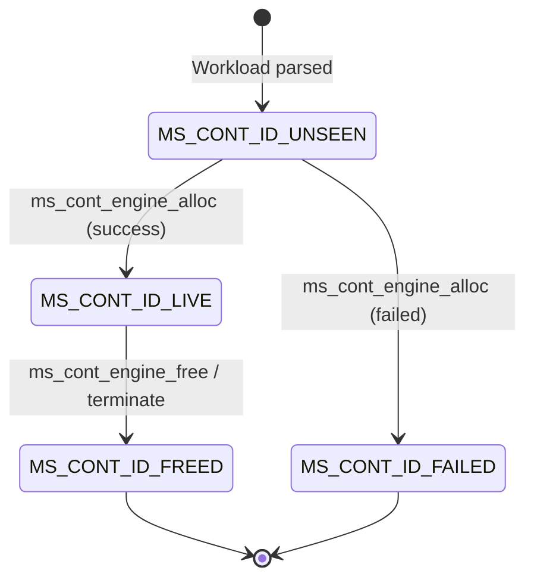

# 11. Memory Model and Allocation State

The contiguous memory subsystem models a linear physical memory of fixed capacity $M$, partitioned into an alternating series of occupied process allocations and unallocated free holes. To simulate this domain with high fidelity and verify algorithmic correctness at every discrete step, MemForge implements a deterministic contiguous state model grounded in explicit block data structures, an address-ordered linear array, an allocation identifier state table, and a formal set of architectural invariants.

## 11.1 Core Contiguous Structures: Blocks and Holes

The physical memory space is treated as an abstract integer range $[0, M)$ where $M$ represents the total capacity configured for the simulation run. Within this space, memory intervals are defined by two primitive structures declared in [`src/common/include/memsim/common/types.h`](file:///home/cyberknight/memforge-agy/rep-concepts/src/common/include/memsim/common/types.h):

```c
typedef struct {
    int64_t start, size;
} ms_hole; /* half-open [start, start + size) */

static inline int64_t ms_hole_end(ms_hole h) {
    return h.start + h.size;
}

typedef enum { MS_BLOCK_FREE, MS_BLOCK_ALLOCATED } ms_block_state;

typedef struct {
    int64_t start;         /* physical base address; changes only via compaction */
    int64_t size;          /* granted size, >= requested */
    ms_block_state state;  /* MS_BLOCK_FREE or MS_BLOCK_ALLOCATED */
    ms_pid pid;            /* MS_NONE iff FREE */
    ms_alloc_id alloc_id;  /* MS_NONE iff FREE */
    int64_t requested;     /* requested size; internal fragmentation = size - requested */
} ms_block;
```

The [`ms_hole`](file:///home/cyberknight/memforge-agy/rep-concepts/src/common/include/memsim/common/types.h#L22-L27) structure models a half-open interval $[start, start + size)$ representing unallocated memory. The [`ms_block`](file:///home/cyberknight/memforge-agy/rep-concepts/src/common/include/memsim/common/types.h#L31-L38) structure models an actual partition within memory. Each block maintains:
- `start`: The low physical address of the partition.
- `size`: The total physical capacity granted to the partition.
- `state`: Denotes whether the partition is actively occupied (`MS_BLOCK_ALLOCATED`) or unallocated (`MS_BLOCK_FREE`).
- `pid`: The interned identifier of the owning process, or `MS_NONE` if the block is free.
- `alloc_id`: The unique, workload-wide logical allocation identifier, or `MS_NONE` if free.
- `requested`: The original allocation size requested by the client. The difference `size - requested` directly quantifies internal fragmentation.

In MemForge, memory allocation granularity is 1 unit, meaning granted size equals requested size for all successful allocations, and internal fragmentation remains zero.

## 11.2 The Sorted Block Array Architecture

The contiguous memory model is encapsulated within [`ms_cont_model`](file:///home/cyberknight/memforge-agy/rep-concepts/src/contiguous/model.h#L20-L26) in [`src/contiguous/model.h`](file:///home/cyberknight/memforge-agy/rep-concepts/src/contiguous/model.h):

```c
typedef struct {
    int64_t size;       /* M: total physical memory capacity */
    ms_block *blocks;   /* dynamic array of blocks in ascending address order */
    size_t count, cap;  /* active partition count and allocated array capacity */
    uint8_t *ids;       /* ms_cont_id_state entry per ms_alloc_id */
    size_t id_cap;      /* capacity of the allocation id state table */
} ms_cont_model;
```

As ratified in ADR-002, the contiguous layout is implemented as a *sorted contiguous array* of [`ms_block`](file:///home/cyberknight/memforge-agy/rep-concepts/src/common/include/memsim/common/types.h#L31-L38) elements maintained strictly in ascending physical address order ($b[0].start < b[1].start < \dots < b[N-1].start$).

This design was chosen over traditional doubly linked lists or binary interval trees based on key architectural considerations:
1. **Cache Locality:** Modern processors exhibit optimal prefetching performance when traversing contiguous memory buffers. Iterating over an array of blocks during placement evaluation, compaction planning, and metric calculation yields minimal cache misses.
2. **Compact Overhead:** The block array eliminates pointer overhead (`prev` and `next` pointers) and per-node dynamic memory allocations, avoiding heap fragmentation within the simulator process itself.
3. **Partition Invariant Verification:** Verifying that partitions form a continuous, gapless tiling of $[0, M)$ is trivial and cache-friendly in an array: the start address of block $i$ must exactly equal the end address of block $i - 1$.
4. **Deterministic Linear Shifting:** Although splitting and coalescing require $O(N)$ memory shifts (`memmove`), typical simulation workloads maintain fewer than a few thousand active partitions, making the array significantly faster and more deterministic than complex heap-allocated tree structures.

The array capacity grows exponentially via [`reserve_blocks`](file:///home/cyberknight/memforge-agy/rep-concepts/src/contiguous/model.c#L17-L26), doubling whenever the active partition count reaches the current buffer capacity.

## 11.3 Identifier Lifecycle and the ID State Table

To enable cross-policy comparison and sliding compaction, workloads identify memory allocations using stable logical identifiers (`ms_alloc_id`) rather than physical addresses (ADR-003). Because sliding compaction relocates blocks across physical addresses, referencing allocations by address would corrupt subsequent `free` operations across different placement strategies.

To prevent identifier collisions and catch invalid operations at runtime, `ms_cont_model` maintains a dense lookup table (`ids`), indexed directly by `ms_alloc_id`. Each entry records one byte corresponding to the [`ms_cont_id_state`](file:///home/cyberknight/memforge-agy/rep-concepts/src/contiguous/model.h#L13-L18) enumeration:



The identifier lifecycle advances monotonically through four states:
1. `MS_CONT_ID_UNSEEN`: The allocation identifier has not yet been processed by the engine.
2. `MS_CONT_ID_LIVE`: The allocation succeeded, and the block currently occupies physical memory.
3. `MS_CONT_ID_FREED`: The block was explicitly freed or released via process termination.
4. `MS_CONT_ID_FAILED`: The allocation was attempted but failed due to capacity exhaustion or external fragmentation.

This design guarantees by construction that the sets of unseen, live, freed, and failed allocation IDs remain strictly disjoint. Reusing an allocation ID or attempting to free an unseen or already freed ID is caught immediately as an invalid operation.

## 11.4 Contiguous Invariants (I1 to I7)

To guarantee simulation soundness and catch regression bugs during development, [`src/contiguous/invariants.c`](file:///home/cyberknight/memforge-agy/rep-concepts/src/contiguous/invariants.c) defines a formal verification routine, [`ms_cont_check_invariants`](file:///home/cyberknight/memforge-agy/rep-concepts/src/contiguous/invariants.c#L33-L66). When invariant checking is enabled, this function runs after every simulation step. If any invariant is violated, the function returns a non-zero error code identifying the specific broken rule, triggering an immediate contract abort.

Table 11.1 details the seven structural invariants enforced by the contiguous model.

Table 11.1: Contiguous Invariants (I1 to I7)

| Invariant | Scope | Mathematical / Semantic Definition | Failure Code | Architectural Guarantee |
| --- | --- | --- | --- | --- |
| **I1: Gapless Physical Tiling** | Global & Local | $b[0].start = 0 \land b[i].start = b[i-1].start + b[i-1].size \land \sum_{i=0}^{N-1} b[i].size = M$ | 1 | The blocks form an exact, continuous partition of physical memory $[0, M)$ without any gaps or overlapping partitions. |
| **I2: Strictly Positive Extents** | Per-Block | $\forall i \in [0, N-1], \quad b[i].size > 0$ | 2 | Every block possesses non-zero physical extent; empty zero-length partitions cannot exist in the array. |
| **I3: Maximal Hole Coalescing** | Adjacent Blocks | $\forall i \in [1, N-1], \quad \neg (b[i].state = \text{FREE} \land b[i-1].state = \text{FREE})$ | 3 | Adjacent free blocks are merged immediately upon release; every free block represents a maximal contiguous hole. |
| **I4: Ownership Consistency** | Per-Block | $(b.state = \text{ALLOCATED} \implies pid \ne \text{NONE} \land id \ne \text{NONE}) \land (b.state = \text{FREE} \implies pid = \text{NONE} \land id = \text{NONE})$ | 4 | Allocated blocks possess valid owners and allocation IDs; free holes possess zero ownership metadata. |
| **I5: ID State and Uniqueness** | Table & Blocks | $\forall b \in \text{Allocated}, \text{state}[b.alloc\_id] = \text{LIVE} \land \sum_{k} (\text{state}[k] = \text{LIVE}) = N_{\text{allocated}}$ | 5 | Every allocated block has a live ID, every live ID belongs to an allocated block, and no ID is assigned to multiple blocks. |
| **I6: Conservation of Memory** | Global & Local | $\forall b \in \text{Allocated}, b.requested = b.size \land \sum b.size_{\text{allocated}} + \sum b.size_{\text{free}} = M$ | 6 | Total physical memory is conserved across all partitions, and granted allocation capacity matches requested capacity. |
| **I7: Monotonic ID Lifecycle** | ID Table | $\text{Transitions follow: } \text{UNSEEN} \to \text{LIVE} \to \text{FREED} \text{ or } \text{UNSEEN} \to \text{FAILED}$ | 0 (structural) | Guaranteed structurally by 1-byte per-ID state tracking; IDs cannot regress to earlier lifecycle states. |

## 11.5 Block Splitting and Coalescing

Physical memory transitions occur through two fundamental mutations: splitting an existing free hole upon allocation, and coalescing adjacent free holes upon deallocation.

### 11.5.1 Block Splitting
When an allocation request of size $s$ is placed within a free hole of size $H > s$, the allocator splits the hole into two partitions: an allocated block of size $s$ positioned at the low end of the hole, and a residual free hole of size $H - s$ positioned immediately after it.

```text
Algorithm 1: Contiguous Block Splitting (ms_cont_model_allocate_in)
Input: Contiguous memory model M, index of free hole i, process id pid, allocation id id, requested size s
Output: Index of the allocated block (always i)

1. Assert that i < M.count, M.blocks[i].state == FREE, s > 0, and M.blocks[i].size >= s
2. Let hole = M.blocks[i]
3. If hole.size > s then:
    3.1 Reserve capacity in M.blocks for M.count + 1 entries
    3.2 Shift existing blocks: memmove(dest = &M.blocks[i + 2],
                                      src = &M.blocks[i + 1],
                                      bytes = (M.count - i - 1) * sizeof(ms_block))
    3.3 Initialize residual hole:
        M.blocks[i + 1].state = FREE
        M.blocks[i + 1].start = hole.start + s
        M.blocks[i + 1].size = hole.size - s
        M.blocks[i + 1].pid = NONE
        M.blocks[i + 1].alloc_id = NONE
        M.blocks[i + 1].requested = 0
    3.4 M.count = M.count + 1
4. Configure allocated block:
    M.blocks[i].state = ALLOCATED
    M.blocks[i].start = hole.start
    M.blocks[i].size = s
    M.blocks[i].pid = pid
    M.blocks[i].alloc_id = id
    M.blocks[i].requested = s
5. Return i
```

**Complexity Analysis:**
- **Time Complexity:** $O(N)$ in the worst case, where $N$ is the number of active blocks. If the hole capacity strictly exceeds the requested size ($hole.size > s$), `memmove` shifts $N - i - 1$ block descriptors one position to the right. If $hole.size = s$, no shift occurs, and the operation executes in $O(1)$ time.
- **Space Complexity:** $O(1)$ auxiliary space amortized. Memory reallocation via `reserve_blocks` occurs logarithmically as $N$ scales.

### 11.5.2 Block Freeing and Coalescing
When an allocated block at index $i$ is released, its state reverts to `FREE`. To preserve invariant I3 (maximal coalescence), the engine checks both immediate physical neighbors in the array and merges adjacent free blocks into a single unified hole.

```text
Algorithm 2: Contiguous Block Freeing and Coalescing (ms_cont_model_free_at)
Input: Contiguous memory model M, index of allocated block i
Output: None (model M mutated in place)

1. Assert that i < M.count and M.blocks[i].state == ALLOCATED
2. Let start = M.blocks[i].start, size = M.blocks[i].size
3. Reset block i to free hole:
    M.blocks[i].state = FREE
    M.blocks[i].start = start
    M.blocks[i].size = size
    M.blocks[i].pid = NONE
    M.blocks[i].alloc_id = NONE
    M.blocks[i].requested = 0
4. Check right neighbor for coalescence:
    If (i + 1 < M.count) and (M.blocks[i + 1].state == FREE) then:
        4.1 M.blocks[i].size = M.blocks[i].size + M.blocks[i + 1].size
        4.2 Remove right block: memmove(dest = &M.blocks[i + 1],
                                        src = &M.blocks[i + 2],
                                        bytes = (M.count - i - 2) * sizeof(ms_block))
        4.3 M.count = M.count - 1
5. Check left neighbor for coalescence:
    If (i > 0) and (M.blocks[i - 1].state == FREE) then:
        5.1 M.blocks[i - 1].size = M.blocks[i - 1].size + M.blocks[i].size
        5.2 Remove current block: memmove(dest = &M.blocks[i],
                                          src = &M.blocks[i + 1],
                                          bytes = (M.count - i - 1) * sizeof(ms_block))
        5.3 M.count = M.count - 1
```

**Complexity Analysis:**
- **Time Complexity:** $O(N)$ in the worst case. Performing a right merge shifts $N - i - 2$ block descriptors to the left, and a subsequent left merge shifts $N - i - 1$ block descriptors to the left. If neither neighbor is free, no memory movement occurs, executing in $O(1)$ time.
- **Space Complexity:** $O(1)$ auxiliary space, operating strictly in place within the pre-allocated block array.
