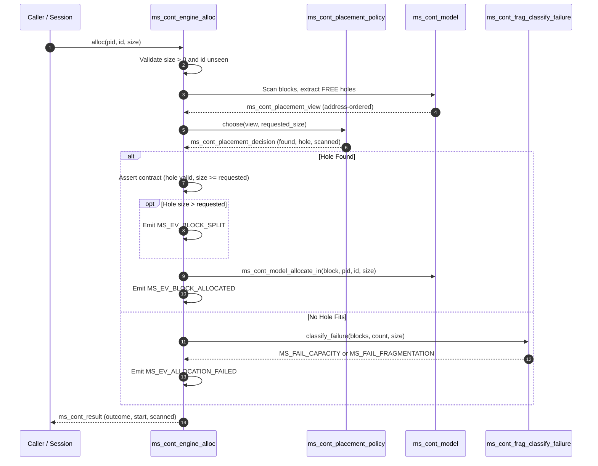

# 12. Placement Algorithms

Contiguous memory allocation requires selecting a free contiguous partition (a "hole") capable of satisfying an incoming allocation request. In MemForge, the contiguous allocation subsystem isolates the hole selection policy from memory state mutation through an explicit architectural separation. This section examines the three placement algorithms implemented in MemForge—First-Fit, Best-Fit, and Worst-Fit—grounded directly in `src/contiguous/policies/first_fit.c`, `src/contiguous/policies/best_fit.c`, and `src/contiguous/policies/worst_fit.c`. It details how the simulation engine dispatches placement requests, defines search cost accounting via scanned hole counts, resolves tie-breaking deterministically, and compares theoretical and observed computational characteristics.

## 12.1 Engine-Policy Invocation Contract

The contiguous execution engine, implemented in `src/contiguous/engine.c`, interacts with placement policies through a strict read-only query contract defined in `src/contiguous/placement.h`. Placement policies are pure decision functions: they inspect an immutable snapshot of free memory partitions and return a placement decision without modifying engine data structures.

When an allocation request is processed by `ms_cont_engine_alloc(ms_cont_engine *e, ms_pid pid, ms_alloc_id id, int64_t size)`:

1. **Input Validation**: The engine verifies that `size > 0` and that `id` has not been previously observed in the simulation (`ms_cont_model_id_state(m, id) == MS_CONT_ID_UNSEEN`). Violations emit `MS_EV_ALLOC_REJECTED` with reason `MS_REJECT_INVALID_SIZE` or `MS_REJECT_DUPLICATE_ID`, and return an error outcome.
2. **View Assembly**: The engine iterates through the memory model's block list (`m->blocks`), which invariant I1 guarantees is strictly sorted in ascending address order. For each block whose state is `MS_BLOCK_FREE`, the engine populates an array of `ms_cont_placement_hole` structures containing `{start, size}` and records the corresponding block index in an auxiliary mapping array `block_of`.
3. **Policy Dispatch**: The engine packages the hole array into an `ms_cont_placement_view` struct (`holes` pointer and `hole_count`) and calls the policy dispatch function `e->policy->choose(&view, size)`.
4. **Decision Interpretation**: The policy returns an `ms_cont_placement_decision` record containing:
   - `found` (`bool`): whether a hole of sufficient size was located.
   - `hole_index` (`size_t`): index of the selected hole within the provided view.
   - `hole` (`ms_cont_placement_hole`): the `{start, size}` descriptor of the chosen partition.
   - `scanned` (`size_t`): number of candidate holes inspected before terminating the search.
5. **Contract Enforcement**: If `found` is true, the engine verifies by contract assertion that `hole_index < view.hole_count`, that `d.hole.size >= size`, and that the model block at `block_of[hole_index]` matches `d.hole.start` and `d.hole.size`. If the selected hole exceeds the requested size, an `MS_EV_BLOCK_SPLIT` event is emitted. The engine then calls `ms_cont_model_allocate_in` to carve out the allocated segment and coalesce remainders, transitioning the allocation ID to `MS_CONT_ID_LIVE`.
6. **Failure Handling**: If `found` is false, the engine delegates to the fragmentation analyzer (`ms_cont_frag_classify_failure`) to determine whether the allocation failed due to total capacity exhaustion or external fragmentation, emitting `MS_EV_ALLOCATION_FAILED` and marking the ID as `MS_CONT_ID_FAILED`.



## 12.2 First-Fit Placement

The First-Fit policy, implemented in `src/contiguous/policies/first_fit.c`, scans the address-ordered sequence of free memory holes from lowest to highest physical address and selects the first hole whose capacity is greater than or equal to the requested size.

```text
Algorithm 1: First-Fit Hole Selection
Input: Memory view view with holes[0 .. hole_count - 1] in ascending address order,
       integer requested_size > 0.
Output: Placement decision result (found, hole_index, hole, scanned).
1: if view is NULL or view.holes is NULL or requested_size <= 0 then
2:     return Decision(found = false, hole_index = 0, hole = {0, 0}, scanned = 0)
3: end if
4: for i = 0 to view.hole_count - 1 do
5:     if view.holes[i].size >= requested_size then
6:         return Decision(found = true, hole_index = i, hole = view.holes[i], scanned = i + 1)
7:     end if
8: end for
9: return Decision(found = false, hole_index = 0, hole = {0, 0}, scanned = view.hole_count)
```

- **Tie-Breaking**: Because holes are presented in strictly ascending address order and iteration terminates upon the very first qualifying hole, tie-breaking is implicitly deterministic and favors the lowest valid physical address.
- **Complexity**:
  - *Time Complexity*: In the best case, the first hole satisfies the request, yielding $O(1)$ comparisons. In the worst case (when no hole fits or only the final hole qualifies), the algorithm inspects all $h$ holes, giving $O(h)$ time, where $h$ is the number of free partitions.
  - *Auxiliary Space*: $O(1)$, executing strictly in-place over the input view.
- **Search Cost Behavior**: The search metric `scanned` records the 1-based index at which search terminated ($i + 1$). First-Fit minimizes search cost under low memory pressure because small, frequently reclaimed allocations near the bottom of memory are quickly reused.

## 12.3 Best-Fit Placement

The Best-Fit policy, implemented in `src/contiguous/policies/best_fit.c`, evaluates every available hole in memory to find the smallest hole that can accommodate the request. The objective is to minimize the size of the residual fragment produced after splitting.

```text
Algorithm 2: Best-Fit Hole Selection
Input: Memory view view with holes[0 .. hole_count - 1] in ascending address order,
       integer requested_size > 0.
Output: Placement decision result (found, hole_index, hole, scanned).
1: if view is NULL or view.holes is NULL or requested_size <= 0 then
2:     return Decision(found = false, hole_index = 0, hole = {0, 0}, scanned = 0)
3: end if
4: best = 0
5: found = false
6: for i = 0 to view.hole_count - 1 do
7:     if view.holes[i].size >= requested_size and (not found or view.holes[i].size < view.holes[best].size) then
8:         best = i
9:         found = true
10:    end if
11: end for
12: if not found then
13:    return Decision(found = false, hole_index = 0, hole = {0, 0}, scanned = view.hole_count)
14: end if
15: return Decision(found = true, hole_index = best, hole = view.holes[best], scanned = view.hole_count)
```

- **Tie-Breaking**: Tie-breaking occurs when two or more candidate holes possess identical capacities. The comparison condition `view.holes[i].size < view.holes[best].size` uses strict inequality. Because the loop iterates in ascending address order, any subsequent hole with identical capacity fails the strict inequality test. Consequently, Best-Fit deterministically selects the lowest-addressed hole among ties.
- **Complexity**:
  - *Time Complexity*: Linear scan $O(h)$ in all cases. Unlike First-Fit, Best-Fit cannot terminate early because a smaller qualifying hole may appear later in the address space.
  - *Auxiliary Space*: $O(1)$ auxiliary storage.
- **Search Cost Behavior**: The `scanned` metric always equals `view.hole_count` whenever `view.hole_count > 0`, reflecting the exhaustive linear inspection demanded by an unsorted hole list.

## 12.4 Worst-Fit Placement

The Worst-Fit policy, implemented in `src/contiguous/policies/worst_fit.c`, searches the entire set of available holes to locate the largest available partition. The underlying theoretical motivation is that allocating from the largest hole leaves behind the largest possible leftover fragment, which may remain large enough to accommodate subsequent allocations.

```text
Algorithm 3: Worst-Fit Hole Selection
Input: Memory view view with holes[0 .. hole_count - 1] in ascending address order,
       integer requested_size > 0.
Output: Placement decision result (found, hole_index, hole, scanned).
1: if view is NULL or view.holes is NULL or requested_size <= 0 then
2:     return Decision(found = false, hole_index = 0, hole = {0, 0}, scanned = 0)
3: end if
4: worst = 0
5: found = false
6: for i = 0 to view.hole_count - 1 do
7:     if view.holes[i].size >= requested_size and (not found or view.holes[i].size > view.holes[worst].size) then
8:         worst = i
9:         found = true
10:    end if
11: end for
12: if not found then
13:    return Decision(found = false, hole_index = 0, hole = {0, 0}, scanned = view.hole_count)
14: end if
15: return Decision(found = true, hole_index = worst, hole = view.holes[worst], scanned = view.hole_count)
```

- **Tie-Breaking**: Similar to Best-Fit, Worst-Fit employs strict inequality (`view.holes[i].size > view.holes[worst].size`). When multiple holes share the same maximal size, the strictly greater check fails for all subsequent duplicates, breaking ties deterministically in favor of the hole with the lowest base address.
- **Complexity**:
  - *Time Complexity*: Linear scan $O(h)$ in all scenarios.
  - *Auxiliary Space*: $O(1)$ auxiliary storage.
- **Search Cost Behavior**: The `scanned` counter is unconditionally set to `view.hole_count` on completion, identical to Best-Fit.

## 12.5 Comparative Analysis and Limitations

The design tradeoffs among the three placement algorithms span search overhead, residual fragment utility, and implementation complexity.

| Policy | Search Criterion | Tie-Break Rule | Early Termination | Scanned Metric | Time Complexity | Auxiliary Space |
| :--- | :--- | :--- | :--- | :--- | :--- | :--- |
| **First-Fit** | First hole with $\text{size} \ge s$ | Lowest address (implicit) | Yes (on first fit) | $1 \le \text{scanned} \le h$ | Best $O(1)$, Worst $O(h)$ | $O(1)$ |
| **Best-Fit** | Smallest hole with $\text{size} \ge s$ | Lowest address (strict $<$)| No (full scan) | Always $h$ | $O(h)$ | $O(1)$ |
| **Worst-Fit** | Largest hole with $\text{size} \ge s$ | Lowest address (strict $>$) | No (full scan) | Always $h$ | $O(h)$ | $O(1)$ |

Table 12.1: Algorithmic comparison of contiguous placement policies in MemForge.

### Architectural Limitations and Exclusions

Several theoretical variations and optimization structures were evaluated during architectural definition (ARCHITECTURE.md Section 8) but deliberately omitted or classified as out of scope:

1. **Next-Fit**: Next-Fit maintains a roving allocation cursor ("rover") that resumes searching from the location of the previous placement. Next-Fit requires maintaining mutable state across allocations, coalescing operations, and compaction passes. In the presence of block shifts during compaction, keeping the rover synchronized introduces substantial edge cases without yielding empirical fragmentation advantages over First-Fit. Next-Fit was excluded from the v1 engine.
2. **Size-Indexed Search Trees**: Best-Fit and Worst-Fit can theoretically be executed in $O(\log h)$ time using self-balancing binary search trees (e.g., AVL or red-black trees) keyed on `(size, start)`. However, MemForge models memory primarily as an educational simulator targeting workloads of hundreds to thousands of partitions. The $O(h)$ array-backed traversal simplifies deterministic event tracing, eliminates heap fragmentation within the simulator, and keeps engine code transparent and auditable.
3. **Buddy System**: Fixed power-of-two partitioning algorithms (Buddy Allocators) prevent external fragmentation through binary splitting and recursive coalescing. However, buddy systems induce internal fragmentation and do not model arbitrary variable-partition contiguous allocation, which is the pedagogical focus of the contiguous subsystem.
