# 13. Fragmentation and Compaction

Contiguous memory allocation is inherently subject to fragmentation. As processes dynamically allocate and release memory partitions of varying sizes, free storage splinters into disconnected intervals. When aggregate free memory across the system is sufficient to satisfy an incoming request, but no individual continuous hole is large enough, an external fragmentation failure occurs. MemForge addresses this through a formal external fragmentation metric, an unambiguous failure classification model, and deterministic compaction algorithms. This section details the fragmentation metrics implemented in `src/contiguous/fragmentation.c`, the failure classification logic, the full sliding and windowed compaction algorithms in `src/contiguous/compaction.c`, their computational costs, and the defensive validation checks enforced by `ms_cont_model_apply_relocations` in `src/contiguous/model.c`.

## 13.1 External Fragmentation Metric and Integer Precision

In operating systems theory, external fragmentation measures the proportion of free memory rendered unusable for a single contiguous allocation. MemForge computes this metric directly from the address-ordered block list in `src/contiguous/fragmentation.c`.

### Mathematical Formulation

Let physical memory of size $M$ be partitioned into an address-ordered sequence of $n$ blocks $B = \langle b_0, b_1, \dots, b_{n-1} \rangle$, where each block $b_i$ has a state $\text{state}(b_i) \in \{\text{FREE}, \text{ALLOCATED}\}$ and a size $s(b_i) > 0$. By invariant I3, adjacent free blocks are coalesced upon deallocation, ensuring each block with state $\text{FREE}$ represents a maximal contiguous hole.

The cumulative free memory $F$ and the maximum single contiguous partition $H_{\max}$ are defined as:

$$F = \sum_{b \in B, \, \text{state}(b) = \text{FREE}} s(b)$$

$$H_{\max} = \max \left( \{0\} \cup \{ s(b) \mid b \in B, \, \text{state}(b) = \text{FREE} \} \right)$$

The external fragmentation metric $E_{\text{frag}}$ is defined as:

$$E_{\text{frag}} = \begin{cases} 1 - \frac{H_{\max}}{F}, & \text{if } F > 0 \\ 0, & \text{if } F = 0 \end{cases}$$

This metric exhibits key analytical properties:
- When all free memory forms a single contiguous partition, $H_{\max} = F$, yielding $E_{\text{frag}} = 0$.
- As free memory is splintered into small pieces, $H_{\max} \ll F$, driving $E_{\text{frag}} \to 1$.
- If no free memory remains ($F = 0$), the metric evaluates to $0$ rather than generating a division-by-zero error.

### Integer Parts-Per-Million (PPM) Precision

To ensure cross-platform reproducibility and guarantee bit-for-bit identical simulation traces across diverse CPU architectures and WebAssembly runtimes, MemForge strictly prohibits floating-point calculations within engine state (ADR-001). Floating-point round-off variances across compiler toolchains could introduce non-deterministic divergences in simulation events.

In `src/contiguous/fragmentation.h`, all fractional quantities are stored as integer parts per million using the constant `MS_PPM` ($1{,}000{,}000$). The helper function `ppm_of` in `src/contiguous/fragmentation.c` calculates $\lfloor \frac{\text{part} \times 10^6}{\text{whole}} \rfloor$ without 64-bit integer overflow:

```c
static uint32_t ppm_of(int64_t part, int64_t whole) {
    uint64_t p = (uint64_t)part;
    uint64_t w = (uint64_t)whole;
    return (uint32_t)(((p / w) * MS_PPM) + (((p % w) * MS_PPM) / w));
}
```

The headline fragmentation value is calculated as:

```c
r.ext_frag_ppm = ppm_of(r.total_free - r.largest_hole, r.total_free);
```

Conversion to `double` via `ms_cont_ppm_to_double` is reserved exclusively for CLI table formatting and trace logging.

### Complementary Metrics

Because $E_{\text{frag}}$ depends only on $H_{\max}$ and $F$, it does not capture the size distribution of the remaining smaller holes. To provide complete visibility, `ms_cont_frag_report_of` and `ms_cont_frag_unusable_free_ppm` also report:
- `total_free`: total unallocated units ($F$).
- `largest_hole`: size of the largest available hole ($H_{\max}$).
- `hole_count`: number of distinct free partitions.
- `unusable_free(s)`: share of free memory residing in holes strictly smaller than reference request size $s$, defined as $\lfloor \frac{\sum_{s(b) < s} s(b)}{F} \times 10^6 \rfloor$ ppm.
- `int_frag`: internal fragmentation, $\sum (\text{size}(b) - \text{requested}(b))$ across allocated blocks.

## 13.2 Allocation Failure Classification

When an allocation request of $g$ units cannot be satisfied, the simulation core classifies the failure to distinguish between genuine capacity exhaustion and spatial fragmentation. The function `ms_cont_frag_classify_failure` in `src/contiguous/fragmentation.c` evaluates the layout:

```c
ms_cont_failure_cause ms_cont_frag_classify_failure(const ms_block *blocks, size_t count, int64_t granted) {
    ms_cont_frag_report r = ms_cont_frag_report_of(blocks, count);
    if (r.largest_hole >= granted) {
        return MS_FAIL_NONE;
    }
    return r.total_free >= granted ? MS_FAIL_FRAGMENTATION : MS_FAIL_CAPACITY;
}
```

| Failure Cause | Condition | Simulation Meaning | Compaction Viability |
| :--- | :--- | :--- | :--- |
| `MS_FAIL_NONE` | $H_{\max} \ge g$ | The request fits an available hole; caller contract violation if raised during failure handling. | Not applicable |
| `MS_FAIL_CAPACITY` | $F < g$ | Total unallocated memory in the system is strictly less than the requested size. Physical exhaustion. | Ineffective: compaction cannot create unallocated units. |
| `MS_FAIL_FRAGMENTATION` | $F \ge g \land H_{\max} < g$ | Aggregate free memory is sufficient, but distributed across disconnected holes smaller than $g$. | Resolvable: compacting free space consolidates memory into a single hole $\ge g$. |

Table 13.1: Failure cause classification logic in MemForge.

## 13.3 Compaction Algorithms

Compaction relocates live allocated partitions toward one boundary of the address space, consolidating scattered holes into a unified contiguous block. MemForge implements two distinct compaction algorithms in `src/contiguous/compaction.c`: full sliding compaction and windowed ("just-enough") compaction.

```mermaid
flowchart TD
  subgraph Sliding["Sliding Compaction (v1 Core)"]
    S1["Cursor = 0"] --> S2["Iterate blocks in address order"]
    S2 --> S3{"ALLOCATED?"}
    S3 -- No --> S2
    S3 -- Yes --> S4{"start != cursor?"}
    S4 -- Yes --> S5["Emit move: src = start, dst = cursor"]
    S4 -- No --> S6["Cursor advances: cursor += size"]
    S5 --> S6
    S6 --> S7{"Done?"}
    S7 -- No --> S2
    S7 -- Yes --> S8["All free memory coalesced at top; ext_frag = 0"]
  end

  subgraph Windowed["Windowed Compaction (Variant)"]
    W1["Search all runs [first, last]"] --> W2{"Free units in run >= need?"}
    W2 -- Yes --> W3["Select run minimizing units moved, then blocks moved"]
    W3 --> W4["Pack only blocks inside window down to window start"]
    W4 --> W5["Hole >= need formed at run end; outside blocks untouched"]
  end
```



### Full Sliding Compaction

The primary strategy utilized by MemForge is sliding compaction, implemented in `ms_cont_compaction_plan_sliding`. Sliding compaction shifts all allocated blocks toward address zero while preserving their relative spatial order.

```text
Algorithm 1: Sliding Compaction Planning
Input: Array of blocks blocks[0 .. count - 1] in ascending address order.
Output: Array of relocation moves out, integer move_count.
1: n = 0
2: cursor = 0
3: for i = 0 to count - 1 do
4:     b = blocks[i]
5:     if b.state != MS_BLOCK_ALLOCATED then
6:         continue
7:     end if
8:     if b.start != cursor then
9:         out[n] = Move(alloc_id = b.alloc_id, src = b.start, dst = cursor)
10:        n = n + 1
11:    end if
12:    cursor = cursor + b.size
13: end for
14: return n
```

- **Order Preservation and In-Place Safety**: Because blocks are processed strictly in ascending address order and every relocated block moves downward ($\text{dst} \le \text{src}$), executing moves in the returned order guarantees that a destination range never overwrites an allocated block that has not yet been relocated.
- **Outcome**: All live blocks occupy the contiguous range $[0, \sum s(b_{\text{alloc}}))$, and all free memory coalesces into a single maximal hole at $[\sum s(b_{\text{alloc}}), M)$. Following sliding compaction, $E_{\text{frag}}$ is strictly $0.000$.
- **Complexity**: Time complexity is $O(n)$, performing a single linear pass over the block array. Auxiliary space is $O(n)$ to store at most $n$ relocation records.

### Windowed ("Just-Enough") Compaction

In large address spaces, sliding every live block imposes high data-copying overhead. MemForge implements a windowed compaction strategy in `ms_cont_compaction_plan_window` that identifies the minimal, lowest-cost contiguous sub-sequence of blocks that can yield a hole of size `need`.

```text
Algorithm 2: Windowed Compaction Planning
Input: Array of blocks blocks[0 .. count - 1], integer need > 0.
Output: Array of relocation moves out, integer move_count.
1: for i = 0 to count - 1 do
2:     if blocks[i].state == MS_BLOCK_FREE and blocks[i].size >= need then
3:         return 0
4:     end if
5: end for
6: found = false; best_first = 0; best_last = 0; best_units = infinity; best_blocks = infinity
7: for first = 0 to count - 1 do
8:     free_units = 0; units = 0; cursor = blocks[first].start; moved = 0
9:     for last = first to count - 1 do
10:        b = blocks[last]
11:        if b.state == MS_BLOCK_FREE then
12:            free_units = free_units + b.size
13:        else
14:            if b.start != cursor then
15:                units = units + b.size; moved = moved + 1
16:            end if
17:            cursor = cursor + b.size
18:        end if
19:        if found and (units > best_units or (units == best_units and moved >= best_blocks)) then
20:            break
21:        end if
22:        if free_units >= need then
23:            found = true; best_first = first; best_last = last
24:            best_units = units; best_blocks = moved
25:            break
26:        end if
27:    end for
28: end for
29: if found then
30:    return pack_run(blocks, best_first, best_last, out)
31: else
32:    return 0
33: end if
```

- **Selection Hierarchy**: Candidate windows that yield $\text{free\_units} \ge \text{need}$ are prioritized by:
  1. Fewest memory units moved (`best_units`).
  2. Fewest blocks moved (`best_blocks`).
  3. Lowest starting address (`first`).
- **Complexity**: Time complexity is $O(n^2)$ worst-case over nested window bounds, with early pruning when running unit costs exceed the current best. Auxiliary space is $O(n)$ for move outputs.

## 13.4 Cost Accounting: Blocks and Units Moved

Real-world compaction costs are dominated by memory bus bandwidth and processor cache invalidation during data copying. Because wall-clock timing is non-deterministic and sensitive to platform background noise, MemForge quantifies compaction cost through two deterministic, hardware-agnostic metrics defined in `ms_cont_compaction_cost`:

$$\text{blocks\_moved} = \sum_{k=0}^{m-1} 1 \quad (\text{for moves where } \text{src}_k \ne \text{dst}_k)$$

$$\text{units\_moved} = \sum_{k=0}^{m-1} s(b_k)$$

The function `ms_cont_compaction_cost_of` in `src/contiguous/compaction.c` looks up each moved allocation ID in the block list and accumulates its granted size. This deterministic cost model enables exact empirical comparison between compaction algorithms across different architectural topologies.

## 13.5 Relocation Application and Model Invariants

Planning a compaction produces an advisory list of moves. To preserve kernel safety, the memory model refuses to apply relocations blindly. In `src/contiguous/model.c`, `ms_cont_model_apply_relocations` enforces four strict defensive contract checks before mutating state:

```c
void ms_cont_model_apply_relocations(ms_cont_model *m, const ms_cont_move *moves, size_t n) {
    for (size_t k = 0; k < n; k++) {
        size_t i = ms_cont_model_find(m, moves[k].alloc_id);
        contract(i < m->count && m->blocks[i].start == moves[k].src);
        contract(k == 0 || moves[k].src > moves[k - 1].src);
    }
    size_t cap = 2 * m->count + 1;
    ms_block *out = malloc(cap * sizeof *out);
    contract(out != NULL);
    m->count = ms_cont_compaction_preview(m->blocks, m->count, moves, n, out);
    free(m->blocks);
    m->blocks = out;
    m->cap = cap;
}
```

1. **Existence Verification**: `ms_cont_model_find` confirms that every `alloc_id` in the move list corresponds to an active allocated block within the model (`i < m->count`).
2. **Source Address Consistency**: The source address specified in the plan (`moves[k].src`) must match the actual live starting address of the block (`m->blocks[i].start`).
3. **Monotonic Ordering**: Moves must appear in strictly ascending source address order (`moves[k].src > moves[k - 1].src`), preventing circular shifts and out-of-order data corruption.
4. **Coalesced Reconstruction**: Rather than shifting array elements in-place, the model executes `ms_cont_compaction_preview`, which reconstructs the layout into a clean output buffer with newly synthesized and coalesced `MS_BLOCK_FREE` records, before atomically replacing `m->blocks`.

Following compaction, the engine emits one `MS_EV_BLOCK_RELOCATED` event for each moved block, bookended by `MS_EV_COMPACTION_STARTED` and `MS_EV_COMPACTION_COMPLETED` (ADR-011). Compaction is never silent.

### Architectural Limitations

- **Hardware Relocation Absence**: Physical operating systems rely on hardware Memory Management Units (MMUs) or base/limit relocation registers to adjust program addresses transparently during compaction. In MemForge, processes access allocations through logical IDs; relocation updates internal block offsets while logical IDs remain stable.
- **Triggering Scope**: In MemForge v1, compaction is triggered exclusively through an explicit `compact` operation. Automatic triggers evaluated during research—such as automatic compaction upon fragmentation failure (`on_failure`) or background compaction when $E_{\text{frag}}$ crosses a defined threshold (`threshold`)—were deferred to avoid non-deterministic policy couplings in standard workload evaluation.
