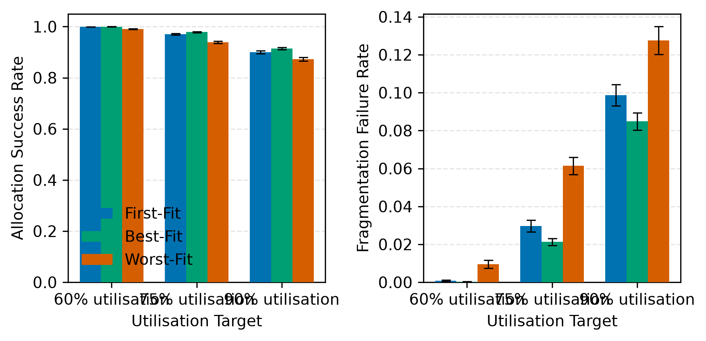
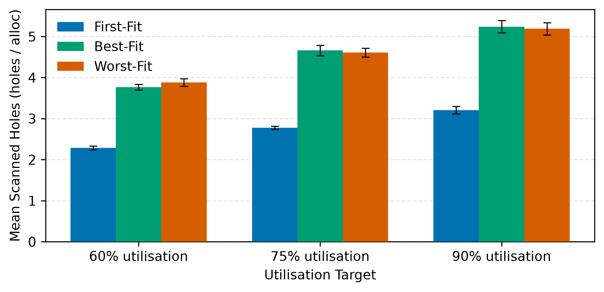

# 14. Memory Allocation Examples and Results

This section presents the empirical validation and comparative evaluation of MemForge's contiguous memory allocation subsystem. It begins with an exhaustive, step-by-step trace of the classic Silberschatz five-holes benchmark (Acceptance Criterion AC-1) across First-Fit, Best-Fit, and Worst-Fit, illustrating why First-Fit and Worst-Fit experience external fragmentation failures on an allocation of 426 units while Best-Fit succeeds. Next, it demonstrates contiguous compaction and allocation retry (Acceptance Criterion AC-2), where full sliding compaction relocates 7 blocks and 781 units to create a unified free hole, permitting the failed 426-unit request to succeed and leaving a final free hole of 533 units at `[1207, 1740)`. Finally, it presents and analyzes the results of Experiment E1 (from `docs/report/tables/e1_summary.md` and associated figures), evaluating allocation success rates, external fragmentation, and search costs across memory pressure regimes.

## 14.1 The Silberschatz Five-Holes Benchmark (AC-1)

To evaluate placement policies against an established baseline from operating systems literature (Silberschatz et al., *Operating System Concepts*), MemForge implements the five-partition benchmark specified in `tests/fixtures/ac1_silberschatz.wl`.

### Initial Configuration

Total memory capacity is $M = 1740$ units. To initialize five distinct holes separated by allocated barriers without introducing policy bias during setup, the workload allocates nine partitions under process `SYS` and subsequently deallocates the five hole partitions in ascending address order:
- `alloc SYS h1 100` $\to [0, 100)$
- `alloc SYS s1 10`  $\to [100, 110)$
- `alloc SYS h2 500` $\to [110, 610)$
- `alloc SYS s2 10`  $\to [610, 620)$
- `alloc SYS h3 200` $\to [620, 820)$
- `alloc SYS s3 10`  $\to [820, 830)$
- `alloc SYS h4 300` $\to [830, 1130)$
- `alloc SYS s4 10`  $\to [1130, 1140)$
- `alloc SYS h5 600` $\to [1140, 1740)$

Deallocating `h1`, `h2`, `h3`, `h4`, and `h5` yields five initial free holes separated by four 10-unit system allocations:
- Hole 0: $[0, 100)$, $\text{size} = 100$
- System Block `s1`: $[100, 110)$, $\text{size} = 10$
- Hole 1: $[110, 610)$, $\text{size} = 500$
- System Block `s2`: $[610, 620)$, $\text{size} = 10$
- Hole 2: $[620, 820)$, $\text{size} = 200$
- System Block `s3`: $[820, 830)$, $\text{size} = 10$
- Hole 3: $[830, 1130)$, $\text{size} = 300$
- System Block `s4`: $[1130, 1140)$, $\text{size} = 10$
- Hole 4: $[1140, 1740)$, $\text{size} = 600$

Initial state: cumulative free memory $F = 100 + 500 + 200 + 300 + 600 = 1700$ units; allocated memory = $40$ units; largest hole $H_{\max} = 600$; initial external fragmentation $E_{\text{frag}} = 1 - 600/1700 \approx 0.647058$.

Four allocation requests arrive in sequence:
1. $a_1$: size 212, process `P1`
2. $a_2$: size 417, process `P2`
3. $a_3$: size 112, process `P3`
4. $a_4$: size 426, process `P4`

### First-Fit Execution Trace

1. **Request $a_1$ (size 212)**:
   - Scans Hole 0 ($[0, 100)$, size 100): does not fit ($100 < 212$).
   - Scans Hole 1 ($[110, 610)$, size 500): fits ($500 \ge 212$).
   - Placed at **start 110**, occupying $[110, 322)$. Remainder hole $[322, 610)$ has size $288$.
   - Holes scanned = 2.
2. **Request $a_2$ (size 417)**:
   - Scans Hole 0 ($[0, 100)$, size 100): does not fit.
   - Scans Hole 1 ($[322, 610)$, size 288): does not fit ($288 < 417$).
   - Scans Hole 2 ($[620, 820)$, size 200): does not fit ($200 < 417$).
   - Scans Hole 3 ($[830, 1130)$, size 300): does not fit ($300 < 417$).
   - Scans Hole 4 ($[1140, 1740)$, size 600): fits ($600 \ge 417$).
   - Placed at **start 1140**, occupying $[1140, 1557)$. Remainder hole $[1557, 1740)$ has size $183$.
   - Holes scanned = 5.
3. **Request $a_3$ (size 112)**:
   - Scans Hole 0 ($[0, 100)$, size 100): does not fit ($100 < 112$).
   - Scans Hole 1 ($[322, 610)$, size 288): fits ($288 \ge 112$).
   - Placed at **start 322**, occupying $[322, 434)$. Remainder hole $[434, 610)$ has size $176$.
   - Holes scanned = 2.
4. **Request $a_4$ (size 426)**:
   - Evaluates remaining holes: $[0, 100)$ (100), $[434, 610)$ (176), $[620, 820)$ (200), $[830, 1130)$ (300), and $[1557, 1740)$ (183).
   - Largest available hole is $[830, 1130)$ with size $300 < 426$.
   - Cumulative free memory: $100 + 176 + 200 + 300 + 183 = 959$ units.
   - Because $F = 959 \ge 426$ but $H_{\max} = 300 < 426$, the engine classifies the failure as `MS_FAIL_FRAGMENTATION`.
   - Result: **fail FRAGMENTATION**. Holes scanned = 5.

### Best-Fit Execution Trace

1. **Request $a_1$ (size 212)**:
   - Scans all 5 holes (sizes 100, 500, 200, 300, 600). Qualifying holes: 500, 300, 600.
   - Smallest qualifying hole is Hole 3 ($[830, 1130)$, size 300).
   - Placed at **start 830**, occupying $[830, 1042)$. Remainder hole $[1042, 1130)$ has size $88$.
   - Holes scanned = 5.
2. **Request $a_2$ (size 417)**:
   - Evaluates holes: 100, 500, 200, 88, 600. Qualifying holes: 500, 600.
   - Smallest qualifying hole is Hole 1 ($[110, 610)$, size 500).
   - Placed at **start 110**, occupying $[110, 527)$. Remainder hole $[527, 610)$ has size $83$.
   - Holes scanned = 5.
3. **Request $a_3$ (size 112)**:
   - Evaluates holes: 100, 83, 200, 88, 600. Qualifying holes: 200, 600.
   - Smallest qualifying hole is Hole 2 ($[620, 820)$, size 200).
   - Placed at **start 620**, occupying $[620, 732)$. Remainder hole $[732, 820)$ has size $88$.
   - Holes scanned = 5.
4. **Request $a_4$ (size 426)**:
   - Evaluates holes: 100, 83, 88, 88, 600.
   - Only Hole 4 ($[1140, 1740)$, size 600) satisfies $600 \ge 426$.
   - Placed at **start 1140**, occupying $[1140, 1566)$. Remainder hole $[1566, 1740)$ has size $174$.
   - Result: **Placed at start 1140**. All four allocations succeed.
   - Holes scanned = 5.

### Worst-Fit Execution Trace

1. **Request $a_1$ (size 212)**:
   - Scans all 5 holes. Largest hole is Hole 4 ($[1140, 1740)$, size 600).
   - Placed at **start 1140**, occupying $[1140, 1352)$. Remainder hole $[1352, 1740)$ has size $388$.
   - Holes scanned = 5.
2. **Request $a_2$ (size 417)**:
   - Evaluates holes: 100, 500, 200, 300, 388.
   - Largest hole is Hole 1 ($[110, 610)$, size 500).
   - Placed at **start 110**, occupying $[110, 527)$. Remainder hole $[527, 610)$ has size $83$.
   - Holes scanned = 5.
3. **Request $a_3$ (size 112)**:
   - Evaluates holes: 100, 83, 200, 300, 388.
   - Largest hole is Hole 4's remainder ($[1352, 1740)$, size 388).
   - Placed at **start 1352**, occupying $[1352, 1464)$. Remainder hole $[1464, 1740)$ has size $276$.
   - Holes scanned = 5.
4. **Request $a_4$ (size 426)**:
   - Evaluates remaining holes: $[0, 100)$ (100), $[527, 610)$ (83), $[620, 820)$ (200), $[830, 1130)$ (300), and $[1464, 1740)$ (276).
   - Largest hole is Hole 3 with size $300 < 426$.
   - Total free memory: $100 + 83 + 200 + 300 + 276 = 959$ units.
   - Result: **fail FRAGMENTATION**. Holes scanned = 5.

```text
Memory Layout Progression (AC-1 Benchmark, Capacity 1740):

1. Setup Complete (Five Holes):
[  H0: 100  ][s1:10][      H1: 500      ][s2:10][  H2: 200  ][s3:10][    H3: 300    ][s4:10][        H4: 600        ]
0          100    110                  610    620          820    830             1130   1140                       1740

2. First-Fit Final Layout (After a1, a2, a3; a4 fails):
[  H0: 100  ][s1][ a1: 212 ][ a3: 112 ][ H1:176 ][s2][  H2: 200  ][s3][    H3: 300    ][s4][ a2: 417 ][ H4: 183 ]
0          100 110        322         434       610 620          820 830             1130 1140     1557      1740

3. Best-Fit Final Layout (All four requests placed successfully):
[  H0: 100  ][s1][ a2: 417 ][ H1: 83 ][s2][ a3: 112 ][ H2: 88 ][s3][ a1: 212 ][ H3: 88 ][s4][ a4: 426 ][ H4: 174 ]
0          100 110        527        610 620        732        820 830        1042     1130 1140     1566      1740

4. Worst-Fit Final Layout (After a1, a2, a3; a4 fails):
[  H0: 100  ][s1][ a2: 417 ][ H1: 83 ][s2][  H2: 200  ][s3][    H3: 300    ][s4][ a1: 212 ][ a3: 112 ][ H4: 276 ]
0          100 110        527        610 620          820 830             1130 1140     1352       1464      1740
```

| Request ID | Size | First-Fit Placement | Best-Fit Placement | Worst-Fit Placement |
| :--- | :--- | :--- | :--- | :--- |
| `a1` | 212 | Start 110 (Hole 1) | Start 830 (Hole 3) | Start 1140 (Hole 4) |
| `a2` | 417 | Start 1140 (Hole 4) | Start 110 (Hole 1) | Start 110 (Hole 1) |
| `a3` | 112 | Start 322 (Hole 1 remainder) | Start 620 (Hole 2) | Start 1352 (Hole 4 remainder) |
| `a4` | 426 | **fail FRAGMENTATION** | Start 1140 (Hole 4) | **fail FRAGMENTATION** |

Table 14.1: Comparative placement outcomes for the Silberschatz five-holes benchmark (AC-1 verification).

As recorded in `docs/report/tables/cli_examples.md`, the aggregate metrics following the benchmark confirm the theoretical behavior: First-Fit required 23 total hole inspections (mean $1.769$ holes/request), whereas Best-Fit and Worst-Fit each required 29 inspections (mean $2.231$ holes/request). Best-Fit utilized 1207 units with 533 units free, whereas First-Fit and Worst-Fit left 781 units used and 959 units free due to rejecting `a4`.

## 14.2 Compaction and Allocation Retry (AC-2)

The AC-2 scenario (`tests/fixtures/ac2_compact.wl`) continues directly from the First-Fit fragmentation failure on request $a_4$. At the point of failure, memory contains seven live allocated blocks:

| Block ID | Owner PID | Start Address | Size (units) |
| :--- | :--- | :--- | :--- |
| `s1` | `SYS` | 100 | 10 |
| `a1` | `P1` | 110 | 212 |
| `a3` | `P3` | 322 | 112 |
| `s2` | `SYS` | 610 | 10 |
| `s3` | `SYS` | 820 | 10 |
| `s4` | `SYS` | 1130 | 10 |
| `a2` | `P2` | 1140 | 417 |

Table 14.2: Live allocated partitions prior to compaction in AC-2.

The cumulative size of live allocations is $10 + 212 + 112 + 10 + 10 + 10 + 417 = 781$ units. Cumulative free space is $1740 - 781 = 959$ units, distributed across five non-adjacent holes ($E_{\text{frag}} = 0.687174$).

### Sliding Execution and Cost

Upon invoking the `compact` operation, the engine executes `ms_cont_compaction_plan_sliding`:
1. `s1` relocates from $100 \to 0$ (distance 100).
2. `a1` relocates from $110 \to 10$ (distance 100).
3. `a3` relocates from $322 \to 222$ (distance 100).
4. `s2` relocates from $610 \to 334$ (distance 276).
5. `s3` relocates from $820 \to 344$ (distance 476).
6. `s4` relocates from $1130 \to 354$ (distance 776).
7. `a2` relocates from $1140 \to 364$ (distance 776).

All **7 blocks** are relocated. The total memory volume copied is **781 units moved**, exactly matching the cumulative size of all live blocks.

```text
Post-Compaction Layout (AC-2):
[s1][  a1: 212  ][ a3: 112 ][s2][s3][s4][     a2: 417     ][              Consolidated Free Hole: 959              ]
0  10          222        334 344 354 364                781                                                       1740

Post-Retry Layout (Allocation a4-retry of 426 units succeeds):
[s1][  a1: 212  ][ a3: 112 ][s2][s3][s4][     a2: 417     ][   a4-retry: 426   ][       Remaining Free Hole: 533       ]
0  10          222        334 344 354 364                781                 1207                                     1740
```

### Allocation Retry

Following compaction, all free space coalesces into a single maximal hole spanning $[781, 1740)$ with size $959$. External fragmentation drops instantaneously to $E_{\text{frag}} = 0.000$.

The deferred request is then retried as `alloc P4 a4-retry 426`. Under First-Fit, the single available hole $[781, 1740)$ is immediately selected. The request is placed at **start address 781**, occupying $[781, 1207)$. The remaining unallocated partition forms a single terminal free hole spanning **$[1207, 1740)$ of size 533 units**, matching the acceptance criterion verified in `docs/report/tables/verification.md`.

## 14.3 Empirical Evaluation: Experiment E1

Experiment E1 (`scripts/experiments/e1_placement.sh`) systematically evaluates First-Fit, Best-Fit, and Worst-Fit across simulated dynamic execution regimes under variable memory pressure.

### Experimental Methodology

The experiment generates 30 distinct synthetic workloads with 3000 operations each using a memory capacity of $M = 1024$ units. Allocation sizes are drawn uniformly from $[16, 128]$ units with an allocation probability $p_{\text{alloc}} = 0.60$. Memory pressure is sustained by regulating target utilization levels: low ($60\%$), medium ($75\%$), and high ($90\%$). Ten independent pseudo-random seeds are evaluated per target-policy configuration, and metrics are computed with $95\%$ confidence intervals across seeds (FR-W4).

| Utilisation Target | Placement Policy | Success Rate | Fragmentation Failures | Holes Scanned | Mean External Frag. |
| :--- | :--- | :--- | :--- | :--- | :--- |
| **60%** | First-Fit | $99.9\% \pm 0.0$ | $1.2 \pm 0.7$ | $2.29 \pm 0.05$ | $0.359 \pm 0.007$ |
| **60%** | Best-Fit | $100.0\% \pm 0.0$ | $0.3 \pm 0.3$ | $3.77 \pm 0.07$ | $0.322 \pm 0.006$ |
| **60%** | Worst-Fit | $99.0\% \pm 0.2$ | $14.3 \pm 3.1$ | $3.88 \pm 0.09$ | $0.546 \pm 0.014$ |
| **75%** | First-Fit | $97.0\% \pm 0.3$ | $44.6 \pm 4.7$ | $2.78 \pm 0.04$ | $0.460 \pm 0.013$ |
| **75%** | Best-Fit | $97.9\% \pm 0.2$ | $32.0 \pm 2.8$ | $4.66 \pm 0.13$ | $0.419 \pm 0.012$ |
| **75%** | Worst-Fit | $93.9\% \pm 0.5$ | $92.4 \pm 6.8$ | $4.61 \pm 0.11$ | $0.597 \pm 0.010$ |
| **90%** | First-Fit | $90.0\% \pm 0.6$ | $148.6 \pm 8.6$ | $3.21 \pm 0.09$ | $0.516 \pm 0.014$ |
| **90%** | Best-Fit | $91.4\% \pm 0.4$ | $127.7 \pm 7.0$ | $5.24 \pm 0.15$ | $0.473 \pm 0.006$ |
| **90%** | Worst-Fit | $87.2\% \pm 0.7$ | $192.0 \pm 11.1$ | $5.19 \pm 0.15$ | $0.629 \pm 0.010$ |

Table 14.3: Summary of Experiment E1 placement policy metrics across memory pressure targets (mean $\pm 95\%$ confidence interval over 10 seeds, git commit 53039c8).

### Results Analysis and Interpretation



Figure 14.1: Allocation success rate and fragmentation failure rate under varying memory utilization targets (Experiment E1).



Figure 14.2: Mean candidate holes scanned per allocation request across placement policies (Experiment E1).

The empirical data reveals distinct operational characteristics for each policy:

1. **Best-Fit Minimizes Fragmentation**: Best-Fit consistently attains the highest allocation success rate ($100.0\%$ at $60\%$ utilization, $97.9\%$ at $75\%$, and $91.4\%$ at $90\%$) and the lowest mean external fragmentation ($0.322$, $0.419$, and $0.473$, respectively). By matching requests to the smallest viable partition, Best-Fit preserves large holes for subsequent high-volume requests. However, this comes at the cost of producing small residual slivers that can accumulate if deallocations do not coalesce them.
2. **Pathological Degradation of Worst-Fit**: Worst-Fit exhibits the lowest success rates ($99.0\%$ at $60\%$, $93.9\%$ at $75\%$, and $87.2\%$ at $90\%$) and the highest external fragmentation ($0.546$, $0.597$, and $0.629$). By systematically partitioning the largest available hole, Worst-Fit rapidly eliminates large contiguous spaces, converting them into medium-sized fragments. Under heavy pressure ($90\%$), Worst-Fit experiences $192.0$ fragmentation failures per run, compared to $127.7$ for Best-Fit.
3. **First-Fit as an Optimal Practical Compromise**: First-Fit delivers allocation success rates within $0.9\%$ to $1.4\%$ of Best-Fit across all regimes ($99.9\%$, $97.0\%$, and $90.0\%$), but dramatically reduces search overhead. As shown in Figure 14.2, First-Fit inspects an average of $2.29$ holes at $60\%$ utilization, $2.78$ at $75\%$, and $3.21$ at $90\%$. In contrast, Best-Fit and Worst-Fit must exhaustively scan all available holes ($3.77$ to $5.24$ holes per request), representing an increase in search operations of $40\%$ to $68\%$. Because First-Fit reuses low-addressed holes, it maintains lower algorithmic overhead while sustaining competitive spatial efficiency.

## 14.4 Interactive Demonstration in the Web Environment

In addition to headless CLI execution, MemForge's contiguous simulation engine compiles to WebAssembly (`web/wasm/memsim_web.c`), executing within an interactive web application (`web/src/routes/Contiguous.svelte`). The web interface permits real-time step-by-step stepping through the AC-1 Silberschatz benchmark, dynamic manual block allocation, deallocation via block clicking, and visualization of post-compaction memory strips.


Figure 14.3: Interactive MemForge web interface displaying side-by-side contiguous placement policy comparison and live fragmentation telemetry.
