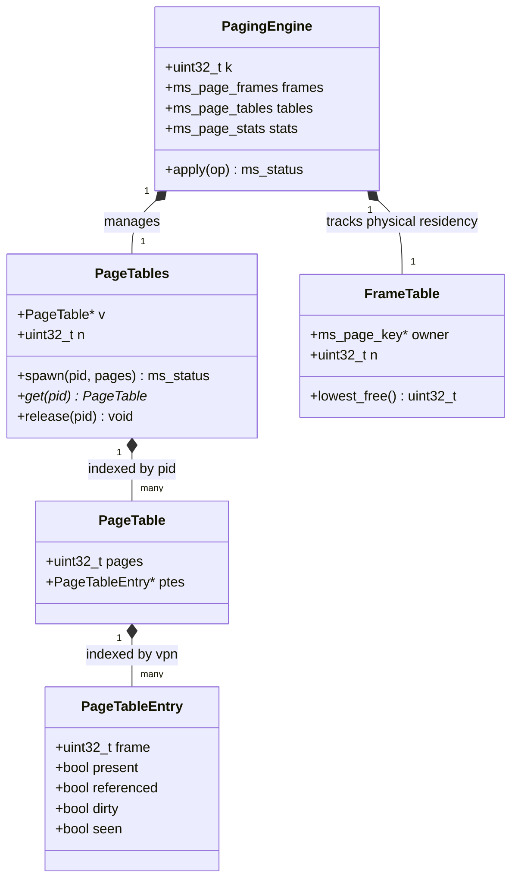
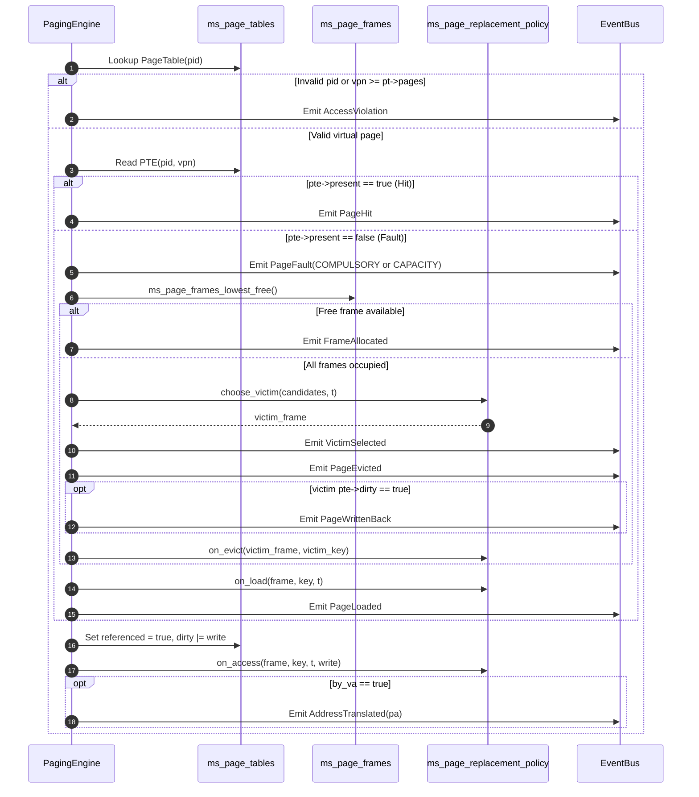
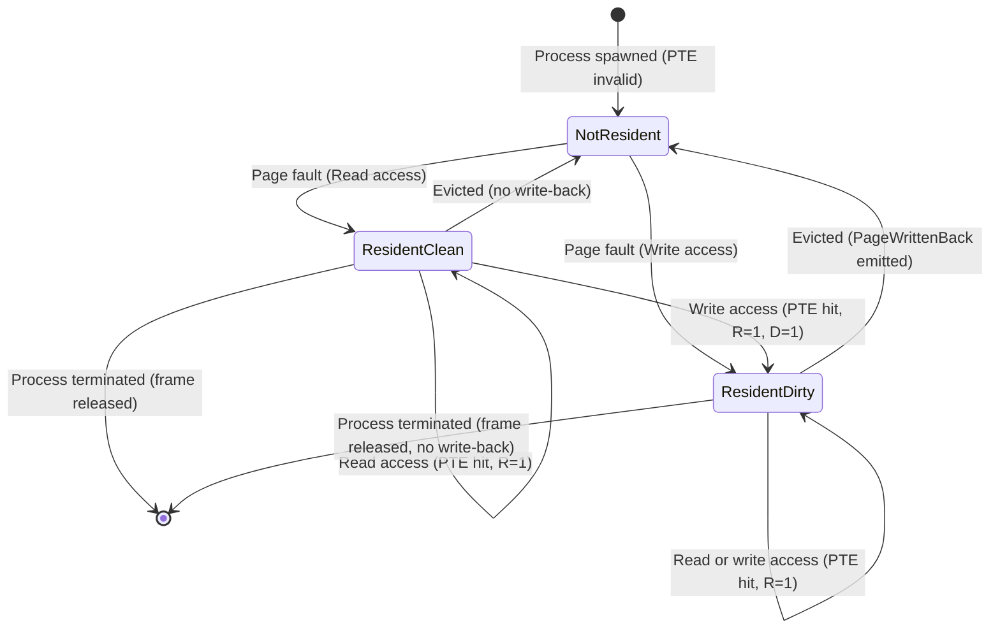

# 15. Paging and Address Translation

The paging subsystem in MemForge simulates virtual memory management with fixed-size page frames and per-process page tables. It implements address translation, page fault handling, frame allocation, page eviction with dirty page write-back, and access violation detection. The subsystem is structured into modular components: an MMU translation layer (`src/paging/mmu.c`, `src/paging/mmu.h`), per-process page tables (`src/paging/tables.c`, `src/paging/tables.h`), an inverted frame table (`src/paging/frames.c`, `src/paging/frames.h`), and the core execution engine (`src/paging/engine.c`, `src/paging/include/memsim/paging/engine.h`).

## 15.1 Architectural Data Structures

The memory hierarchy couples per-process forward page tables with a centralized inverted frame table to achieve $O(1)$ address lookup and $O(1)$ page eviction.



### Page Tables and Entry Layout

Each live process owns a single-level page table represented by `ms_page_table` in `src/paging/tables.h`. The structure contains the virtual address space limit `pages` and a dynamically allocated array `ptes` of `ms_page_pte` structs. When a process spawns via `ms_page_tables_spawn`, memory for `pages` entries is allocated and cleared.

Each page table entry (`ms_page_pte`) contains five fields:
1. `frame` (`uint32_t`): The physical frame index backing this virtual page. If the page is not resident (`present == false`), `frame` is assigned the sentinel value `MS_NONE` (`UINT32_MAX`).
2. `present` (`bool`): Indicates whether the page is currently loaded into physical memory.
3. `referenced` (`bool`, the $R$ bit): Set to `true` upon any read or write access to the page.
4. `dirty` (`bool`, the $D$ bit): Set to `true` when a write operation mutates the page. It indicates that physical memory contents have diverged from secondary storage.
5. `seen` (`bool`): Set to `true` upon the first reference to the page. This field allows MemForge to classify faults deterministically: if `seen` was `false`, the fault is `MS_FAULT_COMPULSORY` (cold start); if `seen` was `true`, the fault is `MS_FAULT_CAPACITY` (evicted earlier due to memory pressure).

### Inverted Frame Table and Free Allocation

Physical memory is partitioned into $F$ contiguous frames of size `page_size`. Physical memory ownership is tracked by `ms_page_frames` in `src/paging/frames.h`. The `owner` array maps each physical frame index $f \in [0, F-1]$ to a composite `ms_page_key` consisting of `{ms_pid pid, uint32_t vpn}`.

When a frame is unassigned, its `pid` field is set to `MS_NONE`. To maintain deterministic behavior, free frames are allocated in strictly ascending order: `ms_page_frames_lowest_free` performs a linear scan over the frame table and returns the lowest index $f$ whose owner `pid` is `MS_NONE`. If all $F$ frames are occupied, an eviction policy must select a victim frame.

## 15.2 Address Translation Formulation

MemForge enforces power-of-two page sizes. Virtual addresses are translated into physical addresses using bitwise shift and mask operations computed by `src/paging/mmu.c` and `src/paging/mmu.h`.

Given a configured page size $S$, the offset bit-width $k$ is calculated as:
$$k = \log_2(S)$$
The function `ms_page_offset_bits` verifies that $S > 0$ and $S \ \& \ (S - 1) == 0$. For a 64-bit virtual address $va$, the virtual page number ($vpn$) and byte offset are derived as:
$$vpn = \lfloor va / S \rfloor = va \gg k$$
$$\text{offset} = va \bmod S = va \ \& \ ((1 \ll k) - 1)$$
When the PTE indicates residency in frame $f$, the 64-bit physical address $pa$ is computed as:
$$pa = (f \cdot S) + \text{offset} = (f \ll k) \mid \text{offset}$$

For example, given $S = 4096$ ($k = 12$) and virtual address $va = 6700$ (`0x1A2C`), the MMU computes $vpn = 6700 \gg 12 = 1$ and $\text{offset} = 6700 \ \& \ 0\text{xFFF} = 2604$ (`0xA2C`). If $vpn = 1$ is resident in physical frame $f = 5$, the resulting physical address is $pa = (5 \ll 12) \mid 2604 = 23084$ (`0x5A2C`).

Workload traces may also issue memory references directly in virtual page space (`by_va = false`). In such cases, the reference specifies $vpn$ directly, $\text{offset}$ is treated as 0, and the resulting physical address evaluates to $f \ll k$.

## 15.3 Translation and Memory Access Execution Path

Memory references are evaluated by `access()` in `src/paging/engine.c`. The execution path follows a six-stage pipeline: validation, residency testing, frame resolution (allocation or eviction), page loading, reference bit update, and address translation.



### Stage 1: Validation
The engine checks whether `pid` corresponds to an active process (`ms_page_tables_get` returns non-null) and whether $vpn < \text{pages}$. If either check fails, the engine emits an `MS_EV_ACCESS_VIOLATION` event with reason `MS_VIOLATION_NO_SUCH_PROCESS` or `MS_VIOLATION_OUT_OF_RANGE`. The operation terminates immediately. The page tables, frame table, and statistics (`refs`, `hits`, `faults`) remain unmodified.

### Stage 2: Hit or Fault Classification
If validation succeeds, `stats.refs` increments. The engine inspects `pte->present`:
- **Hit**: The page resides in physical memory. The engine emits `MS_EV_PAGE_HIT` and increments `stats.hits`.
- **Fault**: The page is absent. The engine increments `stats.faults`, sets `out->fault = true`, and emits `MS_EV_PAGE_FAULT`. If `pte->seen` is `false`, the fault kind is `MS_FAULT_COMPULSORY`; otherwise it is `MS_FAULT_CAPACITY`. The engine then sets `pte->seen = true`.

### Stage 3: Frame Allocation or Victim Eviction
Under a fault, the engine secures a target physical frame:
1. **Free Frame**: If `ms_page_frames_lowest_free` finds an unused frame $f$, the engine emits `MS_EV_FRAME_ALLOCATED` and increments the pool counter `pool_takes`.
2. **Victim Selection**: If all frames are occupied, the active replacement policy's `choose_victim` callback selects frame $f$ from the resident candidates. The engine emits `MS_EV_VICTIM_SELECTED`.

### Stage 4: Write-Back and Victim Invalidation
If a victim frame $f$ is chosen, `evict()` processes the resident page:
1. The engine retrieves the victim's PTE from its owning process page table.
2. An `MS_EV_PAGE_EVICTED` event records the frame, process ID, virtual page number, and whether the page is dirty.
3. If `pte->dirty` is `true`, an `MS_EV_PAGE_WRITTEN_BACK` event is emitted, and `stats.writebacks` increments.
4. The victim PTE is cleared: `present = referenced = dirty = false`, and `frame = MS_NONE`.
5. The frame table owner is reset: `owner[f] = {MS_NONE, MS_NONE}`.
6. The engine increments `stats.evictions` and invokes the policy hook `policy->on_evict(state, f, victim_key)`.

### Stage 5: Loading
The faulting page is loaded into frame $f$:
1. The PTE is updated: `pte->present = true`, `pte->frame = f`, and `pte->dirty = false`.
2. The inverted frame table records `owner[f] = key`.
3. If defined, the policy hook `policy->on_load(state, f, key, t)` is called.
4. An `MS_EV_PAGE_LOADED` event is emitted.

### Stage 6: Completion
For every valid access (both hits and post-fault loads):
1. The access bit is set: `pte->referenced = true`.
2. If the operation is a write (`write == true`), `pte->dirty = true`.
3. The policy hook `policy->on_access(state, f, key, t, write)` is called.
4. The physical address $pa$ is constructed. If the request was translated from a virtual address (`by_va == true`), an `MS_EV_ADDRESS_TRANSLATED` event records $\{va, vpn, \text{offset}, f, pa\}$.

```text
Algorithm 1: Paging Engine Address Translation and Access Pipeline
Input: Engine state e, process identifier pid, address mode by_va, virtual address or page vpn_or_va, operation kind write
Output: Step result out containing physical address pa, fault flag, and event stream

1.  t ← e.t, e.t ← e.t + 1
2.  pt ← ms_page_tables_get(&e.tables, pid)
3.  if pt = NULL then
4.      emit MS_EV_ACCESS_VIOLATION(pid, MS_VIOLATION_NO_SUCH_PROCESS)
5.      return
6.  end if
7.  if by_va then vpn ← vpn_or_va >> e.k else vpn ← vpn_or_va end if
8.  if vpn ≥ pt.pages then
9.      emit MS_EV_ACCESS_VIOLATION(pid, MS_VIOLATION_OUT_OF_RANGE)
10.     return
11. end if
12. pte ← &pt.ptes[vpn]
13. e.stats.refs ← e.stats.refs + 1
14. if pte.present then
15.     emit MS_EV_PAGE_HIT(pid, vpn, pte.frame, write)
16.     e.stats.hits ← e.stats.hits + 1
17. else
18.     kind ← pte.seen ? MS_FAULT_CAPACITY : MS_FAULT_COMPULSORY
19.     pte.seen ← true
20.     e.stats.faults ← e.stats.faults + 1
21.     out.fault ← true
22.     emit MS_EV_PAGE_FAULT(pid, vpn, kind, write)
23.     frame ← ms_page_frames_lowest_free(&e.frames)
24.     if frame ≠ MS_NONE then
25.         emit MS_EV_FRAME_ALLOCATED(frame, pid, vpn)
26.         e.pool_takes ← e.pool_takes + 1
27.     else
28.         frame ← e.policy.choose_victim(e.state, &e.view, e.candidates, e.frames.n, t)
29.         victim_key ← e.frames.owner[frame]
30.         victim_pte ← &ms_page_tables_get(&e.tables, victim_key.pid).ptes[victim_key.vpn]
31.         emit MS_EV_PAGE_EVICTED(frame, victim_key, victim_pte.dirty)
32.         if victim_pte.dirty then
33.             emit MS_EV_PAGE_WRITTEN_BACK(frame, victim_key)
34.             e.stats.writebacks ← e.stats.writebacks + 1
35.         end if
36.         victim_pte.present ← false, victim_pte.frame ← MS_NONE
37.         e.frames.owner[frame] ← {MS_NONE, MS_NONE}
38.         e.stats.evictions ← e.stats.evictions + 1
39.         if e.policy.on_evict ≠ NULL then e.policy.on_evict(e.state, frame, victim_key) end if
40.     end if
41.     pte.present ← true, pte.frame ← frame, pte.referenced ← false, pte.dirty ← false
42.     e.frames.owner[frame] ← {pid, vpn}
43.     if e.policy.on_load ≠ NULL then e.policy.on_load(e.state, frame, {pid, vpn}, t) end if
44.     emit MS_EV_PAGE_LOADED(frame, pid, vpn)
45. end if
46. pte.referenced ← true
47. pte.dirty ← pte.dirty ∨ write
48. if e.policy.on_access ≠ NULL then e.policy.on_access(e.state, pte.frame, {pid, vpn}, t, write) end if
49. offset ← by_va ? (vpn_or_va & ((1 << e.k) - 1)) : 0
50. out.pa ← (pte.frame << e.k) | offset
51. if by_va then emit MS_EV_ADDRESS_TRANSLATED(pid, vpn_or_va, vpn, offset, pte.frame, out.pa) end if
```

**Complexity Analysis**:
- **Time Complexity**: For a page hit, lookup and bit mutation require $O(1)$ time. For a page fault, locating a free frame requires $O(F)$ time where $F$ is the number of physical frames; selecting a victim requires $O(F)$ time under MemForge's stamp-scan replacement design. All event emissions and PTE updates run in $O(1)$. Thus, each access executes in $O(F)$ worst-case time.
- **Space Complexity**: The data structures require $O(\sum_{p} \text{pages}_p)$ words for process page tables, $O(F)$ entries for the inverted frame table, and $O(1)$ auxiliary state per access step.

## 15.4 Page Lifecycle States and Transitions

The lifecycle of each page within MemForge is governed by clean and dirty residency transitions.



A notable nuance occurs during write faults: the engine initializes `pte->dirty = false` upon loading the frame (`Stage 5`), and immediately marks `pte->dirty = true` in the access completion step (`Stage 6`). This sequence models standard hardware where memory controllers load a clean page from backing store before the processor executes the dirtying write.

## 15.5 Invariant Checking and Negative Testing

The engine verifies system state after every operation via `ms_page_engine_check`, implementing invariants V1 through V5:
- **V1 (Table Consistency)**: A frame $f$ lists owner $(p, v)$ if and only if the page table entry for $(p, v)$ is marked `present` with `frame == f`.
- **V2 (Disjoint Partitioning)**: The free frame pool and occupied frames form disjoint sets whose union covers exactly $0 \dots F-1$.
- **V3 (Non-Resident Well-Formedness)**: Any entry with `present == false` must have `frame == MS_NONE`, `referenced == false`, and `dirty == false`.
- **V4 (Capacity Bounds)**: Total resident pages across all processes cannot exceed $F$.
- **V5 (Conservation of References)**: Total valid accesses equal hits plus faults ($\text{refs} = \text{hits} + \text{faults}$); faults equal allocated frames plus evictions ($\text{faults} = \text{pool\_takes} + \text{evictions}$); and write-backs cannot exceed evictions ($\text{writebacks} \le \text{evictions}$).

Table 15.1 lists the negative test scenarios defined in `tests/fixtures/ac5_paging.wl` and verified by `tests/golden/test_ac_fixtures.c`.

| Step | Operation | Condition Tested | Resulting Event | State Mutation |
| --- | --- | --- | --- | --- |
| 1 | `access P0 9` | $vpn = 9 \ge \text{pages} = 4$ | `AccessViolation(OUT_OF_RANGE)` | None (stats and PTEs unchanged) |
| 2 | `access P9 0` | Process `P9` never spawned | `AccessViolation(NO_SUCH_PROCESS)` | None (stats and PTEs unchanged) |

Table 15.1: Negative access violation scenarios verified under Acceptance Criterion 5.

## 15.6 Architectural Scope and Limitations

MemForge intentionally enforces specific architectural constraints:
1. **Global Replacement Only**: Frames are allocated from a single global pool. Local replacement per process is rejected with `MS_ERR_INVALID` at engine initialization.
2. **Single-Level Linear Tables**: Page tables use direct linear indexing. Hierarchical multi-level page tables and inverted hash tables are excluded from scope.
3. **No Translation Lookaside Buffer (TLB)**: Every translation accesses the PTE directly. Hardware caching effects, TLB reach, and shootdown overheads are omitted.
4. **Power-of-Two Geometry**: Page sizes that are not non-zero powers of two are rejected at initialization.
