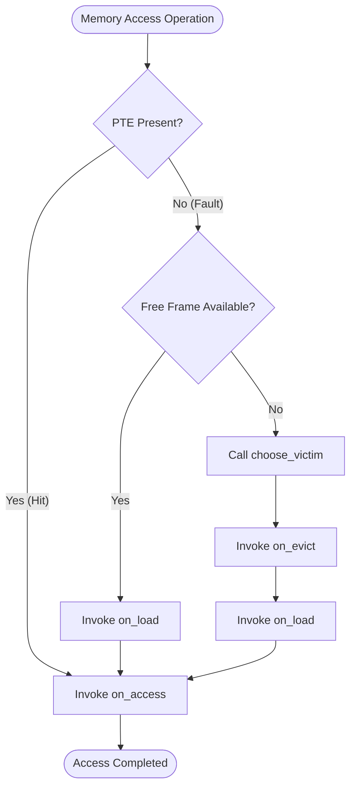

# 16. Page Replacement Algorithms

Page replacement policies decide which physical frame to evict when a page fault occurs and physical memory is exhausted. In MemForge, all replacement algorithms are isolated behind an abstract virtual method table (vtable) defined in `src/paging/replacement.h`. MemForge implements three canonical policies: First-In, First-Out (`fifo.c`), Least Recently Used (`lru.c`), and Belady's Optimal algorithm (`opt.c`). In addition, the paging module provides automated parameter sweeps in `src/paging/belady.c` to detect and quantify anomalies across frame allocations.

## 16.1 The Policy Vtable and Execution Hook Order

To decouple replacement heuristics from the core paging state machine, each algorithm implements the `ms_page_replacement_policy` interface.

```c
typedef struct {
    const char *name;
    bool requires_lookahead;
    void *(*create)(uint32_t frames);
    void (*destroy)(void *state);
    bool (*prepare)(void *state, const ms_page_key *refs, size_t n);
    void (*on_load)(void *state, uint32_t frame, ms_page_key key, uint64_t t);
    void (*on_access)(void *state, uint32_t frame, ms_page_key key, uint64_t t, bool write);
    uint32_t (*choose_victim)(void *state, const ms_page_frame_view *view,
                              const uint32_t *candidates, size_t n, uint64_t t);
    void (*on_evict)(void *state, uint32_t frame, ms_page_key key);
} ms_page_replacement_policy;
```

Policies register their implementation in `src/paging/policies/registry.c`. The CLI and simulation sessions look up policies by name (`"fifo"`, `"lru"`, `"opt"`). If a policy requires future lookahead (`requires_lookahead == true`), it must provide a non-null `prepare` callback; interactive or online sessions that cannot supply the full trace reject such policies with `MS_ERR_INVALID`.

### Hook Invocations and Ordering

The lifecycle of physical frames triggers callbacks in a strict, invariant sequence:
1. **Fault with Eviction**: When no free frame exists, the engine calls `choose_victim` to identify the target frame $f$. It then calls `on_evict` on frame $f$, followed by `on_load` when the new page is mapped into $f$, and finally `on_access` to record the reference.
2. **Fault with Free Frame Allocation**: When a frame is allocated from the free pool, no eviction occurs: the engine calls `on_load` followed by `on_access`.
3. **Page Hit**: Because the page is already resident, neither eviction nor loading takes place; the engine calls only `on_access`.
4. **Process Termination**: When a process exits, each frame held by that process is returned to the free pool, invoking `on_evict` for each released frame without triggering write-back events.

The time argument `t` supplied to all callbacks is a zero-based reference counter (`e->t` in `src/paging/engine.c`) that increments on every memory access operation (including invalid access attempts). This ensures temporal synchronization between the engine and policy states.



## 16.2 Stamp-Per-Frame Unified Architecture

Traditional textbook descriptions implement FIFO using circular pointer queues and LRU using doubly linked lists. MemForge unifies victim selection across all three policies through a *stamp-per-frame* architecture implemented in `src/paging/replacement.h`.

Each policy allocates an array of 64-bit integer timestamps indexed directly by frame index $f \in [0, F-1]$. Eviction selection is generalized through the inline function `ms_page_pick_stamp`:

```c
static inline uint32_t ms_page_pick_stamp(const uint64_t *stamp, const uint32_t *candidates,
                                          size_t n, bool largest) {
    uint32_t best = candidates[0];
    for (size_t i = 1; i < n; i++) {
        uint32_t f = candidates[i];
        bool better = largest ? stamp[f] > stamp[best] : stamp[f] < stamp[best];
        if (better || (stamp[f] == stamp[best] && f < best)) {
            best = f;
        }
    }
    return best;
}
```

This abstraction allows FIFO, LRU, and OPT to share the exact same selection loop while varying only how timestamps are recorded and whether the minimum or maximum value is sought:
- **FIFO**: Records the loading time $t$ in `fifo_on_load`. Scans for the minimum timestamp (`largest = false`).
- **LRU**: Records the access time $t$ in `lru_on_access`. Scans for the minimum timestamp (`largest = false`).
- **OPT**: Records the precomputed timestamp of the next reference to the resident page. Scans for the maximum timestamp (`largest = true`).

### Deterministic Tie-Breaking
When two or more frames evaluate to identical timestamps (for example, in OPT when multiple pages are never referenced again), `ms_page_pick_stamp` selects the candidate with the lowest frame index ($f < \text{best}$). This tie-breaking rule ensures strictly deterministic execution across all compilers and host platforms.

## 16.3 First-In, First-Out (FIFO)

FIFO evicts the page that has resided in physical memory for the longest period, regardless of how frequently or recently it was accessed.

### Implementation Details (`src/paging/policies/fifo.c`)
- State: An array `uint64_t stamp[frames]` allocated via `calloc`.
- `fifo_on_load`: When a page is assigned to frame $f$ at reference index $t$, the policy assigns `stamp[f] = t`.
- `fifo_on_access`: Left as `NULL`. Accesses to resident pages do not update loading times.
- `fifo_choose_victim`: Invokes `ms_page_pick_stamp(state, candidates, n, false)` to select the frame with the oldest load time.

```text
Algorithm 2: FIFO Replacement
Input: Policy state array stamp, candidate frame array candidates of size n, reference time t
Output: Victim frame index

Function fifo_on_load(stamp, frame, key, t):
1.  stamp[frame] ← t

Function fifo_choose_victim(stamp, candidates, n, t):
1.  best ← candidates[0]
2.  for i ← 1 to n - 1 do
3.      f ← candidates[i]
4.      if stamp[f] < stamp[best] or (stamp[f] = stamp[best] and f < best) then
5.          best ← f
6.      end if
7.  end for
8.  return best
```

**Complexity**:
- Time: $O(1)$ for `on_load`, $O(1)$ for hits (no-op), and $O(F)$ for `choose_victim`.
- Space: $O(F)$ words to maintain the per-frame load timestamps.

## 16.4 Least Recently Used (LRU)

LRU approximates optimal replacement by exploiting temporal locality: pages that have not been accessed for the longest time are presumed least likely to be referenced in the near future.

### Implementation Details (`src/paging/policies/lru.c`)
- State: An array `uint64_t stamp[frames]` allocated via `calloc`.
- `lru_on_access`: For every reference (both hits and immediately after a page load), `stamp[frame] = t`. Because `on_access` is invoked by the engine on every memory reference, `lru_on_load` is left as `NULL`.
- `lru_choose_victim`: Invokes `ms_page_pick_stamp(state, candidates, n, false)` to choose the frame whose last access time is smallest.

```text
Algorithm 3: LRU Replacement
Input: Policy state array stamp, candidate frame array candidates of size n, reference time t
Output: Victim frame index

Function lru_on_access(stamp, frame, key, t, write):
1.  stamp[frame] ← t

Function lru_choose_victim(stamp, candidates, n, t):
1.  best ← candidates[0]
2.  for i ← 1 to n - 1 do
3.      f ← candidates[i]
4.      if stamp[f] < stamp[best] or (stamp[f] = stamp[best] and f < best) then
5.          best ← f
6.      end if
7.  end for
8.  return best
```

**Complexity**:
- Time: $O(1)$ on every memory access to record the current timestamp, and $O(F)$ on victim selection.
- Space: $O(F)$ words for frame access timestamps.

## 16.5 Belady's Optimal Algorithm (OPT)

Belady's Optimal algorithm achieves the theoretical lower bound on page faults for any offline reference string by evicting the page whose next reference occurs farthest in the future. If a page is never referenced again, its next reference is defined as infinity ($\infty$).

### Next-Use Precomputation by Sorting (`src/paging/policies/opt.c`)
Rather than performing a costly forward scan over the remaining workload trace during each page fault (which would yield $O(n \cdot F)$ runtime per fault), MemForge precomputes next-use intervals offline during initialization.

Instead of building a hash map, `opt_prepare` sorts trace references using the standard C library `qsort`:
1. It copies all $n$ operations into an auxiliary array of `opt_ref` pairs: `{.key = refs[t], .t = t}`.
2. It sorts the array in $O(n \log n)$ time with `opt_ref_cmp`:
   - Primary key: process ID (`pid`).
   - Secondary key: virtual page number (`vpn`).
   - Tertiary key: reference time index ($t$).
3. In the sorted array, all references to the same `(pid, vpn)` are grouped in monotonically increasing chronological order. A single linear sweep determines next-use intervals:
   - For element $i$, if $i + 1 < n$ and element $i + 1$ has the exact same page key, then `next_use[sorted[i].t] = sorted[i+1].t`.
   - If the page key differs or $i$ is the last reference, `next_use[sorted[i].t] = OPT_NEVER` (`UINT64_MAX`).
4. The temporary array is freed, leaving an $O(n)$ array `next_use` indexed directly by reference index $t$.

```text
Algorithm 4: OPT Next-Use Precomputation by Sorting
Input: Reference list refs of length n
Output: Precomputed next-use lookup array next_use of size n

1.  allocate sorted array of size n
2.  allocate next_use array of size n
3.  for t ← 0 to n - 1 do
4.      sorted[t] ← { key: refs[t], t: t }
5.  end for
6.  sort sorted using comparator opt_ref_cmp
7.  for i ← 0 to n - 1 do
8.      if i + 1 < n and sorted[i].key = sorted[i + 1].key then
9.          next_use[sorted[i].t] ← sorted[i + 1].t
10.     else
11.         next_use[sorted[i].t] ← OPT_NEVER  (UINT64_MAX)
12.     end if
13. end for
14. free sorted
15. return next_use
```

### Victim Selection
During execution, `opt_on_access` updates the frame's next-use timestamp:
$$\text{stamp}[frame] = (t < n) \ ? \ \text{next\_use}[t] : \text{OPT\_NEVER}$$
When an eviction occurs, `opt_choose_victim` calls `ms_page_pick_stamp(..., largest = true)`. Candidates whose pages will never be accessed again hold `OPT_NEVER` and are prioritized for eviction; ties among never-referenced pages are resolved in favor of the lowest frame index.

```text
Algorithm 5: OPT Victim Selection
Input: State struct containing next array of size F, candidate frame array candidates of size n
Output: Victim frame index

Function opt_choose_victim(s, candidates, n, t):
1.  best ← candidates[0]
2.  for i ← 1 to n - 1 do
3.      f ← candidates[i]
4.      if s.next[f] > s.next[best] or (s.next[f] = s.next[best] and f < best) then
5.          best ← f
6.      end if
7.  end for
8.  return best
```

**Complexity**:
- Time: $O(n \log n)$ once during initialization (`opt_prepare`); $O(1)$ per access; $O(F)$ per eviction.
- Space: $O(n)$ words for the `next_use` array and $O(F)$ words for the frame resident stamps.

Table 16.1 compares the algorithmic and runtime properties of the three replacement policies.

| Metric / Property | FIFO | LRU | OPT |
| --- | --- | --- | --- |
| Decision Metric | Earliest load time | Earliest access time | Farthest future access |
| Lookahead Required | No | No | Yes (offline trace required) |
| Initialization Cost | $O(F)$ | $O(F)$ | $O(n \log n + F)$ |
| Hit Update Cost | $O(1)$ (no-op) | $O(1)$ | $O(1)$ |
| Victim Selection Cost | $O(F)$ | $O(F)$ | $O(F)$ |
| Tie-Break Criterion | Lowest frame index | Lowest frame index | Lowest frame index |
| Total Space Overhead | $O(F)$ | $O(F)$ | $O(n + F)$ |
| Theoretical Optimality | Sub-optimal | Near-optimal under locality | Strictly optimal (minimal faults) |
| Inclusion Property | No (exhibits Belady anomaly) | Yes (stack algorithm) | Yes (stack algorithm) |

Table 16.1: Comparison of replacement policies implemented in MemForge.

## 16.6 Belady Sweep and Stack Algorithm Properties

In 1969, László Bélady demonstrated that under FIFO replacement, increasing the number of physical frames allocated to a process can strictly increase the total number of page faults—a phenomenon known as Bélady's anomaly.

MemForge provides native anomaly detection through `src/paging/belady.c`. The module exports three analytical functions:
1. `ms_page_count_faults(policy, refs, n, frames, &faults)`: Executes a complete simulation of `refs` under the specified policy and frame count, returning the fault total.
2. `ms_page_sweep(policy, refs, n, max_frames, faults)`: Sweeps physical frame allocations $f \in [1, \text{max\_frames}]$ and records the resulting page faults into an array.
3. `ms_page_belady_points(faults, max_frames, points)`: Evaluates the sweep results and records every frame count $f$ where:
$$\text{faults}(f + 1) > \text{faults}(f)$$

### The Stack Inclusion Property
Mattson et al. (1970) proved that a replacement policy is immune to Bélady's anomaly if and only if it belongs to the class of *stack algorithms*. A policy is a stack algorithm if the resident set of pages with $f$ frames at time $t$, denoted $M(f, t)$, is always a strict subset of the resident set with $f + 1$ frames:
$$M(f, t) \subseteq M(f + 1, t) \quad \forall f, t$$

Because any page resident under $f$ frames is guaranteed to be resident under $f + 1$ frames, adding memory can never turn a hit into a fault. Both LRU and OPT satisfy the inclusion property:
- Under LRU, $M(f, t)$ comprises the $f$ most recently referenced unique pages, ensuring $M(f, t) \subset M(f + 1, t)$.
- Under OPT, $M(f, t)$ comprises the $f$ pages whose next accesses occur nearest in time, ensuring $M(f, t) \subset M(f + 1, t)$.

In contrast, FIFO maintains pages ordered by initial load time rather than priority of use. When an eviction occurs under $f + 1$ frames, the victim selected often diverges from the victim selected under $f$ frames, causing the contents of the two frame pools to desynchronize. As a result, FIFO violates the inclusion property and produces anomalous fault spikes.
