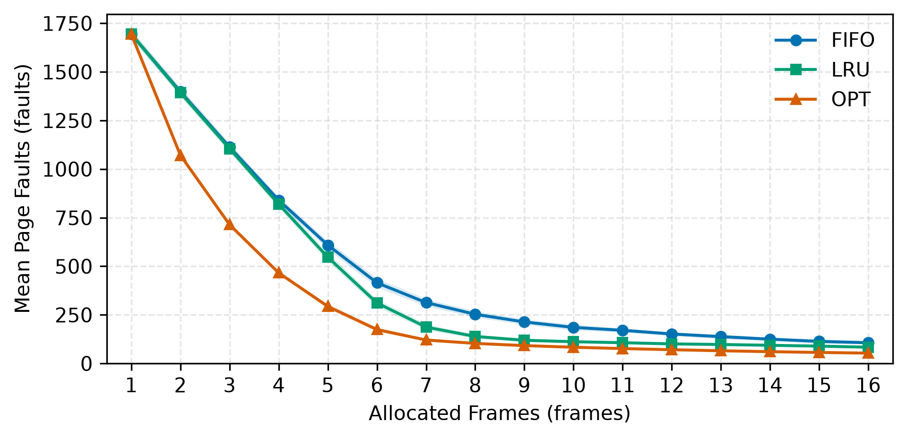
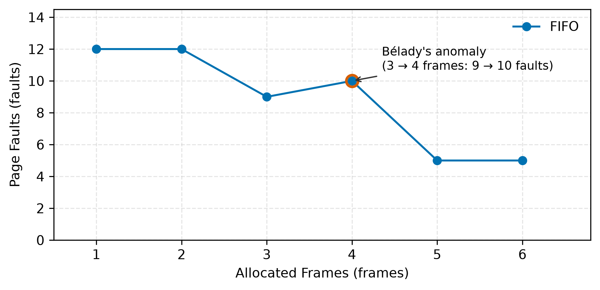

# 18. Paging Results and Performance Comparison

This section presents the empirical evaluation of virtual memory management in MemForge. We evaluate the replacement policies—First-In, First-Out (FIFO), Least Recently Used (LRU), and Belady's Optimal algorithm (OPT)—using synthetic locality workloads across varying physical frame allocations. The experimental protocol evaluates the Experiment 4 (E4) suite specified in `docs/ARCHITECTURE.md` and executes automated frame sweeps for Acceptance Criterion 4 (AC-4) to measure page fault rates, working set dynamics, and anomaly vulnerability.

## 18.1 Experimental Methodology (E4 Benchmark Suite)

The E4 experiment measures page fault frequency as a function of physical frame allocation under realistic reference locality. Workload traces are generated using the `memsim gen refs-locality` engine (`src/workloads/generators.c`) driven by the benchmark runner `scripts/experiments/e4_frames.sh`.

### Workload Characteristics
Each workload execution models an active process executing in an address space of 32 virtual pages with a standard 4096-byte page size ($k = 12$ offset bits):
- **Trace Length**: $N = 2{,}000$ memory references per run.
- **Working Set Size**: $W = 6$ virtual pages active during any single locality phase.
- **Phase Locality Transitions**: The active working set shifts by adding new pages and retiring old ones every 200 references, creating dynamic phase changes.
- **Noise / Out-of-Set References**: With a background probability of $5\%$ ($p_{\text{out}} = 50{,}000\text{ ppm}$), references deviate from the active working set to sample uniformly from the remaining 26 pages.
- **Statistical Replication**: Experiments are executed across 10 independent pseudo-random seeds ($1 \dots 10$). For each configuration, we compute the sample mean and the two-sided $95\%$ confidence interval using Student's $t$-distribution over 9 degrees of freedom.
- **Evaluated Frame Range**: Allocations range from $F = 1$ to $F = 16$ frames, covering scenarios of severe memory thrashing ($F < W$), working-set transition points ($F \approx W$), and memory over-provisioning ($F > 2W$).

## 18.2 Quantitative Fault Comparison Across Frame Allocations

Table 18.1 reports the mean page faults and $95\%$ confidence intervals across representative frame allocations ($F \in \{2, 4, 8, 12, 16\}$), extracted directly from `docs/report/tables/e4_summary.md`.

| Frames ($F$) | FIFO Faults | LRU Faults | OPT Faults | LRU vs FIFO Reduction | OPT vs LRU Bound Gap |
| --- | --- | --- | --- | --- | --- |
| 2 | $1398.2 \pm 21.2$ | $1393.0 \pm 18.8$ | $1070.8 \pm 13.9$ | $-0.37\%$ | $-23.13\%$ |
| 4 | $840.0 \pm 15.9$ | $819.6 \pm 19.9$ | $466.0 \pm 9.3$ | $-2.43\%$ | $-43.14\%$ |
| 8 | $253.1 \pm 16.5$ | $138.9 \pm 10.1$ | $103.2 \pm 5.9$ | **$-45.12\%$** | $-25.70\%$ |
| 12 | $151.7 \pm 9.7$ | $100.7 \pm 6.0$ | $70.7 \pm 4.0$ | **$-33.62\%$** | $-29.79\%$ |
| 16 | $106.7 \pm 9.0$ | $83.5 \pm 5.5$ | $53.2 \pm 3.2$ | **$-21.74\%$** | $-36.29\%$ |

Table 18.1: Mean page faults $\pm 95\%$ confidence intervals over 10 random seeds ($2{,}000$ references each) from Experiment E4.

Figure 18.1 illustrates the complete fault trajectories across all allocations $F \in [1, 16]$.

Figure 18.1: Page faults versus physical frames across FIFO, LRU, and OPT (Experiment E4). Shaded regions represent 95% confidence bands over 10 distinct workload seeds.

## 18.3 Analysis of the Performance Hierarchy ($\text{OPT} < \text{LRU} < \text{FIFO}$)

Across all tested frame allocations and seeds, the observed performance strictly adheres to the theoretical ordering:
$$\text{Faults}_{\text{OPT}} \le \text{Faults}_{\text{LRU}} \le \text{Faults}_{\text{FIFO}}$$
However, the performance differential between the policies varies dramatically across three distinct operating regimes.

### Regime 1: Severe Memory Constriction ($F \le 4$, where $F < W$)
When physical memory is smaller than the active working set ($W = 6$), all policies suffer from severe thrashing.
- At $F = 2$, FIFO incurs $1398.2$ faults and LRU incurs $1393.0$ faults, corresponding to page fault rates of $69.9\%$ and $69.6\%$. Because the frame capacity cannot hold even half of the working set, LRU's recency heuristic provides negligible advantage over FIFO (a modest $0.37\%$ reduction).
- In contrast, OPT incurs $1070.8$ faults ($53.5\%$ fault rate), delivering a $23.1\%$ improvement over LRU. OPT achieves this advantage because offline lookahead allows it to selectively preserve pages that will be accessed immediately in the next 1–3 steps while discarding pages whose next access occurs later in the active cycle.

### Regime 2: Working Set Transition ($F = 8$, where $F > W$)
The transition at $F = 8$ marks the threshold where physical memory exceeds the working set size ($W = 6$). This regime highlights the dramatic superiority of recency-based replacement over arrival-based replacement.
- LRU page faults collapse from $819.6 \pm 19.9$ at $F = 4$ to $138.9 \pm 10.1$ at $F = 8$—an $83.1\%$ reduction in faults. Once the physical capacity accommodates the working set, LRU retains the entire cluster of active pages in memory, restricting faults almost exclusively to phase transitions and the $5\%$ background noise.
- FIFO faults also decline, but remain elevated at $253.1 \pm 16.5$. LRU achieves a **$45.12\%$ fault reduction** relative to FIFO (138.9 vs 253.1 faults). FIFO performs poorly because arrival order is completely decoupled from recency of use: heavily referenced pages loaded early in a phase are repeatedly evicted simply because their load stamps are old, forcing immediate reload faults on subsequent accesses within the same phase.
- OPT achieves $103.2 \pm 5.9$ faults at $F = 8$. LRU closely approaches OPT's lower bound, trailing by only 35.7 faults over $2{,}000$ references.

### Regime 3: Over-Provisioned Memory ($F \ge 12$, where $F \ge 2W$)
At $F = 12$ and $F = 16$, memory capacity easily holds the current working set along with residual pages from previous phases.
- Fault rates across all policies plateau, asymptotically approaching the compulsory fault lower bound imposed by phase transitions (each 200-reference shift introduces new pages into the working set).
- Even with 16 frames (half the entire address space of 32 pages), FIFO continues to incur $106.7 \pm 9.0$ faults, whereas LRU incurs $83.5 \pm 5.5$ faults and OPT incurs $53.2 \pm 3.2$ faults. FIFO continues to suffer anomalous evictions during phase hand-offs, whereas LRU seamlessly preserves hot pages.

## 18.4 Bélady's Anomaly and the AC-4 Frame Sweep

While aggregate statistical runs over smooth locality traces often mask non-monotonic behavior, specialized reference patterns expose FIFO's fundamental vulnerability. Acceptance Criterion 4 (AC-4) executes a frame sweep from $F = 1$ to $F = 6$ on the canonical 12-reference workload defined in `tests/fixtures/ac4_belady.wl`:
$$\langle 1, 2, 3, 4, 1, 2, 5, 1, 2, 3, 4, 5 \rangle$$

Table 18.2 records the exact page faults observed during the sweep, as recorded in `docs/report/tables/cli_examples.md` and verified by `tests/golden/test_ac_fixtures.c`.

| Allocated Frames ($F$) | FIFO Faults | LRU Faults | OPT Faults | Monotonicity Status |
| --- | --- | --- | --- | --- |
| 1 | 12 | 12 | 12 | Monotonic |
| 2 | 12 | 12 | 12 | Monotonic |
| 3 | **9** | 10 | 7 | Monotonic |
| 4 | **10** | **8** | **6** | **Bélady Anomaly Spike (FIFO)** |
| 5 | 5 | 5 | 5 | Monotonic |
| 6 | 5 | 5 | 5 | Monotonic |

Table 18.2: Page fault sweep across frame allocations $1 \dots 6$ on the AC-4 workload string.

Figure 18.2 displays the AC-4 sweep curve, highlighting the anomaly point.

Figure 18.2: Page faults under FIFO for the AC-4 workload across 1 to 6 frames. An explicit anomaly occurs between 3 and 4 frames where faults increase from 9 to 10.

### Theoretical Implications of the Anomaly
As shown in Table 18.2 and Figure 18.2, increasing frame allocation from 3 to 4 increases FIFO faults from 9 to 10. In contrast, LRU faults strictly decrease from 10 to 8, and OPT faults decrease from 7 to 6.

This behavior confirms the theoretical distinction established by Mattson et al.:
1. Stack algorithms (LRU, OPT) satisfy the inclusion property $M(f, t) \subseteq M(f+1, t)$. The set of resident pages under $f$ frames is guaranteed to remain resident when granted $f+1$ frames. Thus, an increase in physical allocation can never transform a cache hit into a page fault.
2. FIFO is not a stack algorithm. Under FIFO, eviction priority depends on when a page entered memory rather than how often or how recently it was accessed. Introducing an additional frame alters the queue insertion and eviction sequence, evicting pages immediately before their subsequent references and provoking cyclic thrashing.

## 18.5 Practical Trade-Offs and System Implications

The empirical findings from MemForge directly mirror operating system design trade-offs:
1. **Unattainability of OPT**: Belady's OPT represents an ideal offline bound. Because true future reference strings cannot be known in advance, OPT cannot be deployed in general-purpose virtual memory managers. However, its implementation in MemForge provides an essential baseline for calculating the competitive ratio of online heuristics.
2. **Deficiencies of Pure FIFO**: While FIFO requires minimal bookkeeping ($O(1)$ timestamp recording and no overhead on hits), its susceptibility to Bélady's anomaly and poor performance under locality transitions ($45\%$ more faults than LRU at $F = 8$) make it unsuitable for production virtual memory systems.
3. **Approximating LRU in Hardware**: While LRU provides near-optimal hit rates under temporal locality, maintaining precise access timestamps or updating a doubly linked list on every CPU memory reference incurs prohibitive hardware overhead. Consequently, real-world systems (e.g., Linux page replacement) implement clock-based approximations (such as the Second-Chance / Clock algorithm) that periodically scan and clear the referenced ($R$) and dirty ($D$) bits maintained in page table entries.

Figure 18.3: Placeholder for the interactive MemForge web application demonstrating virtual address translation, frame allocation, and comparative replacement policy simulation.
