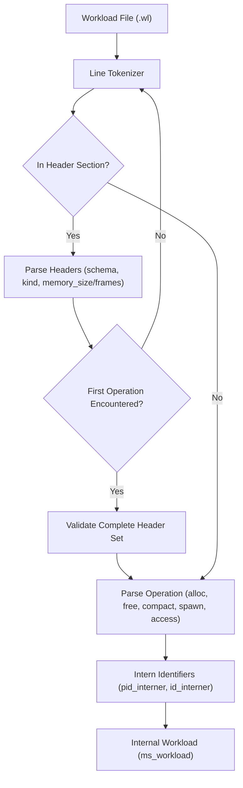

# 19. Workloads and Metrics

MemForge decouples execution policy from workload definition by representing memory workloads as deterministic, human-readable plain-text scripts. Rather than embedding scenario logic inside the simulation engine or relying on heavy serialization formats such as JSON, workloads are parsed into compact internal representations by a dedicated parser implemented in [`src/workloads/loader.c`](file:///home/cyberknight/memforge-agy/rep-eval/src/workloads/loader.c). Synthetic workloads are created through two reproducible pseudorandom generators in [`src/workloads/generators.c`](file:///home/cyberknight/memforge-agy/rep-eval/src/workloads/generators.c), while simulation outcomes are measured comprehensively by the `MetricsCollector` in [`src/metrics/metrics.c`](file:///home/cyberknight/memforge-agy/rep-eval/src/metrics/metrics.c).

## 19.1 Plain-Text Workload Format

A MemForge workload script (`.wl`) comprises a key-value configuration header followed by an ordered sequence of discrete simulation operations. Comments are introduced with `#` and extend to the end of the line. Whitespace (spaces, tabs, carriage returns) serves as a token delimiter.

The workload format enforces strict separation of mechanism and scenario: configuration keys dictate physical constraints (such as memory capacity or page dimensions), but never specify placement or replacement policies. Consequently, an identical workload file can be executed under First-Fit, Best-Fit, and Worst-Fit, or evaluated across FIFO, LRU, and OPT, guaranteeing deterministic cross-policy replay.



### 19.1.1 Header Grammar and Rules

The header section must precede any operational command. Each header line contains exactly two tokens: `<key> <value>`.

Table 19.1: Workload header keys and validation rules.

| Header Key | Allowed Subsystem | Type / Constraint | Description |
| :--- | :--- | :--- | :--- |
| `schema` | All | `uint32_t`, must equal `1` | Format schema version; bumps on breaking changes |
| `kind` | All | `contiguous` or `paging` | Declares target simulator engine |
| `memory_size` | Contiguous only | `int64_t`, strictly positive | Total addressable physical memory units |
| `page_size` | Paging only | `uint32_t`, positive power of 2 | Size of each page and frame in bytes |
| `frames` | Paging only | `uint32_t`, strictly positive | Number of physical frames in memory |
| `negative_test` | All (Optional) | `uint32_t`, `0` or `1` (default `0`) | Disables loader sanity checks for error testing |
| `gen_*` | All (Optional) | Ignored metadata | Generator provenance parameters (seed, ops, distribution) |

### 19.1.2 Operation Grammar

Once the header phase completes, lines define operations executed sequentially by the session runner. Identifiers (`pid`, allocation `id`) are alphanumeric strings limited to 63 characters (`MS_WL_NAME_MAX`).

Table 19.2: Operation token specification.

| Command | Subsystem | Format | Semantics |
| :--- | :--- | :--- | :--- |
| `alloc` | Contiguous | `alloc <pid> <id> <size>` | Request contiguous block of `size` units for process `pid` |
| `free` | Contiguous | `free <pid> <id>` | Release block identified by `id` owned by `pid` |
| `compact` | Contiguous | `compact` | Trigger sliding compaction of allocated blocks |
| `spawn` | Paging | `spawn <pid> <pages>` | Create process `pid` with virtual space of `pages` |
| `access` | Paging | `access <pid> <target> [w]` | Memory access to VPN or `@va`; optional `w` specifies write |
| `terminate` | Both | `terminate <pid>` | Terminate process and reclaim all its allocations or frames |

### 19.1.3 Workload Examples

A contiguous workload script illustrating setup, allocation, and compaction:

```text
# Contiguous Memory Management Scenario
schema 1
kind contiguous
memory_size 1024

alloc SYS s1 64
alloc P1 b1 128
alloc P2 b2 256
free P1 b1
compact
alloc P3 b3 192
terminate P2
```

A paging workload script illustrating multi-process virtual addressing and writes:

```text
# Paging Virtual Memory Scenario
schema 1
kind paging
page_size 4096
frames 4

spawn P0 16
access P0 0
access P0 1 w
access P0 @8192      # virtual address 8192 -> VPN 2
access P0 @8200 w    # virtual address 8200 -> VPN 2, write access
spawn P1 8
access P1 0
terminate P0
```

## 19.2 Workload Parsing and Validation Rules

Parsing in [`src/workloads/loader.c`](file:///home/cyberknight/memforge-agy/rep-eval/src/workloads/loader.c) is handled by `ms_wl_parse` and `ms_wl_load`. The loader parses the script line-by-line using a lightweight token scanner, maintaining line numbers to provide accurate diagnostic feedback via `ms_wl_error`.

### 19.2.1 Loader Invariants and Validation Constraints

1. **Header Completeness**: All required headers for the specified `kind` must appear before any operation line. If `kind` is `contiguous`, `memory_size` is required, and `page_size` or `frames` trigger immediate parse errors. If `kind` is `paging`, `page_size` and `frames` are mandatory, while `memory_size` is rejected.
2. **Duplicate Headers**: Redundant specifications of any recognized header key cause parsing failure.
3. **Power-of-Two Validation**: In paging workloads, `page_size` must satisfy `(val & (val - 1)) == 0`.
4. **String Interning**: String identifiers (`pid_names`, `id_names`) are interned using a 32-bit FNV-1a hash table (`interner_lookup_or_add`) into dense 0-indexed integers (`uint32_t`). The execution engine never processes raw string allocations during execution.
5. **Strict vs. Negative Test Mode**:
   - In standard mode (`negative_test 0`), `alloc` sizes must be strictly positive ($> 0$), allocation IDs cannot be reused, and `free` commands cannot target an ID that has not yet been allocated.
   - When `negative_test 1` is declared in the header, the loader permits non-positive sizes, duplicate IDs, and invalid frees to pass through to the simulator engines. This enables verification of domain outcome handling (such as `MS_EV_ALLOC_REJECTED` and `MS_EV_FREE_REJECTED` in AC-5) without being blocked by loader validation.

## 19.3 Seeded Workload Generators

To support reproducible benchmarking, [`src/workloads/generators.c`](file:///home/cyberknight/memforge-agy/rep-eval/src/workloads/generators.c) provides two synthetic workload generators: `alloc-uniform` and `refs-locality`. Both generators use a deterministic pseudorandom number generation pipeline based on SplitMix64 and xoshiro256** (`xoshiro256ss_rng`).

```text
Algorithm 1: Deterministic Random Number Generation (SplitMix64 and xoshiro256**)
Input: 64-bit integer seed, 64-bit upper bound B
Output: Unbiased pseudo-random integer r in range [0, B - 1]

1. Initialization (SplitMix64 seeding):
   a. Set sm = seed
   b. For i = 0 to 3:
      i. sm = sm + 0x9e3779b97f4a7c15
      ii. z = (sm ^ (sm >> 30)) * 0xbf58476d1ce4e5b9
      iii. z = (z ^ (z >> 27)) * 0x94d049bb133111eb
      iv. State[i] = z ^ (z >> 31)

2. Step (xoshiro256** next):
   a. result = rotl(State[1] * 5, 7) * 9
   b. t = State[1] << 17
   c. State[2] = State[2] ^ State[0]
   d. State[3] = State[3] ^ State[1]
   e. State[1] = State[1] ^ State[2]
   f. State[0] = State[0] ^ State[3]
   g. State[2] = State[2] ^ t
   h. State[3] = rotl(State[3], 45)
   i. Return result

3. Unbiased Bound Drawing (rng_draw):
   a. If B <= 1, return 0
   b. threshold = (2^64 - B) mod B
   c. Loop:
      i. draw = Step()
      ii. If draw >= threshold, return draw mod B
```

- **Time Complexity**: $O(1)$ amortized per random drawing.
- **Space Complexity**: $O(1)$ auxiliary storage (four 64-bit state words).

### 19.3.1 Contiguous Allocation Generator: `alloc-uniform`

The function `ms_wl_gen_alloc_uniform` produces a sequence of contiguous allocation and deallocation operations. It tracks live blocks using a dynamic array and regulates overall memory pressure via a target-utilisation rule.

```text
Algorithm 2: Contiguous Uniform Workload Generation (alloc-uniform)
Input: Parameters struct p (ops, size_min, size_max, memory_size, p_alloc_ppm, target_util_ppm, seed), Output stream out
Output: Workload script written to out

1. Seed xoshiro256ss_rng with p.seed
2. Write script headers (schema 1, kind contiguous, memory_size, gen_* metadata)
3. Allocate tracking arrays live_blocks and live_sizes of capacity p.ops
4. target_units = floor((p.memory_size * p.target_util_ppm) / 1000000)
5. live_units = 0, live_count = 0, k = 0
6. For step = 0 to p.ops - 1:
   a. If live_count == 0:
      do_alloc = true
   b. Else if p.target_util_ppm > 0 and live_units >= target_units:
      do_alloc = false
   c. Else:
      do_alloc = (rng_draw(1000000) < p.p_alloc_ppm)
   d. If do_alloc is true:
      i. sz = p.size_min + rng_draw(p.size_max - p.size_min + 1)
      ii. Emit "alloc P(k mod 4) bk sz" to out
      iii. live_blocks[live_count] = k
      iv. live_sizes[live_count] = sz
      v. live_units = live_units + sz
      vi. live_count = live_count + 1
      vii. k = k + 1
   e. Else (deallocate victim):
      i. idx = rng_draw(live_count)
      ii. victim = live_blocks[idx]
      iii. live_units = live_units - live_sizes[idx]
      iv. live_blocks[idx] = live_blocks[live_count - 1]
      v. live_sizes[idx] = live_sizes[live_count - 1]
      vi. live_count = live_count - 1
      vii. Emit "free P(victim mod 4) b(victim)" to out
7. Free tracking arrays and return MS_OK
```

- **Time Complexity**: $O(\text{ops})$ since choosing and removing a random victim operates in $O(1)$ time via array swap-and-pop.
- **Space Complexity**: $O(\text{ops})$ auxiliary storage for `live_blocks` and `live_sizes`.

### 19.3.2 Paging Reference Generator: `refs-locality`

The function `ms_wl_gen_refs_locality` models phase-based locality of reference. A working set of size $W$ resides within a virtual address space of $P$ pages. References target the active window with probability $1 - p_{\text{out}}$, occasionally drawing outside the locality window. The window advances by $\lfloor W / 2 \rfloor$ every $T$ references to simulate phase changes.

```text
Algorithm 3: Paging Locality Reference Generation (refs-locality)
Input: Parameters struct p (n, pages, working_set, shift_every, p_out_ppm, p_write_ppm, frames, page_size, seed), Output stream out
Output: Workload script written to out

1. Seed xoshiro256ss_rng with p.seed
2. Write script headers (schema 1, kind paging, page_size, frames, gen_* metadata)
3. Emit "spawn P0 p.pages" to out
4. base = 0, shift_count = 0
5. For step = 0 to p.n - 1:
   a. If p.working_set < p.pages and rng_draw(1000000) < p.p_out_ppm:
      offset = rng_draw(p.pages - p.working_set)
      vpn = (base + p.working_set + offset) mod p.pages
   b. Else:
      offset = rng_draw(p.working_set)
      vpn = (base + offset) mod p.pages
   c. is_write = (rng_draw(1000000) < p.p_write_ppm)
   d. If is_write is true:
      Emit "access P0 vpn w" to out
   e. Else:
      Emit "access P0 vpn" to out
   f. shift_count = shift_count + 1
   g. If shift_count == p.shift_every:
      shift_count = 0
      base = (base + floor(p.working_set / 2)) mod p.pages
6. Return MS_OK
```

- **Time Complexity**: $O(n)$ where $n$ is reference count.
- **Space Complexity**: $O(1)$ auxiliary storage.

## 19.4 Metrics Engine and Measurement Formulas

The `MetricsCollector` in [`src/metrics/metrics.c`](file:///home/cyberknight/memforge-agy/rep-eval/src/metrics/metrics.c) observes simulation events (`ms_metrics_on_events`) and contiguous memory snapshots (`ms_metrics_on_blocks`). To avoid floating-point non-determinism across compilers and microarchitectures, all ratios and fractional values are tracked in fixed-point parts-per-million (PPM, scaled by $10^6$ via `PPM_SCALE`).

The fixed-point division function is defined as:
$$\text{calc\_ppm}(\text{part}, \text{whole}) = \left(\left\lfloor \frac{\text{part}}{\text{whole}} \right\rfloor \times 10^6\right) + \left\lfloor \frac{(\text{part} \bmod \text{whole}) \times 10^6}{\text{whole}} \right\rfloor$$

### 19.4.1 Contiguous Memory Metrics

Contiguous simulation tracks 19 distinct metrics summarizing placement attempts, search overhead, fragmentation, and compaction costs.

Table 19.3: Complete contiguous metrics catalog from `src/metrics/metrics.c`.

| Metric Identifier | Fixed-Point Ratio | Mathematical Definition / Counting Rule | Source Event or Model Property |
| :--- | :--- | :--- | :--- |
| `alloc_requests` | False | $N_{\text{req}} = \sum [e = \text{MS\_EV\_PLACEMENT\_DECIDED}]$ | Event stream |
| `alloc_successes` | False | $N_{\text{succ}} = \sum [e = \text{MS\_EV\_BLOCK\_ALLOCATED}]$ | Event stream |
| `alloc_failures` | False | $N_{\text{fail}} = \sum [e = \text{MS\_EV\_ALLOCATION\_FAILED}]$ | Event stream |
| `failures_fragmentation` | False | $\sum [e.\text{cause} = \text{MS\_ALLOC\_FAIL\_FRAGMENTATION}]$ | Event stream |
| `failures_capacity` | False | $\sum [e.\text{cause} = \text{MS\_ALLOC\_FAIL\_CAPACITY}]$ | Event stream |
| `rejections` | False | $\sum [e \in \{\text{MS\_EV\_ALLOC\_REJECTED}, \text{MS\_EV\_FREE\_REJECTED}\}]$ | Event stream |
| `frees` | False | $N_{\text{free}} = \sum [e = \text{MS\_EV\_BLOCK\_FREED}]$ | Event stream |
| `compactions` | False | $N_{\text{comp}} = \sum [e = \text{MS\_EV\_COMPACTION\_COMPLETED}]$ | Event stream |
| `blocks_moved` | False | $\sum e.\text{blocks\_moved}$ during compaction | Event stream |
| `units_moved` | False | $\sum e.\text{units\_moved}$ during compaction | Event stream |
| `scanned_total` | False | $H_{\text{total}} = \sum e.\text{scanned}$ holes scanned during search | Event stream |
| `scanned_mean` | True (PPM) | $\frac{H_{\text{total}}}{N_{\text{req}}} \times 10^6$ | Calculated |
| `ext_frag_final` | True (PPM) | $\left(1 - \frac{\text{largest\_hole}_{\text{final}}}{\text{total\_free}_{\text{final}}}\right) \times 10^6$ | Final block layout |
| `ext_frag_mean` | True (PPM) | $\frac{1}{K} \sum_{k=1}^K \text{ext\_frag}_k$ over all layout samples | Cumulative block layouts |
| `hole_count_final` | False | Total count of free blocks in final layout | Final block layout |
| `total_free_final` | False | $\sum_{b \in \text{Free}} \text{size}(b)$ in final layout | Final block layout |
| `largest_hole_final` | False | $\max_{b \in \text{Free}} \text{size}(b)$ in final layout | Final block layout |
| `used_final` | False | $\sum_{b \in \text{Allocated}} \text{size}(b)$ in final layout | Final block layout |
| `live_blocks_final` | False | Total count of allocated blocks in final layout | Final block layout |

### 19.4.2 Paging Virtual Memory Metrics

Paging simulation calculates 9 metrics characterizing memory reference efficiency, page fault composition, and paging backing-store traffic.

Table 19.4: Complete paging metrics catalog from `src/metrics/metrics.c`.

| Metric Identifier | Fixed-Point Ratio | Mathematical Definition / Counting Rule | Source Event or Property |
| :--- | :--- | :--- | :--- |
| `refs` | False | $N_{\text{refs}} = N_{\text{hits}} + N_{\text{faults}}$ | Event stream |
| `hits` | False | $N_{\text{hits}} = \sum [e = \text{MS\_EV\_PAGE\_HIT}]$ | Event stream |
| `faults` | False | $N_{\text{faults}} = \sum [e = \text{MS\_EV\_PAGE\_FAULT}]$ | Event stream |
| `compulsory_faults` | False | $\sum [e.\text{kind} = \text{MS\_FAULT\_COMPULSORY}]$ | First reference to page |
| `capacity_faults` | False | $\sum [e.\text{kind} = \text{MS\_FAULT\_CAPACITY}]$ | Subsequent references |
| `hit_ratio` | True (PPM) | $\frac{N_{\text{hits}}}{N_{\text{refs}}} \times 10^6$ | Calculated |
| `evictions` | False | $N_{\text{evict}} = \sum [e = \text{MS\_EV\_PAGE\_EVICTED}]$ | Frame replacement |
| `writebacks` | False | $N_{\text{wb}} = \sum [e = \text{MS\_EV\_PAGE\_WRITTEN\_BACK}]$ | Dirty victim evictions |
| `violations` | False | $\sum [e = \text{MS\_EV\_ACCESS\_VIOLATION}]$ | Invalid PID or out of bounds |
