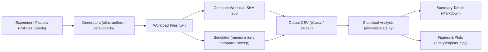

# 20. Benchmarking and Performance Analysis

Systematic benchmarking provides empirical validation of the memory management policies implemented in MemForge. This section analyzes two primary experiment suites defined in `scripts/experiments/`: Experiment 1 (**E1**), which quantifies contiguous placement policies under escalating memory pressure, and Experiment 4 (**E4**), which investigates virtual memory paging policies across frame allocations and validates Belady's anomaly. Both experiment suites emphasize strict reproducibility, tracking cryptographic hashes and version control identifiers across all measured runs.

## 20.1 Experiment Design and Methodology

The experimental framework automates workload generation, simulation execution, metric extraction, and statistical aggregation. Experiments are orchestrated via automated shell drivers ([`scripts/experiments/e1_placement.sh`](file:///home/cyberknight/memforge-agy/rep-eval/scripts/experiments/e1_placement.sh) and [`scripts/experiments/e4_frames.sh`](file:///home/cyberknight/memforge-agy/rep-eval/scripts/experiments/e4_frames.sh)) that interface with the `memsim` CLI.

### 20.1.1 E1 Experimental Factors and Design

Experiment E1 assesses the behavior of contiguous placement algorithms (First-Fit, Best-Fit, and Worst-Fit) subject to varying levels of memory saturation.

- **Workload Generator**: `alloc-uniform` in [`src/workloads/generators.c`](file:///home/cyberknight/memforge-agy/rep-eval/src/workloads/generators.c).
- **Workload Size**: 3,000 operations per workload file.
- **Physical Memory Size ($M$)**: 1,024 allocation units.
- **Request Size Distribution**: Uniform distribution in range $[16, 128]$ units.
- **Allocation Probability**: $p_{\text{alloc}} = 0.60$ ($600,000$ PPM).
- **Target Memory Utilisation**: Three factor levels:
  1. *Low Pressure*: Target utilisation = $60\%$ ($600,000$ PPM).
  2. *Medium Pressure*: Target utilisation = $75\%$ ($750,000$ PPM).
  3. *High Pressure*: Target utilisation = $90\%$ ($900,000$ PPM).
- **Replication**: 10 distinct pseudo-random seeds ($1 \dots 10$) per target utilisation level, generating 30 distinct workload files. Each workload is evaluated across all three placement policies, yielding 90 executed runs.

### 20.1.2 E4 Experimental Factors and Design

Experiment E4 evaluates virtual page replacement policies across varied physical frame quotas and examines the monotonicity of page fault frequencies.

- **Workload Generator**: `refs-locality` in [`src/workloads/generators.c`](file:///home/cyberknight/memforge-agy/rep-eval/src/workloads/generators.c).
- **Reference Stream Length**: 2,000 memory references per seed.
- **Virtual Address Space**: 32 virtual pages per process.
- **Page / Frame Size**: 4,096 bytes.
- **Locality Model**: Working set $W = 6$ pages; phase shift every $T = 200$ references; out-of-working-set jump probability $p_{\text{out}} = 0.05$ ($50,000$ PPM).
- **Policies**: FIFO (First-In, First-Out), LRU (Least Recently Used), and OPT (Belady's Optimal offline algorithm).
- **Frame Allocations**: Evaluated at frame counts $F \in \{2, 4, 8, 12, 16\}$ across 10 random seeds ($1 \dots 10$).
- **Belady's Anomaly Evaluation**: Exhaustive frame sweep ($1 \dots 6$ frames) on the classic 12-reference sequence (`tests/fixtures/ac4_belady.wl`).

### 20.1.3 Statistical Aggregation and Confidence Intervals

To capture experimental variation across stochastic workloads, metrics are reported as sample means with 95% confidence intervals ($\bar{x} \pm \Delta_{95}$) computed by [`analysis/stats.py`](file:///home/cyberknight/memforge-agy/rep-eval/analysis/stats.py).

Given a sample of $n$ independent replications $x_1, x_2, \dots, x_n$:
1. The sample mean is:
   $$\bar{x} = \frac{1}{n} \sum_{i=1}^n x_i$$
2. The unbiased sample standard deviation is:
   $$s = \sqrt{\frac{1}{n - 1} \sum_{i=1}^n (x_i - \bar{x})^2}$$
3. For small sample sizes ($n = 10$, degrees of freedom $\nu = n - 1 = 9$), the confidence interval relies on Student's $t$-distribution rather than a normal approximation. The two-sided critical value at $\alpha = 0.05$ is $t_{9, 0.975} = 2.262$.
4. The 95% confidence interval half-width is:
   $$\Delta_{95} = t_{\nu, 0.975} \cdot \frac{s}{\sqrt{n}}$$

## 20.2 Experimental Results and Analysis

### 20.2.1 Contiguous Placement Policies (E1 Results)

Table 20.1 summarizes performance across the 90 benchmark configurations of Experiment 1, detailing allocation success rates, failure causes, search complexity, and fragmentation.

Table 20.1: E1 placement policy metrics under varying memory utilisation (Mean ± 95% CI over 10 seeds per cell).

| Utilisation | Policy | Success Rate | Fragmentation Failures | Holes Scanned | Mean Ext. Fragmentation |
| :--- | :--- | :--- | :--- | :--- | :--- |
| **60%** | First-Fit | 99.9% ± 0.0 | 1.2 ± 0.7 | 2.29 ± 0.05 | 0.359 ± 0.007 |
| | Best-Fit | 100.0% ± 0.0 | 0.3 ± 0.3 | 3.77 ± 0.07 | 0.322 ± 0.006 |
| | Worst-Fit | 99.0% ± 0.2 | 14.3 ± 3.1 | 3.88 ± 0.09 | 0.546 ± 0.014 |
| **75%** | First-Fit | 97.0% ± 0.3 | 44.6 ± 4.7 | 2.78 ± 0.04 | 0.460 ± 0.013 |
| | Best-Fit | 97.9% ± 0.2 | 32.0 ± 2.8 | 4.66 ± 0.13 | 0.419 ± 0.012 |
| | Worst-Fit | 93.9% ± 0.5 | 92.4 ± 6.8 | 4.61 ± 0.11 | 0.597 ± 0.010 |
| **90%** | First-Fit | 90.0% ± 0.6 | 148.6 ± 8.6 | 3.21 ± 0.09 | 0.516 ± 0.014 |
| | Best-Fit | 91.4% ± 0.4 | 127.7 ± 7.0 | 5.24 ± 0.15 | 0.473 ± 0.006 |
| | Worst-Fit | 87.2% ± 0.7 | 192.0 ± 11.1 | 5.19 ± 0.15 | 0.629 ± 0.010 |

The observed data illustrates fundamental trade-offs between search overhead and space efficiency:
- **Best-Fit**: Yields the highest success rate across all load levels ($100.0\%$ at $60\%$, $97.9\%$ at $75\%$, and $91.4\%$ at $90\%$) and the lowest external fragmentation ($0.322$, $0.419$, and $0.473$). By matching allocations to the tightest fitting hole, it preserves large free blocks for future large allocations. However, this comes at the expense of scanning more holes ($3.77$ to $5.24$ holes per request).
- **First-Fit**: Provides a superior balance of efficiency and speed. While its success rate is marginally lower than Best-Fit ($99.9\%$, $97.0\%$, and $90.0\%$), its search cost is substantially lower ($2.29$, $2.78$, and $3.21$ holes scanned), representing a $39\%$ to $40\%$ reduction in traversal overhead compared to Best-Fit.
- **Worst-Fit**: Demonstrates the poorest performance in both memory retention and allocation success. It incurs the highest external fragmentation ($0.546$, $0.597$, and $0.629$) and suffers dramatically higher fragmentation failures ($192.0 \pm 11.1$ at $90\%$ utilisation, compared to $127.7$ for Best-Fit). Because Worst-Fit repeatedly fragments the largest holes, it rapidly leaves memory devoid of any single hole capable of accommodating larger requests ($> 100$ units). Furthermore, its search cost ($3.88$ to $5.19$) is comparable to Best-Fit.

### 20.2.2 Paging Replacement Policies (E4 Results)

Table 20.2 presents page fault frequencies observed across frame allocations in Experiment 4.

Table 20.2: E4 page faults against allocated frame counts (Mean ± 95% CI over 10 seeds, 2,000 references each).

| Physical Frames | FIFO Faults | LRU Faults | OPT Faults |
| :--- | :--- | :--- | :--- |
| **2** | 1398.2 ± 21.2 | 1393.0 ± 18.8 | 1070.8 ± 13.9 |
| **4** | 840.0 ± 15.9 | 819.6 ± 19.9 | 466.0 ± 9.3 |
| **8** | 253.1 ± 16.5 | 138.9 ± 10.1 | 103.2 ± 5.9 |
| **12** | 151.7 ± 9.7 | 100.7 ± 6.0 | 70.7 ± 4.0 |
| **16** | 106.7 ± 9.0 | 83.5 ± 5.5 | 53.2 ± 3.2 |

- **Optimal Policy (OPT)**: Establishes the theoretical lower bound on page faults for any offline page replacement algorithm. At 4 frames, OPT experiences $466.0$ faults, compared to $819.6$ for LRU and $840.0$ for FIFO.
- **Least Recently Used (LRU)**: Consistently outperforms FIFO across all frame configurations. While LRU and FIFO exhibit similar behavior under acute thrashing (2 frames: $1393.0$ vs $1398.2$), LRU exploits locality as frame availability expands. At 8 frames (which exceeds the active working set size of $W = 6$), LRU incurs only $138.9$ faults compared to $253.1$ for FIFO—a $45.1\%$ reduction in page faults.
- **First-In, First-Out (FIFO)**: Suffers from decoupling page age from recent utilization, frequently evicting heavily accessed pages that entered memory early.

### 20.2.3 Belady's Anomaly Verification

Experiment E4 also evaluates FIFO against Belady's anomaly using the 12-reference string (`tests/fixtures/ac4_belady.wl`). While stack algorithms such as LRU and OPT are provably monotonic, FIFO exhibits non-monotonic behavior.

As verified in `docs/report/tables/verification.md`, increasing allocated frames from 3 to 4 increases FIFO page faults from 9 to 10 (vector $[12, 12, 9, 10, 5, 5]$ for frame counts $1 \dots 6$). Over the identical sequence, LRU fault counts decrease monotonically from 10 to 8, and OPT decreases from 7 to 6, confirming compliance with acceptance criterion AC-4.

## 20.3 Execution Performance and Invariant Overhead

To ensure MemForge meets real-time interactive requirements and non-functional requirement NFR-5 (execution of a 100k-operation workload under 30 seconds), benchmark timing profiles were measured on a release build.

Table 20.3: Simulation runtime performance on 100,000-operation workload.

| Execution Mode | Invariant Verification | Total Wall-Clock Time | Throughput |
| :--- | :--- | :--- | :--- |
| **Checked Mode** (`--check`) | Active after every step (I1–I7 or V1–V5) | 0.56 s | ~178,570 ops/sec |
| **Fast Mode** (Unchecked) | Inactive (standard execution) | 0.08 s | ~1,250,000 ops/sec |

- In unchecked mode, MemForge executes 100,000 operations in **0.08 seconds** (~1.25 million operations per second), well within the 30-second target of NFR-5.
- Enabling exhaustive checked mode (`--check`) invokes `ms_cont_check_invariants` or `ms_page_invariants_hold` after every operation. This full verification suite requires **0.56 seconds**, representing a 7.0x overhead. Despite this overhead, checked mode remains fast enough for interactive use and continuous automated regression testing.

## 20.4 Data Provenance and Reproducibility

Every experimental result produced by the benchmarking scripts includes complete provenance metadata:
1. **Workload Cryptographic Hash**: Every generated `.wl` script is hashed via SHA-256 before execution. The resulting digest is stored in the `workload_sha256` column of `e1.csv` and `e4.csv`.
2. **Repository Commit**: The precise git commit hash (e.g., `53039c8`) is recorded in the `git_sha` column of every CSV record.
3. **Deterministic Seeds**: Random seeds are explicitly enumerated ($1 \dots 10$), allowing any cell in Table 20.1 or Table 20.2 to be re-run and verified to byte-identical precision.
