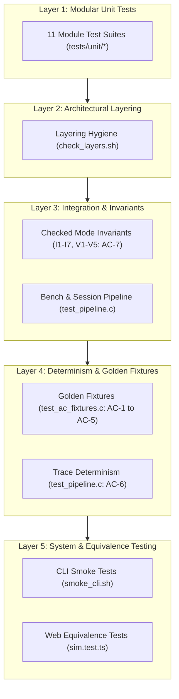
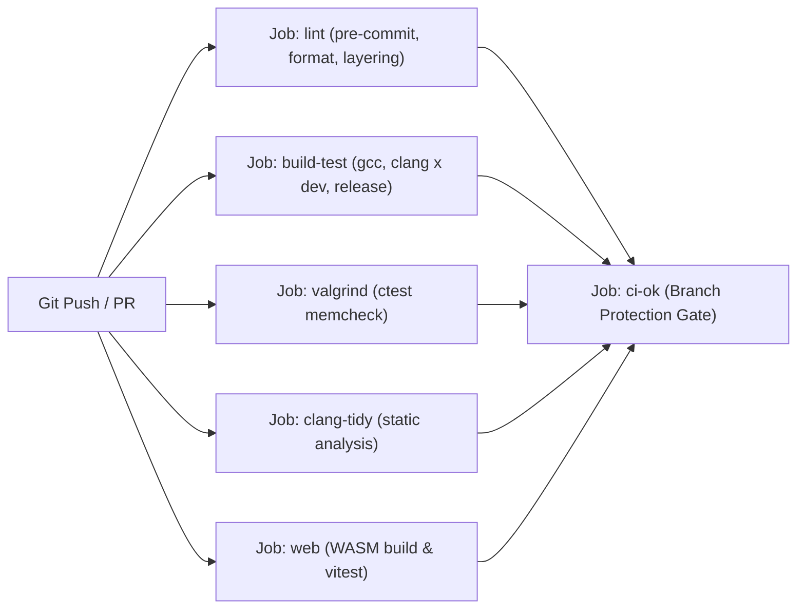

# 21. Testing Strategy and Correctness

Memory management software demands rigorous correctness guarantees: subtle pointer arithmetic errors, fragmentation accounting mismatches, or non-deterministic state mutations can compromise simulation fidelity. MemForge implements a multi-layered quality assurance strategy that combines unit testing, formal invariant verification, end-to-end golden fixtures, determinism validation, WebAssembly cross-compilation testing, dynamic sanitizers, Valgrind memory audits, and strict static analysis.

## 21.1 Test Pyramid and Verification Layers

MemForge organizes its validation suite into five hierarchical testing layers, balancing granular isolation against full-system fidelity.



### 21.1.1 Layer 1: Unit Testing per Module

Unit tests reside in [`tests/unit/`](file:///home/cyberknight/memforge-agy/rep-eval/tests/unit) and verify individual modules in complete isolation. Under CMake, unit test executables are granted private header access to their respective module under `src/<module>/`, allowing direct inspection of internal representations:
- **`common`** ([`tests/unit/common/test_smoke.c`](file:///home/cyberknight/memforge-agy/rep-eval/tests/unit/common/test_smoke.c)): Verifies foundational version macros, basic types, and error enumeration structures.
- **`contiguous`** ([`tests/unit/contiguous/`](file:///home/cyberknight/memforge-agy/rep-eval/tests/unit/contiguous)): Tests block allocation, coalescing upon free, exact-fit splitting, First-Fit, Best-Fit, Worst-Fit hole selection (`test_p3_policies.c`), fragmentation index calculation (`test_fragmentation.c`), sliding compaction algorithms (`test_compaction.c`), and random allocation sequences (`test_p4_random.c`).
- **`paging`** ([`tests/unit/paging/`](file:///home/cyberknight/memforge-agy/rep-eval/tests/unit/paging)): Validates address translation from virtual address to physical address, page table mapping, free frame allocation, dirty bit tracking, write-back event generation (`test_page_engine.c`), and eviction policies including FIFO, LRU, and OPT lookahead scanning (`test_replacement.c`).
- **`metrics`** ([`tests/unit/metrics/test_metrics.c`](file:///home/cyberknight/memforge-agy/rep-eval/tests/unit/metrics/test_metrics.c)): Tests fixed-point PPM calculations, event counter increments, and layout-driven metrics.
- **`trace`** ([`tests/unit/trace/test_writer.c`](file:///home/cyberknight/memforge-agy/rep-eval/tests/unit/trace/test_writer.c)): Verifies canonical JSONL serialization of trace headers, step events, snapshots, and summaries.
- **`workloads`** ([`tests/unit/workloads/`](file:///home/cyberknight/memforge-agy/rep-eval/tests/unit/workloads)): Tests line tokenization, header parsing, string interning, error reporting with line coordinates (`test_loader.c`), and pseudorandom generators (`test_generators.c`).

### 21.1.2 Layer 2: Architectural Layering Enforcement

Module boundaries are enforced statically by [`scripts/check_layers.sh`](file:///home/cyberknight/memforge-agy/rep-eval/scripts/check_layers.sh). The script parses all `#include` directives across `src/` to verify strict DAG (directed acyclic graph) dependencies. For example, the core engines (`contiguous`, `paging`) cannot include the higher-level `session` or `cli` modules, ensuring zero cyclic dependencies.

### 21.1.3 Layer 3: Integration and Determinism

The integration test suite in [`tests/integration/test_pipeline.c`](file:///home/cyberknight/memforge-agy/rep-eval/tests/integration/test_pipeline.c) tests the complete execution path through `Session` and `BenchmarkRunner`:
- **Trace Determinism (AC-6)**: Executes every acceptance fixture twice independently into temporary trace files and compares the outputs byte-for-byte. The trace files must match bit-for-bit, verifying that uninitialized memory padding, non-deterministic hash iteration, or pointer sorting cannot influence simulator traces.
- **Pipeline Consistency (AC-8)**: Asserts that comparative multi-policy execution correctly classifies and formats allocation failures (such as `fail FRAGMENTATION`).

### 21.1.4 Layer 4: Golden Acceptance Fixtures

Golden fixtures in [`tests/golden/test_ac_fixtures.c`](file:///home/cyberknight/memforge-agy/rep-eval/tests/golden/test_ac_fixtures.c) evaluate committed `.wl` workload scripts against textbook scenarios and predetermined acceptance criteria:
- **`ac1_silberschatz.wl`**: Validates the five-hole contiguous allocation scenario from Silberschatz across First-Fit, Best-Fit, and Worst-Fit.
- **`ac2_compact.wl`**: Verifies full order-preserving sliding compaction and subsequent retry of failed allocations.
- **`ac3_refs.wl`**: Asserts exact page fault counts (15 for FIFO, 12 for LRU, 9 for OPT) on a 20-reference string with 3 physical frames.
- **`ac4_belady.wl`**: Sweeps frames $1 \dots 6$ to verify Belady's anomaly in FIFO at frame 4 and confirms monotonic fault reduction in LRU and OPT.
- **`ac5_contiguous.wl` & `ac5_paging.wl`**: Tests error rejection of duplicate IDs, double frees, invalid sizes, and illegal process memory accesses.

### 21.1.5 Layer 5: CLI Smoke and Web Equivalence Testing

Top-level system behavior is validated through two automated harnesses:
1. **CLI Smoke Suite** ([`scripts/smoke_cli.sh`](file:///home/cyberknight/memforge-agy/rep-eval/scripts/smoke_cli.sh)): Executes the compiled native `memsim` binary through subcommands: `validate`, `compare`, `refs`, `sweep`, `gen`, and `run --trace`, checking expected exit codes and output patterns.
2. **WebAssembly Equivalence Suite** ([`web/src/lib/sim.test.ts`](file:///home/cyberknight/memforge-agy/rep-eval/web/src/lib/sim.test.ts)): The core C simulator engine is compiled to WebAssembly via `clang --target=wasm32-wasi` and linked with `wasi-libc`. Using Vitest, the test suite executes the WebAssembly engine in a Node.js/browser-like environment across all acceptance fixtures (`ac1` through `ac5`) and policies, comparing its generated JSONL trace records against those produced by the native C CLI executable. This ensures exact cross-platform behavioral equivalence between the desktop CLI and the browser application.


## 21.2 Checked Mode Invariants

MemForge implements structural invariant checking active after every operational step when `--check` is specified or during the test suite. If any invariant is violated, execution terminates immediately with a diagnostic assertion.

### 21.2.1 Contiguous Allocation Invariants (I1–I7)

Contiguous invariants are evaluated by `ms_cont_check_invariants` in [`src/contiguous/invariants.c`](file:///home/cyberknight/memforge-agy/rep-eval/src/contiguous/invariants.c):
- **I1 (Complete Address Space Coverage)**: Blocks are sorted strictly by address; the first block begins at address $0$; block $i$ begins exactly where block $i-1$ ends ($\text{start}_i = \text{start}_{i-1} + \text{size}_{i-1}$); and the final block ends at memory capacity $M$.
- **I2 (Strict Positivity)**: Every block satisfies $\text{size} > 0$. Zero-length blocks are forbidden.
- **I3 (Maximal Coalescing)**: No two adjacent blocks may both reside in the `MS_BLOCK_FREE` state.
- **I4 (Ownership Consistency)**: An allocated block must have valid process and allocation IDs ($\text{pid} \neq \text{MS\_NONE} \land \text{alloc\_id} \neq \text{MS\_NONE}$). A free block must have $\text{pid} = \text{MS\_NONE} \land \text{alloc\_id} = \text{MS\_NONE}$.
- **I5 (Unique Allocation ID Mapping)**: The number of active IDs in the tracking table must equal the count of allocated blocks, ensuring no allocation ID is mapped to multiple blocks or left unreferenced.
- **I6 (Conservation of Storage Units)**: The sum of all allocated block sizes plus all free hole sizes must equal total memory capacity $M$ ($\sum \text{used} + \sum \text{free} = M$). Furthermore, for every block, granted size matches requested size.
- **I7 (Pairwise Disjoint ID States)**: The sets of live, freed, and failed allocation IDs are disjoint by construction, enforced structurally via an ID state table.

### 21.2.2 Paging Virtual Memory Invariants (V1–V5)

Paging invariants are verified by `ms_page_invariants_hold` in [`src/paging/invariants.c`](file:///home/cyberknight/memforge-agy/rep-eval/src/paging/invariants.c):
- **V1 (Bidirectional Table-Frame Consistency)**: For every allocated frame $f$, the frame table owner $(p, v)$ maps to a valid page table entry for process $p$ where $\text{PTE}[v].\text{present} = \text{true}$ and $\text{PTE}[v].\text{frame} = f$. Conversely, every present PTE must be reflected in the frame table.
- **V2 (Disjoint Frame Allocation)**: Free frame pool entries and occupied physical frames are mutually exclusive and together partition the physical frame space $[0, F - 1]$.
- **V3 (Non-Present PTE Sanitization)**: Any page table entry where $\text{present} = \text{false}$ must have $\text{frame} = \text{MS\_NONE}$, $\text{referenced} = \text{false}$, and $\text{dirty} = \text{false}$.
- **V4 (Frame Capacity Bounds)**: The total number of resident pages across all active processes cannot exceed physical frame capacity $F$.
- **V5 (Conservation of Paging References)**: Reference accounting must satisfy:
  $$\text{hits} + \text{faults} = \text{refs}$$
  $$\text{faults} = \text{pool\_takes} + \text{evictions}$$
  $$\text{writebacks} \le \text{evictions}$$

## 21.3 Dynamic Sanitizers, Valgrind, and Static Analysis

To ensure complete memory safety and standard compliance, MemForge integrates multiple automated static and dynamic validation tools.

Table 21.1: Verification tools and quality gates.

| Tool | Invocation / Preset | Scope | Failure Criteria |
| :--- | :--- | :--- | :--- |
| **AddressSanitizer (ASan)** | `-fsanitize=address` (`dev` preset) | Heap bounds, use-after-free, double free | Any memory defect halts process |
| **UBSan** | `-fsanitize=undefined` (`dev` preset) | Integer overflow, alignment, undefined shifts | Any undefined behavior halts process |
| **Valgrind Memcheck** | `ctest --preset valgrind` | Uninitialized memory reads, memory leaks | `--error-exitcode=1`, definite/indirect leaks |
| **clang-tidy** | Release compile commands | Static bug analysis, CERT rules, MISRA | `WarningsAsErrors: '*'` |
| **Compiler Flags** | GCC & Clang (`-Wall -Wextra ...`) | Pedantic standard compliance (C17) | `-Werror` (warnings treated as errors) |

### 21.3.1 AddressSanitizer and UndefinedBehaviorSanitizer

The `dev` CMake preset enables AddressSanitizer and UndefinedBehaviorSanitizer via `-fsanitize=address,undefined -fno-omit-frame-pointer`. This configuration detects buffer overflows, memory leaks, invalid pointer dereferences, and integer overflows during daily unit test execution. In the continuous integration environment on Ubuntu 24.04, `vm.mmap_rnd_bits=28` is configured to prevent ASan initialization conflicts with kernel address space layout randomization (ASLR).

### 21.3.2 Valgrind Memcheck Suite

While sanitizers instrument binaries at compile time, Valgrind performs binary-level translation to detect uninitialized memory reads. The `valgrind` preset builds un-instrumented debug binaries and runs every test target under:
```bash
valgrind --quiet --error-exitcode=1 --leak-check=full --errors-for-leak-kinds=definite,indirect
```
This ensures zero memory leaks upon process exit and confirms all allocated structures in `ms_session`, `ms_workload`, and engine modules are freed.

### 21.3.3 Static Analysis with clang-tidy

Static code analysis is governed by [`.clang-tidy`](file:///home/cyberknight/memforge-agy/rep-eval/.clang-tidy). The configuration enables checkers from `bugprone-*`, `cert-*`, `clang-analyzer-*`, `misc-*`, `performance-*`, and `readability-*`, while treating all diagnostics as fatal errors (`WarningsAsErrors: '*'`). First-party headers in `include/memsim/` are checked while third-party libraries are excluded.

## 21.4 Continuous Integration Workflow

Continuous integration is automated via GitHub Actions in [`.github/workflows/ci.yml`](file:///home/cyberknight/memforge-agy/rep-eval/.github/workflows/ci.yml). Every pull request and push to the `main` branch triggers five parallel verification jobs:



1. **`lint`**: Runs `pre-commit` hooks, formatting checks (`clang-format`), and `scripts/check_layers.sh` to enforce architecture rules.
2. **`build-test`**: Compiles and executes `ctest` across a $2 \times 2$ matrix: compilers {`gcc`, `clang`} $\times$ presets {`dev`, `release`}. The `dev` preset verifies runtime assertions under ASan/UBSan, while `release` compiles with `-O2` to expose optimization-level diagnostics.
3. **`valgrind`**: Compiles debug targets and executes the test suite under Valgrind Memcheck.
4. **`clang-tidy`**: Performs comprehensive static analysis against the compilation database.
5. **`web`**: Compiles the C engine to WebAssembly (`scripts/build_wasm.sh`), builds native CLI binaries, and runs `npm test` (`vitest`) in `web/` to verify browser-CLI equivalence.
6. **`ci-ok`**: Serves as the single required branch-protection status check, confirming that all preceding jobs succeeded.
