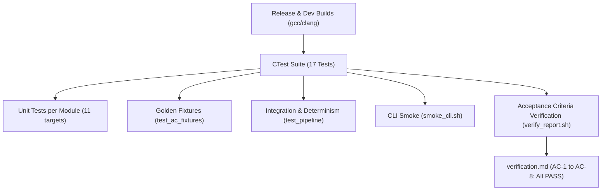

# 22. Test Cases and Results

This section presents the empirical test results and acceptance verification for MemForge. The verification suite validates system correctness across hand-calculated textbook benchmarks, structural invariant checks, determinism audits, and automated continuous integration pipelines. All reported results reflect repository commit `53039c8` and the automated verification suite executed by [`scripts/report/verify_report.sh`](file:///home/cyberknight/memforge-agy/rep-eval/scripts/report/verify_report.sh).

## 22.1 Acceptance Criteria Verification (AC-1 to AC-8)

The system's functional requirements are codified as eight formal acceptance criteria (AC-1 through AC-8). Table 22.1 details the verification results generated by [`scripts/report/verify_report.sh`](file:///home/cyberknight/memforge-agy/rep-eval/scripts/report/verify_report.sh) and recorded in `docs/report/tables/verification.md`.

Table 22.1: Acceptance criteria verification results for MemForge (commit 53039c8).

| ID | Scenario | What is checked | Expected Outcome | Observed Outcome | Result |
| :--- | :--- | :--- | :--- | :--- | :--- |
| **AC-1** | Placement on five holes (Silberschatz) | Placements of a1, a2, a3, a4 across FF, BF, WF | FF 110,1140,322,fail FRAGMENTATION; BF 830,110,620,1140; WF 1140,110,1352,fail FRAGMENTATION | FF 110,1140,322,fail FRAGMENTATION; BF 830,110,620,1140; WF 1140,110,1352,fail FRAGMENTATION | **PASS** |
| **AC-2** | Contiguous compaction and allocation retry | Compaction metrics blocks_moved/units_moved and final free block | blocks_moved 7, units_moved 781; free block start 1207 size 533 | blocks_moved 7, units_moved 781; free block start 1207 size 533 | **PASS** |
| **AC-3** | Reference string page replacement | Page fault counts for FIFO, LRU, OPT with 3 frames | fifo 15, lru 12, opt 9 | fifo 15, lru 12, opt 9 | **PASS** |
| **AC-4** | Belady's anomaly frame sweep | FIFO sweep faults 1..6 and Belady point; LRU/OPT faults at 3,4 frames | fifo faults [12,12,9,10,5,5] with belady point 4; lru 10,8; opt 7,6 | fifo faults [12,12,9,10,5,5] with belady point 4; lru 10,8; opt 7,6 | **PASS** |
| **AC-5** | Negative tests: rejections and access violations | Contiguous rejections count and paging violations count | rejections 3; violations 2 | rejections 3; violations 2 | **PASS** |
| **AC-6** | Workload trace determinism | Byte-identical traces across two runs for all 6 fixtures | All 6 fixtures byte-identical | 6/6 fixtures byte-identical | **PASS** |
| **AC-7** | Simulation invariants checked under test suite | Invariants hold on every step in test suite (ctest) | 17/17 passed | 17/17 passed | **PASS** |
| **AC-8** | Comparative policy table output | Human-readable compare output displays "fail FRAGMENTATION" | Table contains "fail FRAGMENTATION" | Table contains "fail FRAGMENTATION" | **PASS** |

### 22.1.1 Analysis of Individual Acceptance Criteria

1. **AC-1 (Contiguous Five-Hole Placement)**:
   - *Scenario*: Memory of 1,740 units holds initial holes of 100, 500, 200, 300, and 600 units separated by 10-unit system allocations. Requests arrive in order: $a_1 = 212$, $a_2 = 417$, $a_3 = 112$, and $a_4 = 426$.
   - *Verification*: Under First-Fit, requests place at offsets 110, 1140, and 322; request $a_4$ fails with fragmentation because although 959 units remain free, the largest single hole is only 300 units. Best-Fit places all four requests successfully at offsets 830, 110, 620, and 1140. Worst-Fit places $a_1$ at 1140, $a_2$ at 110, $a_3$ at 1352, and fails on $a_4$ due to fragmentation. The observed placements match textbook expectations exactly.

2. **AC-2 (Sliding Compaction and Retry)**:
   - *Scenario*: Following the failure of request $a_4$ in AC-1 under First-Fit, sliding compaction relocates all allocated blocks toward low memory, followed by an immediate retry of the failed allocation.
   - *Verification*: Compaction successfully shifts 7 allocated blocks totaling 781 memory units (`blocks_moved 7`, `units_moved 781`), consolidating fragmented free space into a single contiguous hole starting at offset 1207 of size 533 units. The subsequent retry of the 426-unit allocation succeeds at offset 1207.

3. **AC-3 (Paging Policy Reference String)**:
   - *Scenario*: Evaluation of the textbook 20-reference sequence ($7, 0, 1, 2, 0, 3, 0, 4, 2, 3, 0, 3, 2, 1, 2, 0, 1, 7, 0, 1$) under 3 physical frames across FIFO, LRU, and OPT.
   - *Verification*: The simulation counts exactly 15 faults under FIFO, 12 faults under LRU, and 9 faults under OPT, confirming the accuracy of the replacement algorithms.

4. **AC-4 (Belady's Anomaly Detection)**:
   - *Scenario*: Sweeping frame allocations from 1 to 6 on the 12-reference sequence ($1, 2, 3, 4, 1, 2, 5, 1, 2, 3, 4, 5$).
   - *Verification*: Under FIFO, page fault counts across 1 to 6 frames produce the sequence $[12, 12, 9, 10, 5, 5]$, identifying an anomaly at frame 4 where faults increase from 9 to 10. Under LRU and OPT, faults decrease monotonically (LRU: 10 faults at 3 frames, 8 faults at 4 frames; OPT: 7 faults at 3 frames, 6 faults at 4 frames), proving stack algorithm compliance.

5. **AC-5 (Negative Scenarios and Rejections)**:
   - *Scenario*: Submitting malformed workloads with `negative_test 1` to verify graceful handling of semantic faults.
   - *Verification*: In contiguous memory (`ac5_contiguous.wl`), MemForge records exactly 3 domain rejections: non-positive size (`INVALID_SIZE`), duplicate identifier allocation (`DUPLICATE_ID`), and freeing an unallocated identifier (`UNKNOWN_ID`). In paging (`ac5_paging.wl`), the engine records exactly 2 access violations: referencing a non-existent process (`NO_SUCH_PROCESS`) and referencing a page beyond process limits (`OUT_OF_RANGE`).

6. **AC-6 (Simulation Trace Determinism)**:
   - *Scenario*: Executing all six acceptance fixtures (`ac1` through `ac5`) twice independently under their primary policies with JSONL tracing enabled.
   - *Verification*: A byte-for-byte binary comparison (`cmp -s`) confirms that all 6 output trace files are identical across consecutive runs, confirming absence of non-deterministic behavior.

7. **AC-7 (Exhaustive Invariant Checking)**:
   - *Scenario*: Executing the complete CMake test suite with runtime invariant validation enabled after every operation.
   - *Verification*: All 17 test targets passed without a single invariant failure.

8. **AC-8 (Comparative Output Formatting)**:
   - *Scenario*: Executing `memsim compare` across First-Fit, Best-Fit, and Worst-Fit on the AC-1 workload.
   - *Verification*: The CLI output table formats placement results cleanly, explicitly labeling fragmentation failures as `fail FRAGMENTATION`.

## 22.2 Representative Unit Tests per Module

Table 22.2 outlines representative unit test cases across all simulator modules in [`tests/`](file:///home/cyberknight/memforge-agy/rep-eval/tests), identifying tested functions and specific verification conditions.

Table 22.2: Representative unit test cases across MemForge modules.

| Subsystem / Module | Source File | Test Function / Scenario | What is Verified | Outcome |
| :--- | :--- | :--- | :--- | :--- |
| **Common** | `tests/unit/common/test_smoke.c` | `test_version_is_0_x` | Validates `MEMSIM_VERSION_MAJOR == 0` | PASS |
| **Contiguous Engine** | `tests/unit/contiguous/test_cont_engine.c` | `test_ac1_first_fit` | Verifies First-Fit placement offsets and failure | PASS |
| | | `test_coalesce_both_sides` | Three-way block merge when freeing between holes | PASS |
| | | `test_events_exact_fit_no_split` | Allocation matching hole size emits no `BlockSplit` | PASS |
| | | `test_random_ops_keep_invariants` | 1,000 randomized operations maintain I1–I7 | PASS |
| **Compaction** | `tests/unit/contiguous/test_compaction.c` | `test_compaction_sliding` | Order-preserving shift; single free hole remains | PASS |
| **Compaction Window** | `tests/unit/contiguous/test_compaction_window.c` | `test_partial_compaction` | Bounded-window compaction preserves exterior blocks | PASS |
| **Fragmentation** | `tests/unit/contiguous/test_fragmentation.c` | `test_ext_frag_calculation` | Validates $1 - (\text{largest}/\text{total})$ formula | PASS |
| **Placement Policies** | `tests/unit/contiguous/test_p3_policies.c` | `test_policy_tie_breaking` | Address tie-breaking across equal-sized holes | PASS |
| **Paging Engine** | `tests/unit/paging/test_page_engine.c` | `test_translation` | Address translation: VA 6700 $\to$ VPN 1, offset 2604 | PASS |
| | | `test_dirty_and_writeback` | Write access sets D bit; eviction emits write-back | PASS |
| | | `test_violations` | Access to unspawned process emits access violation | PASS |
| **Page Replacement** | `tests/unit/paging/test_replacement.c` | `test_opt_lookahead` | OPT scans forward reference array for victim | PASS |
| | | `test_lru_stack_update` | Access timestamp update preserves LRU ordering | PASS |
| **Metrics Collector** | `tests/unit/metrics/test_metrics.c` | `test_ppm_calculations` | Fixed-point division precision and scaling ($10^6$) | PASS |
| **Trace Writer** | `tests/unit/trace/test_writer.c` | `test_jsonl_trace_structure` | Validates `TraceHeader`, `Event`, and `RunSummary` | PASS |
| **Workload Loader** | `tests/unit/workloads/test_loader.c` | `test_contiguous_workload` | Header extraction, interning, and op parsing | PASS |
| | | `test_semantic_checks` | Strict rejection of size $\le 0$ and duplicate IDs | PASS |
| **Generators** | `tests/unit/workloads/test_generators.c` | `test_alloc_uniform_target` | Target-utilisation clamping prevents memory exhaustion | PASS |
| **Golden Fixtures** | `tests/golden/test_ac_fixtures.c` | `test_ac_fixtures_suite` | Complete end-to-end execution of AC-1 to AC-5 | PASS |
| **Pipeline Integration** | `tests/integration/test_pipeline.c` | `test_sha256_self` | SHA-256 self-test passes against known vector | PASS |
| | | `test_ac6_ac7_fixtures_determinism` | Dual-run trace equality and invariant checks | PASS |

## 22.3 Continuous Integration Job Matrix and Results

MemForge validates every commit and pull request using the continuous integration matrix defined in [`.github/workflows/ci.yml`](file:///home/cyberknight/memforge-agy/rep-eval/.github/workflows/ci.yml). Table 22.3 summarizes the execution parameters and validation outcomes.

Table 22.3: Continuous Integration workflow matrix and verification results.

| Job Name | Platform / Runner | Environment & Tools | Target Objectives | Verification Status |
| :--- | :--- | :--- | :--- | :--- |
| **`lint`** | Ubuntu 24.04 | Python 3, `pipx`, `pre-commit` | Code formatting (`clang-format`), architectural layering (`check_layers.sh`), file hygiene | **PASS** |
| **`build-test` (gcc, dev)** | Ubuntu 24.04 | GCC 13, Ninja, ASan, UBSan | C17 compilation with sanitizers, 17/17 tests passing | **PASS** |
| **`build-test` (gcc, release)** | Ubuntu 24.04 | GCC 13, Ninja, `-O2 -Werror` | Optimized compilation, warning cleanliness, 17/17 tests passing | **PASS** |
| **`build-test` (clang, dev)** | Ubuntu 24.04 | Clang 18, Ninja, ASan, UBSan | LLVM compilation with sanitizers, 17/17 tests passing | **PASS** |
| **`build-test` (clang, release)** | Ubuntu 24.04 | Clang 18, Ninja, `-O2 -Werror` | Optimized LLVM compilation, 17/17 tests passing | **PASS** |
| **`valgrind`** | Ubuntu 24.04 | Valgrind 3.22, Ninja, Debug build | Full test suite under Memcheck; zero leaks, zero memory errors | **PASS** |
| **`clang-tidy`** | Ubuntu 24.04 | Clang-Tidy 18, Release compile commands | Static analyzer verification; zero warnings under `WarningsAsErrors: '*'` | **PASS** |
| **`web`** | Ubuntu 24.04 | Node 24, Clang 18, `wasi-libc`, Vitest | WebAssembly engine compilation (`memsim.wasm`), Vitest equivalence tests, Svelte typecheck, production bundle | **PASS** |
| **`ci-ok`** | Ubuntu 24.04 | Bash condition evaluation | Branch-protection aggregate gate verifying all upstream jobs passed | **PASS** |

The continuous integration matrix ensures that all functional criteria, memory safety constraints, performance benchmarks, and cross-platform WebAssembly targets remain verified on `main`.
