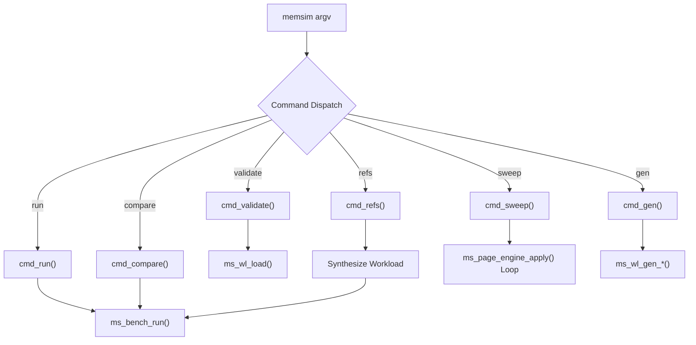
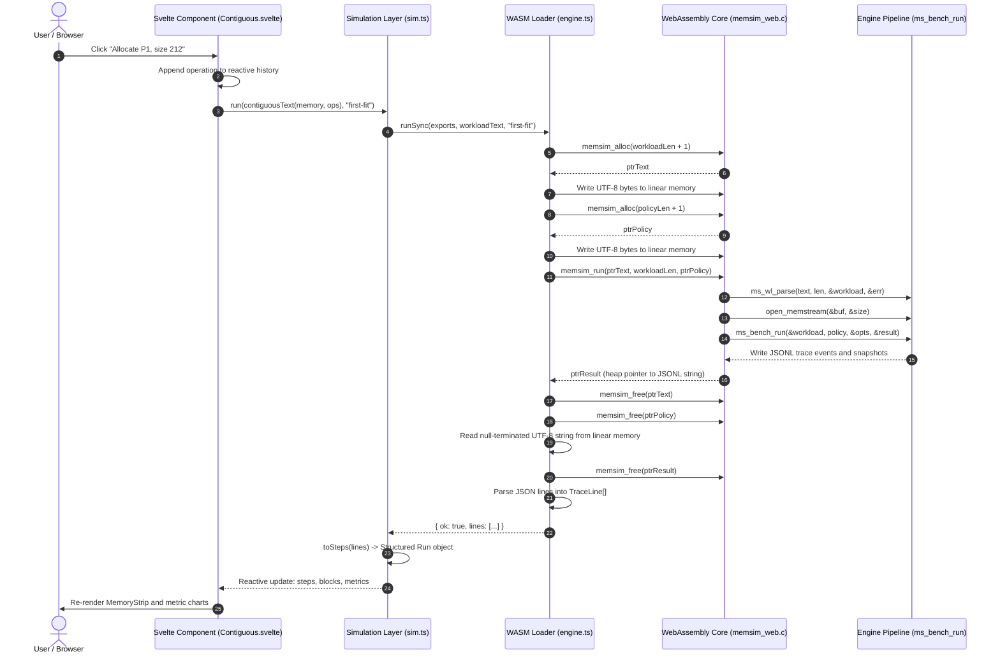

# 23. User Interface and Workflow

MemForge provides two unified interfaces for exploring and evaluating memory management policies: the `memsim` command-line interface (CLI) and an interactive web application. Both interfaces execute the identical C17 simulation engine. The CLI provides high-throughput, scriptable execution for benchmarking, verification, and automated grading. The web application, compiled to WebAssembly via LLVM and WASI libc, runs entirely client-side within the browser to provide visual exploration, timeline scrubbing, and comparative policy demonstration without requiring an external server.

## 23.1 Command-Line Interface (`memsim`)

The `memsim` CLI is implemented in [src/cli/main.c](file:///home/cyberknight/memforge-agy/rep-ops/src/cli/main.c). It acts as the primary user-facing binary and is linked against `memsim::bench`, which transitively integrates all simulator modules (`common`, `contiguous`, `paging`, `trace`, `workloads`, `metrics`, and `session`).

The executable follows standard POSIX process conventions and dispatches subcommands from `main()` (lines 1141–1176). The entry point verifies cryptographic primitives at initialization via `ms_sha256_self_test()` to guarantee trace integrity. Process exit codes adhere to the three-tier contract defined in the project architecture:
- `0`: Successful execution. Allocations that fail due to memory exhaustion or fragmentation are treated as valid simulation outcomes, not process errors.
- `2`: Command-line syntax error, invalid flag combination, or workload parse failure (reported with line and column numbers).
- `3`: Engine contract violation (`MS_ASSERT` failure) or unrecoverable out-of-memory error (`MS_ERR_NOMEM`).



### Command Reference

#### 1. `validate`
```bash
memsim validate <workload.wl>
```
Validates the structural and semantic integrity of a plain-text workload file without executing simulation steps. It invokes `cmd_validate()` (lines 60–75), which calls `ms_wl_load()` in strict mode. If errors are detected (such as duplicate block identifiers, invalid operations, negative sizes, or undeclared processes), the command emits `<path>:<line>: <message>` to `stderr` and returns exit code 2.

#### 2. `run`
```bash
memsim run <workload.wl> --policy <P> [--trace <file>] [--no-check] [--json]
```
Executes a single simulation run under policy `P`. The function `cmd_run()` (lines 126–191) computes the SHA-256 digest of the workload file using `ms_sha256_file()`, initializes execution options `ms_bench_opts`, and invokes `ms_bench_run()`.
- Supported contiguous policies: `first-fit`, `best-fit`, `worst-fit`.
- Supported paging policies: `fifo`, `lru`, `opt`.
- `--trace <file>`: Emits the canonical JSONL execution stream to `<file>`.
- `--no-check`: Disables post-step invariant assertions (enabled by default for verified execution).
- `--json`: Emits machine-readable run metrics as structured JSON.

#### 3. `compare`
```bash
memsim compare <workload.wl> --policies <P1,P2,...> [--json]
```
Executes multiple placement or replacement policies sequentially against the exact same parsed workload instance (`cmd_compare()`, lines 436–538). In human-readable mode, it renders:
1. An aligned placement table showing the allocated starting address of each request across policies, or explicit failure reasons (`fail FRAGMENTATION` or `fail CAPACITY`).
2. A side-by-side metric comparison matrix containing allocation success rates, external fragmentation averages, and search costs.

#### 4. `refs`
```bash
memsim refs "<r1 r2 ...>" --frames <F> --policy <P> [--table] [--json]
```
A rapid-evaluation command for paging algorithms (`cmd_refs()`, lines 644–750). It parses an inline space-separated string of virtual page numbers, generates an in-memory synthetic paging workload (`ms_op` stream with a single `MS_OP_SPAWN` followed by `MS_OP_ACCESS` operations), and executes the paging engine. When `--table` is passed, it outputs the classic textbook reference grid displaying frame contents at each discrete step and marking page faults with `F`.

#### 5. `sweep`
```bash
memsim sweep <file.wl> --policy <P> --frames <A..B> [--json]
```
Evaluates page fault frequencies across an inclusive range of physical frame allocations $[A, B]$ (`cmd_sweep()`, lines 898–980). It executes the workload across each frame configuration and prints `<frames> <faults>`. If Belady's anomaly occurs (i.e., fault count increases strictly when moving from $f$ to $f+1$ frames), the command marks the offending row with an asterisk (`*`).

#### 6. `gen`
```bash
memsim gen alloc-uniform|refs-locality --seed <S> [options] -o <file.wl>
```
Deterministic workload generator dispatch (`cmd_gen()`, lines 1125–1139).
- `alloc-uniform`: Generates contiguous allocation/free sequences with uniform request sizes in $[size_{min}, size_{max}]$ and allocation probability $p_{alloc}$, parameterized by `--ops`, `--memory-size`, `--size-min`, `--size-max`, and `--p-alloc-ppm`.
- `refs-locality`: Generates synthetic paging reference strings with temporal and spatial locality based on Denning's working set model, parameterized by `--n`, `--pages`, `--working-set`, `--shift-every`, `--p-out-ppm`, and `--p-write-ppm`.

## 23.2 Interactive Web Application

The MemForge web application is located in the [web/](file:///home/cyberknight/memforge-agy/rep-ops/web/) directory. It is built as a Single Page Application (SPA) using Svelte 5 and TypeScript, compiled and bundled via Vite. The web interface directly embeds the C simulation engine compiled into a WebAssembly reactor module, eliminating any divergence between CLI results and visual demonstrations.

```
web/
├── src/
│   ├── App.svelte              # Main navigation shell and router
│   ├── routes/
│   │   ├── Home.svelte         # Overview hero and curated scenarios
│   │   ├── Contiguous.svelte   # Contiguous memory lab
│   │   ├── Paging.svelte       # Demand paging lab
│   │   └── Replay.svelte       # Trace post-mortem viewer
│   ├── components/
│   │   ├── MemoryStrip.svelte  # Contiguous block layout visualization
│   │   ├── FrameTable.svelte   # Paging grid with hit/fault markers
│   │   └── Tokens.svelte       # Event narration tokenizer
│   ├── lib/
│   │   ├── engine.ts           # WebAssembly instantiation and WASI shim
│   │   └── sim.ts              # Workload serializer and trace decoder
└── wasm/
    └── memsim_web.c            # Exported C WebAssembly entry points
```

### Page Workflows

#### 1. Overview Page (`Home.svelte`)
The Overview page serves as the entry portal for the application. It includes a live hero component that runs the real C engine against the classic textbook five-hole benchmark (Silberschatz AC-1) under First-Fit. The visualization periodically cycles through execution steps at 2.6-second intervals using an animated memory bar (`MemoryStrip.svelte`) and natural-language event tokens (`Tokens.svelte`). Below the hero banner, six curated scenario cards provide one-click access into pre-configured lab environments:
1. *One request, three policies*: Side-by-side comparison of First-Fit, Best-Fit, and Worst-Fit on identical holes.
2. *Fragmentation, then compaction*: Demonstrates an allocation failure followed by sliding compaction and retry.
3. *Page replacement*: Evaluation of FIFO, LRU, and OPT over a 20-reference textbook string.
4. *Belady's anomaly*: Demonstration of FIFO page faults increasing from 9 to 10 when frames increase from 3 to 4.
5. *Dirty pages and two processes*: Two processes contending for 4 frames with dirty page write-backs.
6. *Address translation*: Deconstruction of virtual addresses into page numbers and offsets.


#### 2. Contiguous Memory Lab (`Contiguous.svelte`)
The Contiguous Memory Lab provides an interactive simulation sandbox for variable-partition memory management:
- **Presets**: Instant configuration of classic scenarios including the Silberschatz 5-hole baseline (1,740 units) or an unallocated buffer (1,024 units).
- **Interactive Controls**: Users can issue arbitrary allocation requests by specifying process identifier (`PID`) and size in units, trigger deallocations by clicking directly on allocated blocks in the strip, execute full sliding compaction, or terminate entire processes.
- **Comparative Mode**: When set to `compare`, the lab executes First-Fit, Best-Fit, and Worst-Fit concurrently on the current operation history, rendering synchronized memory strips and metric differentials.
- **Metrics and History**: Displays live sparklines of external fragmentation ($1 - \frac{\text{largest hole}}{\text{total free}}$), hole count, and total free memory, with full keyboard-driven step scrubbing (`ArrowLeft`/`ArrowRight`) and undo capabilities.


#### 3. Paging Lab (`Paging.svelte`)
The Paging Lab models virtual memory translation and frame allocation under FIFO, LRU, and OPT:
- **Reference Table**: Renders the complete historical references grid via `FrameTable.svelte`, detailing frame occupancy across time, hit/fault classifications (compulsory vs. capacity), and victim selections.
- **Belady Sweep Chart**: Re-runs the active reference string across frame sizes from 1 to 7 frames in real time, plotting the fault curve and visually marking non-monotonic Belady anomalies.
- **Address Translation Inspector**: When virtual addresses are supplied using the `@va` prefix, the UI decomposes the 32-bit address into Virtual Page Number (VPN) and page offset based on the configured page size, displaying the resolved Physical Address (PA) and page table flags (Present, Referenced, Dirty).
- **Transport Controls**: Automated playback timer with adjustable intervals, step navigation, and spacebar play/pause toggling.


#### 4. Trace Replay (`Replay.svelte`)
The Replay interface allows researchers and students to inspect offline simulations generated by the CLI:
- Accepts drag-and-drop ingestion of `.jsonl` files emitted by `memsim run --trace`.
- Validates the `TraceHeader` schema (requiring schema version 1) and reconstructs execution state without re-running the simulator.
- Dynamically adapts its visualization depending on whether the trace represents contiguous allocation (`MemoryStrip`) or demand paging (`FrameTable`), providing full timeline scrubbing, step inspection, and event metadata review.


## 23.3 WebAssembly Execution Engine and Interaction Flow

To guarantee absolute behavioral fidelity between the command-line tool and the web application, MemForge does not implement a JavaScript simulation fallback. Instead, the native C codebase is compiled to a WebAssembly reactor binary (`memsim.wasm`).

### WebAssembly Bridge Implementation

The compilation pipeline is orchestrated by [scripts/build_wasm.sh](file:///home/cyberknight/memforge-agy/rep-ops/scripts/build_wasm.sh). It compiles all engine source files from `src/` (excluding `src/cli/*`) together with [web/wasm/memsim_web.c](file:///home/cyberknight/memforge-agy/rep-ops/web/wasm/memsim_web.c) using Clang with `--target=wasm32-wasi` (or `wasm32-wasip1`) and `-mexec-model=reactor`.

The C bridge exports three symbols to the host environment:
1. `void *memsim_alloc(size_t n)`: Allocates $n$ bytes within the WebAssembly linear heap using the C runtime `malloc()`.
2. `void memsim_free(void *p)`: Releases WebAssembly heap memory via `free()`.
3. `char *memsim_run(const char *text, size_t len, const char *policy)`: Parses the workload string using `ms_wl_parse()`, opens an in-memory stream via POSIX `open_memstream()`, executes `ms_bench_run()`, and returns a pointer to a null-terminated JSONL trace buffer.

In the browser runtime, [web/src/lib/engine.ts](file:///home/cyberknight/memforge-agy/rep-ops/web/src/lib/engine.ts) instantiates the WebAssembly module with a minimal WASI Snapshot Preview 1 shim (`wasiShim()`). Because the simulation core strictly adheres to engine purity (NFR-2), it requires no file system access, network sockets, or system clocks. The shim satisfies WASI linking requirements with dummy implementations for standard descriptors (`fd_write` forwarding to memory offsets, `clock_time_get` returning 0) and maps `proc_exit` to a JavaScript exception.

### Sequence of an Interactive Action

The flow of an interactive user allocation in the Contiguous Lab proceeds through the system as shown in the sequence diagram below:



### Algorithm Specification

The WebAssembly execution dispatch algorithm is defined formally below.

```text
Algorithm 1: WebAssembly Run Dispatch
Input: WebAssembly exports instance ex, workload string W, policy string P
Output: Array of parsed JSON trace objects L or error descriptor (line, message)

1:  encoded_W ← UTF8Encode(W)
2:  encoded_P ← UTF8Encode(P)
3:  ptr_W ← ex.memsim_alloc(Length(encoded_W) + 1)
4:  ptr_P ← ex.memsim_alloc(Length(encoded_P) + 1)
5:  CopyMemory(destination: ex.memory.buffer + ptr_W, source: encoded_W)
6:  ex.memory.buffer[ptr_W + Length(encoded_W)] ← 0
7:  CopyMemory(destination: ex.memory.buffer + ptr_P, source: encoded_P)
8:  ex.memory.buffer[ptr_P + Length(encoded_P)] ← 0
9:  ptr_out ← ex.memsim_run(ptr_W, Length(encoded_W), ptr_P)
10: ex.memsim_free(ptr_W)
11: ex.memsim_free(ptr_P)
12: if ptr_out = 0 then
13:     return Error(line: 0, message: "Out of memory in WebAssembly engine")
14: end if
15: raw_text ← ReadNullTerminatedString(ex.memory.buffer, ptr_out)
16: ex.memsim_free(ptr_out)
17: if raw_text starts with "!" then
18:     (err_line, err_msg) ← ParseErrorString(raw_text)
19:     return Error(line: err_line, message: err_msg)
20: end if
21: L ← []
22: for each line in SplitLines(Trim(raw_text)) do
23:     Append(L, JSONParse(line))
24: end for
25: return Success(lines: L)
```

**Complexity Analysis**:
- **Time Complexity**: $\mathcal{O}(|W| + N_{\text{events}})$, where $|W|$ is the length of the workload text and $N_{\text{events}}$ is the total number of events emitted during simulation. Allocation and string copying into WebAssembly linear memory take linear time $\mathcal{O}(|W| + |P|)$. Simulation runtime is bounded by the underlying policy algorithms ($\mathcal{O}(H)$ per contiguous step where $H$ is hole count; $\mathcal{O}(F)$ per paging step where $F$ is frame count). Trace serialisation via `open_memstream` and client-side JSON parsing are linear in trace size.
- **Space Complexity**: $\mathcal{O}(|W| + M_{\text{trace}})$, where $M_{\text{trace}}$ is the total memory allocated for the serialized JSONL trace in WebAssembly linear memory and subsequently deserialized into JavaScript objects. All intermediate buffers allocated in the WebAssembly heap (`ptr_W`, `ptr_P`, `ptr_out`) are freed explicitly before control returns.
