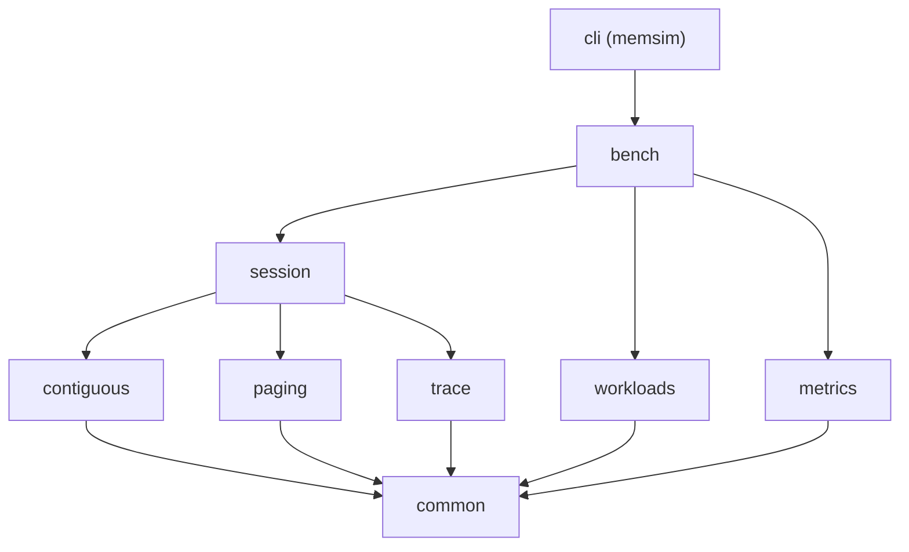

# 25. Repository Structure and Conventions

This section documents the architectural structure of the MemForge repository, the modularization model governing the C codebase, the team ownership matrix, and the development conventions established in [docs/CONVENTIONS.md](file:///home/cyberknight/memforge-agy/rep-ops/docs/CONVENTIONS.md) and [README.md](file:///home/cyberknight/memforge-agy/rep-ops/README.md).

## 25.1 Repository File Tree

The MemForge repository is organized into distinct top-level directories separating core engine implementations, testing suites, automated experiments, web applications, and documentation:

```text
memforge/
├── CMakeLists.txt                # Top-level build specification
├── CMakePresets.json             # Standard build presets (dev, release, valgrind)
├── LICENSE                       # MIT open-source license
├── README.md                     # Project overview and quick-start guide
├── .pre-commit-config.yaml       # Formatting, hygiene, and layering Git hooks
├── .github/
│   ├── CODEOWNERS                # Subsystem ownership assignments
│   └── workflows/
│       └── ci.yml                # GitHub Actions CI pipeline specification
├── cmake/
│   └── MemsimModule.cmake        # memsim_module() modular target definition function
├── src/                          # Modular C17 simulation engine
│   ├── common/                   # Shared kernel: types, errors, events, bus, rng
│   ├── contiguous/               # Memory model, placement policies, compaction
│   ├── paging/                   # MMU, page tables, replacement policies, Belady
│   ├── trace/                    # Canonical JSONL trace writer and snapshot logic
│   ├── workloads/                # Workload parser, validator, and PRNG generators
│   ├── metrics/                  # Run metrics collector and online statistical accumulator
│   ├── session/                  # Client facade coordinating engines, traces, and events
│   ├── bench/                    # Execution harness driving workloads and configurations
│   └── cli/                      # Command-line interface executable (memsim)
├── tests/                        # Multi-tiered verification test suite
│   ├── test.h                    # Dependency-free unit test harness
│   ├── unit/                     # Unit tests per module (accesses private headers)
│   ├── golden/                   # Acceptance scenario fixtures (AC-1 to AC-5)
│   ├── property/                 # Seeded property-based invariant fuzzing
│   ├── oracle/                   # Differential testing against brute-force oracles
│   └── fixtures/                 # Canonical workload files (.wl)
├── benchmarks/
│   └── specs/                    # Workload benchmark specifications
├── analysis/                     # Statistical reduction and visualization scripts
│   ├── plot_e1.py                # Contiguous allocation plotting script
│   ├── plot_e4.py                # Paging fault sweep plotting script
│   ├── stats.py                  # Student's t-distribution confidence interval utility
│   └── summarize.py              # Experiment markdown table generator
├── scripts/                      # Build, verification, and execution scripts
│   ├── build_wasm.sh             # WebAssembly reactor build script
│   ├── check_layers.sh           # Architectural layering enforcement script
│   ├── smoke_cli.sh              # CLI smoke test script
│   ├── experiments/              # Experiment runner scripts (e1_placement, e4_frames)
│   └── report/                   # Acceptance verification script (verify_report.sh)
├── web/                          # Client-side Svelte 5 / TypeScript web application
│   ├── package.json              # Web dependencies and build scripts
│   ├── vite.config.ts            # Vite bundler configuration
│   ├── src/                      # UI components, lab routes, and WASI loader
│   └── wasm/                     # memsim_web.c C bridge for WebAssembly
├── third_party/                  # Vendored dependencies (SHA-256 implementation)
│   └── sha256/
└── docs/                         # Engineering documentation
    ├── ARCHITECTURE.md           # Formal architectural specification
    ├── CONVENTIONS.md            # Coding, naming, and engineering rules
    └── RESEARCH.md               # Operating systems literature review
```

## 25.2 Module Layout and Layering Contracts

To prevent spaghetti dependencies and enforce modular boundary integrity, every subsystem under `src/` is encapsulated as an independent static library named `memsim_<module>`.

### Directory Structure of a Module
Every module adheres to an identical directory structure:
```text
src/<module>/
  CMakeLists.txt                  # Calls memsim_module(<module> SOURCES ... DEPS ...)
  include/memsim/<module>/*.h     # Public exported headers (visible to dependents)
  *.h, *.c                        # Private headers and implementation files
  policies/*.c                    # Pluggable policy implementations (contiguous/paging)
```

The encapsulation rules mandate:
1. **Minimal Surface Area**: Headers placed in `include/memsim/<module>/` define the module's public contract. If a type or function is used exclusively within its parent module, it remains private in the root of `src/<module>/`.
2. **Include Syntax**: A module includes its own private headers using double quotes (`#include "model.h"`) and includes exported headers using repository-root paths (`#include "memsim/common/events.h"`).
3. **Policy Decoupling**: Placement and replacement policies are implemented as vtables (`const` structs of function pointers paired with an opaque `void *` state pointer) registered dynamically in the module's registry. Under Architectural Decision ADR-010, *policies decide, engines mutate*. A policy receives a read-only view of memory and is strictly prohibited from including or directly mutating engine structures.
4. **File Size Limits**: When an implementation file exceeds approximately 500 lines, it is split by functional responsibility (e.g., separating allocation from deallocation) within the same directory.

### Layering Hierarchy

The dependency relationships between modules form a strict Directed Acyclic Graph (DAG). Dependencies must be explicitly declared via the `DEPS` parameter in `CMakeLists.txt` and are verified by [scripts/check_layers.sh](file:///home/cyberknight/memforge-agy/rep-ops/scripts/check_layers.sh).



The allowed dependency mapping is summarized in Table 25.1.

*Table 25.1: Subsystem Layering and Permitted Direct Dependencies*

| Module | Permitted Header Includes (`DEPS`) | Functional Responsibility |
| --- | --- | --- |
| `common` | `common` | Shared types, configuration, error codes, events |
| `contiguous` | `common`, `contiguous` | Block layouts, hole management, placement policies, compaction |
| `paging` | `common`, `paging` | Page/frame tables, MMU translation, replacement policies, Belady sweep |
| `trace` | `common`, `trace` | Canonical JSONL serialisation, snapshot recording |
| `workloads` | `common`, `workloads` | Plain-text workload parser, validator, synthetic PRNG generators |
| `metrics` | `common`, `metrics` | Event-driven statistical metrics accumulation |
| `session` | `common`, `contiguous`, `paging`, `trace`, `session` | Unified client facade coordinating engines, traces, and events |
| `bench` | `common`, `contiguous`, `paging`, `trace`, `workloads`, `metrics`, `session`, `bench` | Test runner driving automated execution grids |
| `cli` | All modules (`*`) | Argument parsing, console formatting, and process exit codes |

## 25.3 Naming Prefixes and Conventions

Because C17 lacks native namespaces, MemForge enforces strict identifier prefixing for all non-static symbols to eliminate symbol collisions and clarify ownership.

*Table 25.2: Identifier Prefixing Conventions Across Subsystems*

| Subsystem | Prefix | Example Types / Functions |
| --- | --- | --- |
| Common Kernel | `ms_` | `ms_event`, `ms_status`, `ms_paging_config_default()` |
| Contiguous Allocation | `ms_cont_` | `ms_cont_engine`, `ms_cont_engine_alloc()` |
| Demand Paging | `ms_page_` | `ms_page_engine`, `ms_page_engine_apply()` |
| Trace Emission | `ms_trace_` | `ms_trace_writer`, `ms_trace_writer_open()` |
| Session Facade | `ms_session_` | `ms_session`, `ms_session_step()` |
| Workload Management | `ms_wl_` | `ms_workload`, `ms_wl_load()`, `ms_wl_parse()` |
| Metrics Collection | `ms_metrics_` | `ms_metrics`, `ms_metrics_on_events()` |
| Benchmark Engine | `ms_bench_` | `ms_bench_opts`, `ms_bench_run()` |

Additional convention rules include:
- **Types**: Typedef struct definitions use `snake_case` (e.g., `typedef struct ms_hole ms_hole;`).
- **Constants and Macros**: Enumeration constants, configuration defines, and assertion macros use `MS_UPPER_CASE` (e.g., `MS_OK`, `MS_ERR_NOMEM`, `MS_ASSERT`).
- **Internal Scope**: Any function or global variable not explicitly exported in a public header must be declared `static`. The compiler flag `-Wmissing-prototypes` enforces this rule.
- **Header Guards**: Include guards follow the pattern `MEMSIM_<PATH>_H_` (e.g., `MEMSIM_CONTIGUOUS_ENGINE_H_`).

## 25.4 Ownership Matrix

Project responsibilities are divided among ten discrete functional roles ($P_1$ through $P_{10}$), formally recorded in [.github/CODEOWNERS](file:///home/cyberknight/memforge-agy/rep-ops/.github/CODEOWNERS).

*Table 25.3: Subsystem Ownership and Scope Assignment*

| Role | Subsystem Domain | Primary Files and Responsibilities |
| --- | --- | --- |
| $P_1$ | Architecture & Core Kernel | `src/common/`, `src/session/`, `src/trace/`, architecture, trace schema |
| $P_2$ | Contiguous Memory Engine | `src/contiguous/engine.c`, `src/contiguous/model.c`, block layout |
| $P_3$ | Placement Policies | `src/contiguous/policies/` (First-Fit, Best-Fit, Worst-Fit) |
| $P_4$ | Fragmentation & Compaction | `src/contiguous/fragmentation.c`, `src/contiguous/compaction.c` |
| $P_5$ | Paging & Address Translation | `src/paging/engine.c`, `src/paging/tables.c`, MMU address translation |
| $P_6$ | Replacement Policies & Belady | `src/paging/policies/` (FIFO, LRU, OPT), `src/paging/belady.c` |
| $P_7$ | Workloads & Benchmarking | `src/workloads/`, `src/metrics/`, `src/bench/`, experiment scripts |
| $P_8$ | QA & Verification | `tests/golden/`, `tests/property/`, `tests/oracle/`, verification reports |
| $P_9$ | CLI & User Interfaces | `src/cli/`, `web/src/`, `web/wasm/` |
| $P_{10}$ | Build, CI & Infrastructure | `CMakeLists.txt`, `CMakePresets.json`, `.github/workflows/`, conventions |

## 25.5 Branch, Commit, and Engineering Conventions

MemForge adopts a disciplined trunk-based engineering workflow:
1. **Branching Model**: Developers branch directly from `main` using short-lived feature branches formatted as `feat/<module>-<topic>` (e.g., `feat/contiguous-compaction`) or `fix/<topic>`. Long-lived branches are forbidden, and `main` is protected to guarantee it remains deployable and passing all tests.
2. **Commit Standard**: All commit messages must follow the [Conventional Commits](https://www.conventionalcommits.org/) specification:
   ```text
   <type>(<scope>): <short description>
   ```
   Allowed types: `feat`, `fix`, `docs`, `test`, `refactor`, `perf`, `chore`.
3. **Pull Request Protocol**: Merging into `main` requires:
   - Approval from the primary module owner designated in `CODEOWNERS`.
   - Explicit secondary approval from $P_1$ if the change alters `src/common/`, a public header, an event definition, or a trace/workload schema.
   - Successful completion of the consolidated `ci-ok` GitHub Actions check.
4. **Memory Management and Ownership**:
   - Dynamic allocations must have clear ownership. Modules define explicit constructor/destructor pairs (e.g., `_create()` and `_destroy()`).
   - Policies do not allocate engine state directly.
   - Unrecoverable internal bugs or contract invalidations trigger immediate termination via `MS_ASSERT` (ADR-006).
5. **Determinism and Engine Purity (NFR-1, NFR-2)**:
   - The simulation core (`src/common`, `src/contiguous`, `src/paging`) is forbidden from performing file I/O or querying host clocks (`<stdio.h>`, `<time.h>`, `<unistd.h>`, `<fcntl.h>`, `<sys/*.h>`).
   - Simulation state must use fixed-width integer arithmetic (`uint32_t`, `int64_t`). Floating-point types are prohibited inside core engine state to eliminate platform-dependent rounding drift.
   - Ambiguous policy choices must break ties deterministically: lowest starting address for contiguous placement, lowest frame index for page replacement.

## 25.6 Layering Enforcement Algorithm

To automate the verification of layering constraints during pre-commit and CI runs, [scripts/check_layers.sh](file:///home/cyberknight/memforge-agy/rep-ops/scripts/check_layers.sh) executes Algorithm 3.

```text
Algorithm 3: Layering and Header Dependency Verification
Input: Source directory tree src/, allowed dependency map Allowed
Output: Exit status 0 on compliance, or non-zero with list of violations

1:  violations ← []
2:  for each directory D in src/*/ do
3:      mod ← BaseName(D)
4:      if mod ∉ Keys(Allowed) then
5:          Append(violations, "Unknown module directory: " + mod)
6:          continue
7:      end if
8:      if Allowed[mod] = "*" then
9:          continue // CLI may link all modules
10:     end if
11:     for each source file F in FindFiles(D, "*.c", "*.h") do
12:         for each line L in ReadLines(F) matching '#include "memsim/..."' do
13:             target_header ← ExtractIncludePath(L)
14:             target_mod ← ExtractModuleFromHeader(target_header)
15:             if target_mod ∉ Allowed[mod] then
16:                 Append(violations, F + ": illegal include of " + target_header)
17:             end if
18:         end for
19:     end for
20: end for
21: // Policy decoupling check (ADR-010)
22: for each policy file P in FindFiles("src/*/policies/", "*.c") do
23:     if MatchesPattern(P, '#include ".*engine\.h"') then
24:         Append(violations, P + ": policy must not include its engine")
25:     end if
26: end for
27: // Engine purity check (NFR-2)
28: for each core file C in FindFiles("src/{common,contiguous,paging}/", "*.c", "*.h") do
29:     if MatchesPattern(C, '#include <(stdio|time|unistd|fcntl|sys/[a-z_]+)\.h>') then
30:         Append(violations, C + ": core engine must not include system I/O or time headers")
31:     end if
32: end for
33: if Length(violations) > 0 then
34:     PrintViolations(violations)
35:     return Failure(1)
36: end if
37: return Success(0)
```

**Complexity Analysis**:
- **Time Complexity**: $\mathcal{O}(S \cdot L)$, where $S$ is the total number of source and header files in `src/` and $L$ is the average number of lines per file. The script performs single-pass regex scans across source files.
- **Space Complexity**: $\mathcal{O}(V)$, where $V$ is the number of detected violation records retained in memory.
