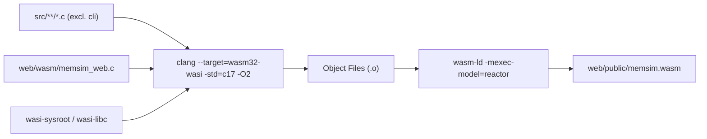
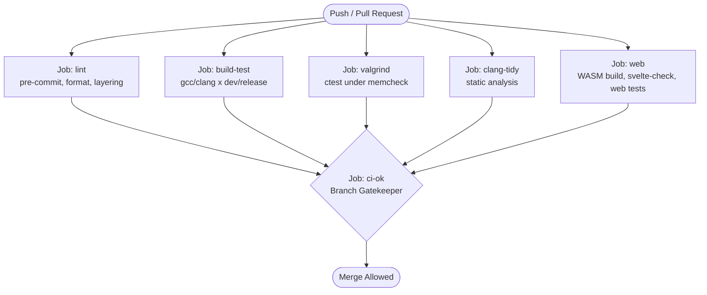

# 26. Build System and Continuous Integration

To guarantee reproducible builds, strict memory safety, and cross-platform verification, MemForge employs modern CMake (version 3.25 or higher) with standard presets, Ninja build orchestration, LLVM WebAssembly toolchains, and a multi-stage GitHub Actions Continuous Integration (CI) pipeline.

## 26.1 CMake Architecture and Presets

The top-level [CMakeLists.txt](file:///home/cyberknight/memforge-agy/rep-ops/CMakeLists.txt) enforces the ISO C17 standard (`CMAKE_C_STANDARD 17`, `CMAKE_C_STANDARD_REQUIRED ON`, `CMAKE_C_EXTENSIONS OFF`) and enables compile-command database generation (`CMAKE_EXPORT_COMPILE_COMMANDS ON`) for static analysis integration.

### Compiler Flags and Warning Hygiene
All first-party simulation targets link against an interface library named `memsim_flags`. This library configures rigorous diagnostic flags:
```cmake
add_library(memsim_flags INTERFACE)
target_compile_options(memsim_flags INTERFACE
  -Wall -Wextra -Wpedantic -Wshadow -Wconversion -Wsign-conversion
  -Wstrict-prototypes -Wmissing-prototypes -Wvla
  $<$<BOOL:${MEMSIM_WERROR}>:-Werror>)
```
Notably:
- `-Wconversion` and `-Wsign-conversion` flag subtle integer truncations or sign mismatches that could jeopardize simulation determinism.
- `-Wstrict-prototypes` and `-Wmissing-prototypes` require declarations for all non-static functions, enforcing encapsulation.
- `-Wvla` forbids Variable Length Arrays, preventing uncontrolled runtime stack allocation.
- In CI environments, `MEMSIM_WERROR=ON` elevates all warnings to fatal compilation errors. Locally, `-Werror` is disabled by default to prevent newer compiler releases from blocking developers.

### Presets Configuration
Standardized build configurations are managed through [CMakePresets.json](file:///home/cyberknight/memforge-agy/rep-ops/CMakePresets.json) (version 6 schema):

*Table 26.1: CMake Configuration Presets*

| Preset Name | Build Type | Flags & Options | Intended Use Case |
| --- | --- | --- | --- |
| `dev` | `Debug` (`-g`) | `MEMSIM_SANITIZE=ON`<br>`-fsanitize=address,undefined`<br>`-fno-omit-frame-pointer` | Day-to-day development. Catches buffer overflows, out-of-bounds array accesses, use-after-free, and undefined behavior. |
| `release` | `Release` (`-O2`) | `-DNDEBUG` | Performance benchmarks and production binaries. Optimization enables deep data-flow analysis that uncovers uninitialized variables. |
| `valgrind` | `Debug` (`-g`) | `MEMSIM_VALGRIND=ON`<br>`-DMEMSIM_VALGRIND=ON` | Comprehensive dynamic analysis. Executes all unit and system tests under Valgrind memcheck to detect uninitialized reads and memory leaks. |

Under `CMakeLists.txt` (lines 13–15), `MEMSIM_SANITIZE` and `MEMSIM_VALGRIND` are explicitly mutually exclusive:
```cmake
if(MEMSIM_SANITIZE AND MEMSIM_VALGRIND)
  message(FATAL_ERROR "MEMSIM_SANITIZE and MEMSIM_VALGRIND cannot be combined")
endif()
```
This mutual exclusion prevents severe performance degradation and diagnostic conflicts, as Valgrind's shadow memory implementation conflicts with AddressSanitizer's redzone instrumentation.

## 26.2 Modular Target Definition (`memsim_module()`)

Modular boundaries are maintained through a custom CMake function defined in [cmake/MemsimModule.cmake](file:///home/cyberknight/memforge-agy/rep-ops/cmake/MemsimModule.cmake):

```cmake
function(memsim_module name)
  cmake_parse_arguments(ARG "" "" "SOURCES;DEPS" ${ARGN})
  add_library(memsim_${name} STATIC ${ARG_SOURCES})
  add_library(memsim::${name} ALIAS memsim_${name})
  target_include_directories(memsim_${name}
    PUBLIC ${CMAKE_CURRENT_SOURCE_DIR}/include
    PRIVATE ${CMAKE_CURRENT_SOURCE_DIR})
  list(TRANSFORM ARG_DEPS PREPEND memsim::)
  target_link_libraries(memsim_${name} PUBLIC ${ARG_DEPS} PRIVATE memsim_flags)
endfunction()
```

### Architectural Properties of `memsim_module()`
1. **Target Aliasing**: Defines both a static target (`memsim_${name}`) and a namespaced alias target (`memsim::${name}`). Dependent modules must link against the alias, preventing accidental linkage to system libraries with similar names.
2. **Include Separation**:
   - `PUBLIC`: `${CMAKE_CURRENT_SOURCE_DIR}/include` exposes public headers to dependent targets. Because headers reside under `include/memsim/<module>/`, consumers must include them using `<module>`-qualified paths.
   - `PRIVATE`: `${CMAKE_CURRENT_SOURCE_DIR}` confines private implementation headers to the module itself and its direct unit tests.
3. **Layering Contract Enforcement**: The `DEPS` parameter defines the permitted dependencies. If module $A$ attempts to include a header from module $B$ without declaring $B$ in its `DEPS`, compilation fails immediately because the include directory is absent from the include search path.

## 26.3 WebAssembly Build Pipeline (`build_wasm.sh`)

The browser-based simulator is produced by compiling the C17 engine directly into WebAssembly bytecode using LLVM and WASI libc. The compilation process is automated by [scripts/build_wasm.sh](file:///home/cyberknight/memforge-agy/rep-ops/scripts/build_wasm.sh).



### Build Script Workflow
1. **Target and Sysroot Discovery**: Lines 15–23 inspect standard installation locations (including `${WASI_SYSROOT}`, `/usr/share/wasi-sysroot`, and `/usr`) to locate `wasi-libc`. The script dynamically resolves whether the toolchain targets `wasm32-wasip1` or legacy `wasm32-wasi`.
2. **Compilation Flags**:
   ```bash
   flags=(--target="$target" --sysroot="$sysroot" -std=c17 -O2 -DNDEBUG -D_GNU_SOURCE -Wall -Wextra)
   ```
3. **Source Discovery**: Aggregates all `.c` files in `src/` while strictly excluding the command-line interface (`src/cli/*`), then appends the WebAssembly export wrapper [web/wasm/memsim_web.c](file:///home/cyberknight/memforge-agy/rep-ops/web/wasm/memsim_web.c).
4. **Header Inclusion**: Dynamically extracts every public include directory (`src/*/include`) and appends private module roots.
5. **Reactor Execution Model**: Compiles object files and invokes the Clang linker with `-mexec-model=reactor`. Unlike a standard command-line executable with a terminating `main()` function, a WASI reactor persists in memory as a library, exporting callable functions (`memsim_alloc`, `memsim_free`, `memsim_run`) to the host JavaScript environment.
6. **Output**: Writes the optimized binary to `web/public/memsim.wasm`.

## 26.4 Continuous Integration Workflow

The GitHub Actions CI pipeline ([.github/workflows/ci.yml](file:///home/cyberknight/memforge-agy/rep-ops/.github/workflows/ci.yml)) executes on all pushes to `main` and all pull requests. Pull request concurrency is managed such that new pushes automatically cancel in-flight runs for that PR.



### Job Descriptions

#### 1. `lint` (Hygiene, Formatting, and Layering)
- **Environment**: Ubuntu 24.04.
- **Cache**: Restores and caches `~/.cache/pre-commit` based on the hash of `.pre-commit-config.yaml`.
- **Command**: `pipx run pre-commit run --all-files --show-diff-on-failure`.
- **Enforcement**: Verifies trailing whitespace, end-of-file newlines, merge conflict markers, YAML/JSON validity, pinned `clang-format` compliance, and runs `scripts/check_layers.sh`.

#### 2. `build-test` (Compilation Matrix and Invariant Testing)
- **Matrix Configuration**:
  - Compiler (`cc`): `gcc`, `clang`.
  - Preset (`preset`): `dev` (Debug + ASan/UBSan), `release` (`-O2` optimized).
  - Total Matrix Size: 4 parallel jobs.
- **ASan Kernel Workaround**: In Ubuntu 24.04 runners, high virtual address space layout randomization (ASLR) entropy can cause AddressSanitizer initialization failures. The job executes:
  ```bash
  sudo sysctl -w vm.mmap_rnd_bits=28
  ```
- **Execution**: Configures with `-DMEMSIM_WERROR=ON`, builds all targets, and runs `ctest --preset ${{ matrix.preset }}`.

#### 3. `valgrind` (Dynamic Memory Verification)
- **Environment**: Ubuntu 24.04 with `valgrind` and `ninja-build`.
- **Execution**: Configures with `cmake --preset valgrind -DMEMSIM_WERROR=ON`, builds, and runs `ctest --preset valgrind`.
- **Criteria**: Any invalid memory read/write or definite/indirect memory leak fails the test suite with exit code 1.

#### 4. `clang-tidy` (Static Analysis)
- **Environment**: Ubuntu 24.04 with Clang toolchain and `clang-tidy`.
- **Execution**: Configures the `release` preset to generate `build/release/compile_commands.json`. Runs `clang-tidy` across all `.c` files in `src/` with warnings as errors.

#### 5. `web` (WebAssembly and Frontend Verification)
- **Environment**: Ubuntu 24.04 with Node.js 24 and LLVM WASI toolchain (`clang lld wasi-libc libclang-rt-18-dev-wasm32`).
- **Steps**:
  1. Compiles the WebAssembly engine via `bash scripts/build_wasm.sh`.
  2. Compiles the native `release` CLI (`cmake --preset release && cmake --build --preset release`).
  3. Installs web dependencies via `npm ci`.
  4. Runs TypeScript and Svelte type verification: `npx svelte-check --tsconfig ./tsconfig.app.json --fail-on-warnings`.
  5. Executes differential test suite: `npm test`. The web tests execute workloads through the WebAssembly engine and verify that resulting JSONL traces match the native CLI output byte-for-byte.
  6. Bundles production frontend assets: `npm run build`.

#### 6. `ci-ok` (Consolidated Status Gatekeeper)
The `ci-ok` job acts as the single required status check for GitHub branch protection on `main`. It runs conditionally with `if: always()`, waiting for all five upstream jobs (`lint`, `build-test`, `valgrind`, `clang-tidy`, `web`). It parses the upstream execution states and asserts that no job was cancelled, skipped, or failed. This decoupling allows matrix expansions in `build-test` without requiring updates to repository branch protection rules.

## 26.5 Pre-Commit Hook Configuration

Local developer hygiene is enforced via Git hooks defined in [.pre-commit-config.yaml](file:///home/cyberknight/memforge-agy/rep-ops/.pre-commit-config.yaml):
- **Standard Checks**: Trailing whitespace removal, end-of-file newline enforcement, mixed line ending normalization (`--fix=lf`), merge conflict detection, YAML syntax verification, JSON validation (excluding `tsconfig*.json` which contain comments).
- **Code Formatting**: Pinned `mirrors-clang-format` (version `v23.1.3`). Pinning the formatter version in configuration prevents formatting discrepancies between different local developer machines and CI. Third-party directories (`third_party/`) are explicitly excluded.
- **Layering and Core Purity**: Local script hook executing `scripts/check_layers.sh` whenever files in `src/` or the layer-check script itself are modified.

## 26.6 Build Orchestration Algorithm

The algorithmic logic governing target registration and flags assignment in the build system is formalized below.

```text
Algorithm 4: Modular Target Compilation and Linkage
Input: Module name M, source list S, dependency list D, flags target F
Output: Configured static library target memsim_M and alias memsim::M

1:  target_name ← "memsim_" + M
2:  alias_name ← "memsim::" + M
3:  CreateStaticLibrary(target_name, sources: S)
4:  CreateTargetAlias(alias_name, target: target_name)
5:  SetIncludeDirectories(target_name,
        PUBLIC: CurrentSourceDir() + "/include",
        PRIVATE: CurrentSourceDir())
6:  resolved_deps ← []
7:  for each dep in D do
8:      Append(resolved_deps, "memsim::" + dep)
9:  end for
10: LinkLibraries(target_name, PUBLIC: resolved_deps, PRIVATE: F)
11: RegisterExportedTarget(target_name)
```

**Complexity Analysis**:
- **Time Complexity**: $\mathcal{O}(|S| + |D|)$ during the CMake configuration phase for each module. Total graph construction time is $\mathcal{O}(M_{\text{modules}} + E_{\text{deps}})$, representing a rapid configuration pass over the modular DAG.
- **Space Complexity**: $\mathcal{O}(M_{\text{modules}} + E_{\text{deps}})$ memory in the CMake internal build graph.
