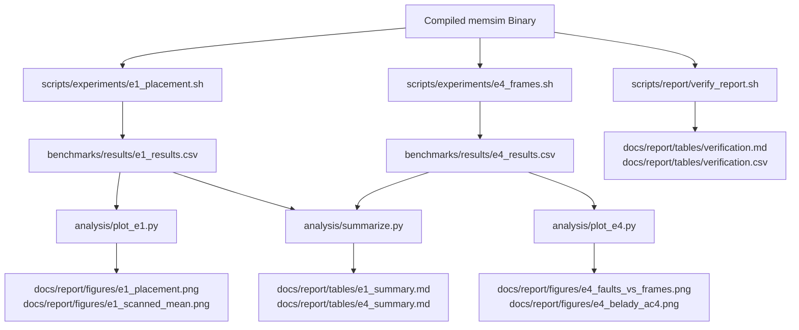

# 27. Setup Instructions and Documentation

This section provides comprehensive, reproducible setup instructions for compiling, testing, evaluating, and serving MemForge on Linux platforms, accompanied by a complete documentation directory map.

## 27.1 System Requirements and Toolchain Dependencies

MemForge is engineered to build on POSIX-compliant environments. Recommended distributions include Ubuntu (22.04 LTS or 24.04 LTS), Debian 12, Fedora 39+, Arch Linux, or Windows Subsystem for Linux (WSL2).

### Core Prerequisites
1. **C17 Compiler**: GCC 11+ or Clang 14+ supporting ISO C17 (`-std=c17`).
2. **Build System**: CMake 3.25 or later, paired with the Ninja build generator.
3. **Dynamic Analyzers**: Valgrind (version 3.18+) for dynamic memory analysis; AddressSanitizer and UndefinedBehaviorSanitizer are provided directly by Clang/GCC.
4. **Developer Hygiene**: Python 3.10+ and `pre-commit` for Git hook management.
5. **Data Analysis**: Python 3 packages (`matplotlib`, `numpy`, `scipy`) for statistical aggregation and figure plotting.
6. **WebAssembly and Web Runtime**: Node.js (version 20 LTS or higher), NPM, LLVM `wasm-ld` linker, and `wasi-libc`.

### Automated Package Installation

#### Ubuntu 24.04 / Debian 12
```bash
sudo apt-get update && sudo apt-get install -y \
  build-essential gcc clang cmake ninja-build valgrind \
  python3-pip python3-venv pipx lld wasi-libc libclang-rt-18-dev-wasm32 \
  nodejs npm
pipx install pre-commit
pipx ensurepath
python3 -m pip install --user --break-system-packages matplotlib numpy scipy
```

#### Arch Linux
```bash
sudo pacman -S --needed \
  base-devel gcc clang cmake ninja valgrind \
  python python-pipx wasi-libc wasi-compiler-rt lld \
  nodejs npm python-matplotlib python-numpy python-scipy
pipx install pre-commit
pipx ensurepath
```

## 27.2 Building the Simulator

MemForge uses CMake presets to configure build artifacts deterministically under the `build/` directory.

### 1. Repository Clone and Hook Setup
```bash
git clone https://github.com/CyberKnight-cmd/memforge.git
cd memforge
pre-commit install
```
`pre-commit install` activates local Git commit hooks that verify file formatting, JSON/YAML schemas, and architectural layering boundaries before every commit.

### 2. Development Debug Build (`dev`)
The `dev` preset is the primary target for coding and interactive debugging. It enables debug symbols (`-g`), AddressSanitizer, and UndefinedBehaviorSanitizer (`-fsanitize=address,undefined`):
```bash
cmake --preset dev
cmake --build --preset dev
```
The compiled CLI binary is placed at `./build/dev/bin/memsim`.

### 3. Optimized Release Build (`release`)
The `release` preset optimizes code generation (`-O2 -DNDEBUG`) for execution performance during benchmark sweeps:
```bash
cmake --preset release
cmake --build --preset release
```
The optimized executable is output to `./build/release/bin/memsim`.

### 4. Valgrind Dynamic Verification Build (`valgrind`)
The `valgrind` preset compiles with debug symbols but omits compiler sanitizer instrumentation, enabling Valgrind memcheck to run cleanly:
```bash
cmake --preset valgrind
cmake --build --preset valgrind
```

## 27.3 Executing the Test Suite

Testing is coordinated through CTest across all 17 registered test suites, covering unit tests, golden acceptance benchmarks, property-based invariant fuzzing, naive reference oracles, and CLI smoke scripts.

### Running Tests Under AddressSanitizer
```bash
ctest --preset dev --output-on-failure
```
Expected output:
```text
Test project /path/to/memforge/build/dev
      Start  1: test_common_bus
 1/17 Test  #1: test_common_bus ..................   Passed    0.01 sec
      Start  2: test_contiguous_engine
 2/17 Test  #2: test_contiguous_engine ...........   Passed    0.02 sec
...
      Start 17: cli_smoke
17/17 Test #17: cli_smoke ........................   Passed    0.15 sec

100% tests passed, 0 tests failed out of 17
```

### Running Tests Under Valgrind Memcheck
To verify that no uninitialized reads or memory leaks occur across any test case:
```bash
ctest --preset valgrind --output-on-failure
```
Every test binary is automatically invoked with `valgrind --quiet --error-exitcode=1 --leak-check=full --errors-for-leak-kinds=definite,indirect`.

### Running Individual Unit Tests
Individual unit tests can be inspected directly:
```bash
./build/dev/tests/unit/contiguous/test_contiguous_engine
./build/dev/tests/golden/test_golden_ac1
```

## 27.4 Running Experiments and Generating Reports

The experimental evaluation pipeline is automated through reproducible shell and Python scripts located in `scripts/` and `analysis/`.



### 1. Executing Full Experiment Suite
To run all placement and paging experiments, reduce statistics, and regenerate publication figures:
```bash
./scripts/experiments/run_all.sh
```
This script executes:
1. `scripts/experiments/e1_placement.sh`: Evaluates First-Fit, Best-Fit, and Worst-Fit across 3 memory pressure regimes (60%, 75%, 90% target utilisation) using 10 seeded random workloads per cell (30 distinct workloads, 90 total runs).
2. `scripts/experiments/e4_frames.sh`: Evaluates FIFO, LRU, and OPT across frame allocations from 1 to 16 frames over 10 seeded reference streams of 2,000 accesses each (480 total runs).
3. `analysis/plot_e1.py`: Generates Figure  and Figure .
4. `analysis/plot_e4.py`: Generates Figure  and Figure .
5. `analysis/summarize.py`: Computes sample means and 95% confidence intervals using Student's $t$-distribution ($t = 2.262$ for $N=10$, $df=9$), generating Table 24.1 ([docs/report/tables/e1_summary.md](file:///home/cyberknight/memforge-agy/rep-ops/report/tables/e1_summary.md)) and Table 24.2 ([docs/report/tables/e4_summary.md](file:///home/cyberknight/memforge-agy/rep-ops/report/tables/e4_summary.md)).

### 2. Validating Acceptance Criteria
To execute the automated end-to-end verification harness and update the acceptance verification report:
```bash
./scripts/report/verify_report.sh
```
This script runs the CLI against all acceptance fixtures, validates outputs, and outputs [docs/report/tables/verification.md](file:///home/cyberknight/memforge-agy/rep-ops/report/tables/verification.md).

## 27.5 Running the Web Application

The interactive web application runs client-side in the browser, powered by the C engine compiled to WebAssembly.

### 1. Compiling the WebAssembly Engine
```bash
bash scripts/build_wasm.sh
```
This script uses Clang and WASI libc to compile all simulation engine modules and `web/wasm/memsim_web.c` into `web/public/memsim.wasm` under the reactor execution model.

### 2. Installing Node Dependencies
```bash
cd web
npm ci
```

### 3. Running TypeScript and Svelte Verification
```bash
npx svelte-check --tsconfig ./tsconfig.app.json --fail-on-warnings
```

### 4. Running Web Engine Differential Tests
```bash
npm test
```
The test suite executes the WebAssembly engine in a Node.js test environment against benchmark fixtures and asserts that generated JSONL traces match native CLI outputs byte-for-byte.

### 5. Launching the Local Development Server
```bash
npm run dev
```
Open a browser and navigate to `http://localhost:5173`. The application provides hot-module replacement for UI editing.

### 6. Production Bundle Creation
```bash
npm run build
```
Creates an optimized static bundle in `web/dist/` suitable for deployment to any static web hosting provider (e.g., GitHub Pages, Cloudflare Pages) without server-side dependencies.

## 27.6 Project Documentation Map

The MemForge documentation suite provides complete architectural specifications, coding rules, empirical results, and testing evidence.

*Table 27.1: Comprehensive Documentation Map*

| Path / File | Purpose and Key Contents |
| --- | --- |
| [README.md](file:///home/cyberknight/memforge-agy/rep-ops/README.md) | High-level system overview, quick-start build commands, team roles, and contribution guide. |
| [LICENSE](file:///home/cyberknight/memforge-agy/rep-ops/LICENSE) | MIT open-source licensing agreement. |
| [docs/ARCHITECTURE.md](file:///home/cyberknight/memforge-agy/rep-ops/docs/ARCHITECTURE.md) | Comprehensive engineering specification: requirements (FR/NFR), acceptance criteria (AC-1..AC-8), subsystem architectures, trace format, event catalogue, and decision records (ADR-001..ADR-013). |
| [docs/CONVENTIONS.md](file:///home/cyberknight/memforge-agy/rep-ops/docs/CONVENTIONS.md) | C17 code conventions, identifier prefixing matrix, header encapsulation rules, and determinism constraints. |
| [docs/RESEARCH.md](file:///home/cyberknight/memforge-agy/rep-ops/docs/RESEARCH.md) | Annotated review of memory management literature (Silberschatz, Knuth, Belady, Denning). |
| [.github/CODEOWNERS](file:///home/cyberknight/memforge-agy/rep-ops/.github/CODEOWNERS) | Declarative mapping of repository paths to owners $P_1$ through $P_{10}$. |
| [.github/workflows/ci.yml](file:///home/cyberknight/memforge-agy/rep-ops/.github/workflows/ci.yml) | GitHub Actions CI workflow covering linting, matrix builds, Valgrind, clang-tidy, and WebAssembly builds. |
| [docs/report/sections/](file:///home/cyberknight/memforge-agy/rep-ops/report/sections/) | 30-section academic project report detailing theoretical background, implementation details, verification results, and operational workflows. |
| [docs/report/tables/](file:///home/cyberknight/memforge-agy/rep-ops/report/tables/) | Generated markdown tables: `e1_summary.md` (placement under pressure), `e4_summary.md` (paging faults), `verification.md` (AC matrix), `cli_examples.md` (CLI transcripts). |
| [docs/report/figures/](file:///home/cyberknight/memforge-agy/rep-ops/report/figures/) | Generated plots: `e1_placement.png`, `e1_scanned_mean.png`, `e4_faults_vs_frames.png`, `e4_belady_ac4.png`. |

## 27.7 Clean-Room Verification Algorithm

The end-to-end verification procedure executed to validate a fresh checkout of the system is formalized below.

```text
Algorithm 5: Clean-Room System Verification Pipeline
Input: Clean clone of the MemForge repository
Output: Complete verification status (Boolean success/failure)

1:  ExecuteCommand("pre-commit install")
2:  ExecuteCommand("cmake --preset dev -DMEMSIM_WERROR=ON")
3:  ExecuteCommand("cmake --build --preset dev")
4:  test_status ← ExecuteCommand("ctest --preset dev --output-on-failure")
5:  if test_status ≠ 0 then
6:      return Failure("CTest dev suite failed")
7:  end if
8:  ExecuteCommand("cmake --preset valgrind -DMEMSIM_WERROR=ON")
9:  ExecuteCommand("cmake --build --preset valgrind")
10: valgrind_status ← ExecuteCommand("ctest --preset valgrind")
11: if valgrind_status ≠ 0 then
12:     return Failure("Valgrind memcheck detected memory errors or leaks")
13: end if
14: ExecuteCommand("bash scripts/build_wasm.sh")
15: ExecuteCommand("cd web && npm ci && npm test && npm run build")
16: ExecuteCommand("./scripts/experiments/run_all.sh")
17: verify_status ← ExecuteCommand("./scripts/report/verify_report.sh")
18: if verify_status ≠ 0 then
19:     return Failure("Acceptance verification report contains failing criteria")
20: end if
21: return Success("All verification criteria PASS")
```

**Complexity Analysis**:
- **Time Complexity**: The full compilation and test pipeline runs in under 3 minutes on a modern multi-core development workstation with Ninja concurrency. Valgrind memcheck introduces an approximate $10\times$ execution slowdown on unit test binaries, running in approximately 20 seconds.
- **Space Complexity**: The build directories (`build/dev`, `build/release`, `build/valgrind`) consume approximately 150 MB of disk storage, and the web production bundle (`web/dist/`) occupies less than 2 MB.
