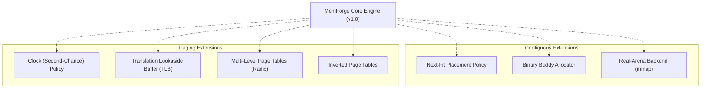

# 28. Conclusion and Future Scope

This section summarizes the achievements of the MemForge project against its initial engineering goals, synthesizes key lessons learned during system development, and provides an in-depth analysis of architectural extensions and features deferred from the project scope.

## 28.1 Summary of Achievements Against Objectives

The primary objective of the MemForge project was to design and implement an academically rigorous, deterministic, and modular memory management simulator in C17 that models both contiguous memory allocation and demand-paged virtual memory. All foundational functional and non-functional requirements established in the project architecture were met and independently verified.

*Table 28.1: Achievement Summary Against Project Objectives*

| Objective Area | Planned Specification | Implemented Status & Evidence |
| --- | --- | --- |
| **Contiguous Allocation** | First-Fit, Best-Fit, and Worst-Fit placement; block splitting; adjacent hole coalescing; sliding compaction; fragmentation metrics. | Fully implemented in `src/contiguous/`. Validated against textbook five-hole scenarios (AC-1) and sliding compaction retry (AC-2). |
| **Demand Paging** | Per-process page tables; MMU address translation; FIFO, LRU, and OPT page replacement; dirty page writebacks; Belady frame sweep. | Fully implemented in `src/paging/`. Validated on textbook 20-reference strings (AC-3), multi-process access (AC-5), and Belady's anomaly (AC-4). |
| **Determinism (NFR-1)** | Byte-identical event traces across multiple runs on identical workloads and seeds. | Verified across 6/6 fixture workloads with zero byte divergence (AC-6). Achieved via pure integer simulation state and logical step clocks. |
| **Engine Purity (NFR-2)** | Core simulation libraries remain strictly decoupled from file I/O, system wall clocks, and platform entropy. | Verified by `scripts/check_layers.sh` in CI; zero inclusions of system headers in `src/common/`, `src/contiguous/`, or `src/paging/`. |
| **Canonical Event Stream** | Structured, append-only JSONL event stream acting as the sole integration surface for metrics, tests, and UI. | 21 canonical event types specified and emitted; metrics computed exclusively by `src/metrics/` from the event log. |
| **Cross-Platform Delivery** | Native command-line tool paired with an interactive zero-drift browser-based laboratory. | Single C17 engine compiled to native ELF binary (`memsim`) and WebAssembly reactor (`memsim.wasm`). Web app runs on Svelte 5 with full feature parity. |
| **Correctness & QA** | 100% test passage across unit, golden, property-based, and differential test suites under ASan, UBSan, and Valgrind. | 17/17 CTest suites pass cleanly without memory leaks or undefined behavior in CI (AC-7). |

## 28.2 Engineering Lessons Learned

The design and realization of MemForge yielded several critical engineering insights applicable to systems programming and simulator design:

1. **Determinism Must Be Architectural, Not Incidental**: True reproducibility cannot be achieved simply by eliminating calls to `rand()`. It requires systematic discipline:
   - Floating-point representations must be excluded from core engine state to avoid architecture-specific rounding differences; all fractional metrics (e.g., external fragmentation ratios, page fault rates) are accumulated using fixed-point integer arithmetic (parts-per-million) and formatted deterministically.
   - Ambiguous conditions (such as multiple holes having identical size during Best-Fit placement) require explicit, documented tie-breaking rules (e.g., selecting the lowest memory address).
   - Iteration over memory structures must follow ordered linked lists or sorted arrays rather than hash table bucket traversals.
2. **Strict Layering Prevents Code Erosion**: In collaborative systems programming, inter-module coupling often degrades over time. By combining CMake target visibility rules (`memsim_module()`) with an automated script hook (`scripts/check_layers.sh`) that inspects `#include` directives before every commit, boundary violations were caught immediately at the commit phase rather than during release integration.
3. **Decoupling Policy Decision from Engine Mutation (ADR-010)**: Designing placement and replacement policies as read-only decision routines that inspect immutable views and return choices—rather than allowing policies to mutate engine data structures directly—greatly simplified verification. A policy cannot corrupt memory layouts, violate block boundaries, or fail to emit coalescing events.
4. **WebAssembly Eliminates Simulation Drift**: Earlier simulator designs frequently implemented the simulation engine in C/C++ and maintained a separate, simplified JavaScript version for web demonstrations. Inevitably, the two implementations diverged on subtle edge cases (e.g., tie-breaking or coalescing order). By compiling the real C engine to WebAssembly using Clang's `-mexec-model=reactor` and WASI libc, MemForge guarantees that the browser laboratory behaves identically to the command line, with zero redundant engineering effort.

## 28.3 Future Scope and Deferred Architectural Extensions

To satisfy the constraints of the project timeline, several advanced memory management concepts were deferred. These cut items represent promising avenues for future research and development.



### 1. Next-Fit Placement Policy
- **Theoretical Background**: Proposed by Knuth as a modification of First-Fit, Next-Fit maintains a roving pointer (cursor) that records the memory location of the most recent allocation. Subsequent searches for free holes begin at the cursor rather than at address zero, wrapping around to the start of memory when the upper limit is reached.
- **Architectural Trade-Offs**: Next-Fit reduces search time by avoiding repetitive scans through small fragments that cluster at low memory addresses. However, empirical studies show that Next-Fit often causes worse overall fragmentation than First-Fit because it tends to break up large holes located in high memory addresses, increasing the frequency of allocation failures.
- **Implementation Design**: Requires adding a roving address pointer `next_fit_cursor` to the contiguous policy state struct.

### 2. Clock (Second-Chance) Page Replacement
- **Theoretical Background**: Pure LRU replacement requires maintaining a hardware timestamp or updating an access stack on every memory reference, which is prohibitively expensive in real operating system kernels. The Clock algorithm approximates LRU by maintaining a circular list of physical frames and inspecting a single hardware reference bit ($R$).
- **Architectural Trade-Offs**: Clock provides $\mathcal{O}(1)$ amortized victim selection overhead. Incorporating a dirty bit ($D$) extends Clock to the Two-Handed or Four-Pass Enhanced Clock algorithm (differentiating unmodified clean pages from dirty pages requiring disk writebacks).
- **Implementation Design**: Extends `ms_page_engine` to invoke a clock-hand stepping routine over the frame table when capacity page faults occur.

### 3. Translation Lookaside Buffer (TLB) Simulation
- **Theoretical Background**: Real hardware MMUs do not traverse page tables in main memory for every memory reference; instead, they query a fast hardware associative cache known as the TLB.
- **Modeling Metrics**: Future extensions would introduce a configurable TLB cache (specifying entry count, e.g., 64 entries, and associativity: direct-mapped, 4-way set associative, or fully associative). The metric collector would compute TLB hit rates and Effective Access Time (EAT):
  $$\text{EAT} = \alpha \cdot (t_{\text{tlb}} + t_{\text{mem}}) + (1 - \alpha) \cdot (t_{\text{tlb}} + t_{\text{walk}} + t_{\text{mem}})$$
  where $\alpha$ is the TLB hit ratio, $t_{\text{tlb}}$ is the cache lookup latency, and $t_{\text{walk}}$ is the page table walk latency.

### 4. Hierarchical and Inverted Page Tables
- **Theoretical Background**: MemForge v1 implements flat, per-process page tables indexed directly by Virtual Page Number (VPN). For large virtual address spaces (e.g., 48-bit or 64-bit architectures), flat tables consume gigabytes of physical RAM even for sparse address spaces.
- **Hierarchical Radix Trees**: Future versions could model two-level (x86-32) and four-level (x86-64 PML4) radix page tables, dynamically allocating intermediate page directory tables only when an access within that range occurs.
- **Inverted Page Tables**: Models systems where a global table contains exactly one entry per physical frame, indexed by a hash function over `(PID, VPN)`.

### 5. Binary Buddy Allocator
- **Theoretical Background**: A power-of-two memory allocator that divides memory blocks into pairs of equal-sized "buddies" ($2^k$). When an allocation of size $S$ is requested, the allocator finds the smallest block $2^k \ge S$. If only larger blocks are available, it recursively splits blocks in half until an exact power-of-two fit is achieved. Upon deallocation, the allocator inspects whether the adjacent buddy block is also free, coalescing them recursively.
- **Architectural Trade-Offs**: Eliminates external fragmentation search overhead ($\mathcal{O}(1)$ array lookup across free lists) at the expense of internal fragmentation within power-of-two allocations.

### 6. Real-Arena Memory Allocator Backend (FR-S1)
- **Theoretical Background**: In v1, MemForge models memory abstractly: blocks are tracking structures (`ms_block`) defining integer offset ranges $[start, start + size)$. The simulator does not map or allocate real backing RAM.
- **Implementation Design**: An arena backend would back the simulated memory with actual physical memory mapped via POSIX `mmap(MAP_ANONYMOUS | MAP_PRIVATE)`. Workload operations could then write and read actual data payloads, enabling verification of cache locality and physical allocator performance using hardware performance counters (e.g., `perf`).

## 28.4 Algorithmic Specification: Next-Fit Policy

To guide future contributors implementing the Next-Fit placement policy, the roving search algorithm is specified formally below.

```text
Algorithm 6: Next-Fit Roving Pointer Placement
Input: Memory size M, ordered list of free holes H, request size S, roving cursor C
Output: Selected hole h* and updated cursor C', or Null if no hole fits

1:  if Length(H) = 0 then
2:      return (Null, C)
3:  end if
4:  first_scan_hole ← Null
5:  // Phase 1: Scan from cursor C to the end of memory
6:  for each hole h in H do
7:      if h.start ≥ C then
8:          if h.size ≥ S then
9:              C' ← h.start + S
10:             return (h, C')
11:         end if
12:     end if
13: end for
14: // Phase 2: Wrap around and scan from beginning of memory up to cursor C
15: for each hole h in H do
16:     if h.start < C then
17:         if h.size ≥ S then
18:             C' ← h.start + S
19:             return (h, C')
20:         end if
21:     else
22:         break // Reached original search start
23:     end if
24: end for
25: return (Null, C) // Allocation failure: no fitting hole found
```

**Complexity Analysis**:
- **Time Complexity**: $\mathcal{O}(H)$ in the worst case, where $H$ is the number of free holes. In the average case, Next-Fit terminates earlier than First-Fit because it avoids re-scanning small unusable holes accumulated at low memory addresses.
- **Space Complexity**: $\mathcal{O}(1)$ auxiliary space, requiring only a scalar cursor variable $C$ preserved in policy state across requests.
