# 29. References

This section lists the authoritative academic literature, foundational papers, technical specifications, and software frameworks underpinning the theoretical foundations and implementation of MemForge. All citations adhere to standard IEEE bibliographic style.

```mermaid
flowchart TD
    subgraph Foundational OS Theory
        REF1["[1] Silberschatz et al. (OS Concepts)"]
        REF2["[2] Tanenbaum & Bos (Modern OS)"]
        REF5["[5] Knuth (TAOCP Vol. 1)"]
        REF6["[6] Denning (Working Set Model)"]
    end

    subgraph Paging & Replacement
        REF3["[3] Belady 1966 (MIN / OPT Algorithm)"]
        REF4["[4] Belady et al. 1969 (Belady's Anomaly)"]
    end

    subgraph Computational Foundations & Runtimes
        REF7["[7] Blackman & Vigna (xoshiro256**)"]
        REF8["[8] WebAssembly Core Specification"]
        REF9["[9] WASI Snapshot Preview 1"]
        REF10["[10] Svelte 5 Framework"]
        REF11["[11] CMake Build System"]
    end

    REF1 & REF5 --> MOD_CONT["src/contiguous/ (First-, Best-, Worst-Fit, AC-1)"]
    REF3 & REF4 --> MOD_PAGE["src/paging/ (FIFO, LRU, OPT, AC-3, AC-4)"]
    REF6 & REF7 --> MOD_WL["src/workloads/ (alloc-uniform, refs-locality)"]
    REF8 & REF9 & REF10 --> MOD_WEB["web/ & wasm/ (WebAssembly Engine & Labs)"]
    REF11 --> MOD_BUILD["CMakeLists.txt & cmake/ (Presets & Modules)"]
```

---

### [1] Operating System Concepts (10th Edition)
A. Silberschatz, P. B. Galvin, and G. Gagne, *Operating System Concepts*, 10th ed. Hoboken, NJ, USA: John Wiley & Sons, 2018.
- **Context in MemForge**: Provides the primary pedagogical framework for variable-partition contiguous allocation and virtual memory paging. Specifically, Chapter 9 ("Main Memory") provides the five-hole contiguous allocation problem ($100, 500, 200, 300, 600$ units with requests $212, 417, 112, 426$) codified directly in [tests/fixtures/ac1_silberschatz.wl](file:///home/cyberknight/memforge-agy/rep-ops/tests/fixtures/ac1_silberschatz.wl) and verified under acceptance criterion **AC-1**. Chapter 10 ("Virtual Memory") provides the classic 20-reference paging string ($7, 0, 1, 2, 0, 3, 0, 4, 2, 3, 0, 3, 2, 1, 2, 0, 1, 7, 0, 1$) used to benchmark FIFO, LRU, and OPT in **AC-3**.

### [2] Modern Operating Systems (4th Edition)
A. S. Tanenbaum and H. Bos, *Modern Operating Systems*, 4th ed. Boston, MA, USA: Pearson, 2015.
- **Context in MemForge**: Informs the design of memory models in `src/contiguous/` and `src/paging/`. Chapter 3 ("Memory Management") guides the implementation of sliding memory compaction, bitmap versus linked-list hole management, page table entries (present, referenced, and dirty bits), and page writeback policies for dirty victims during replacement.

### [3] Belady's Optimal Replacement Algorithm (1966)
L. A. Belady, "A study of replacement algorithms for a virtual-storage computer," *IBM Systems Journal*, vol. 5, no. 2, pp. 78–101, 1966, doi: 10.1147/sj.52.0078.
- **Context in MemForge**: Formulates the theoretical foundation for the clairvoyant optimal page replacement algorithm (MIN/OPT) implemented in `src/paging/policies/opt.c`. Belady proves that evicting the page whose next access occurs furthest in the future minimizes page fault frequency for any fixed physical frame allocation, establishing the formal lower bound against which FIFO and LRU are evaluated.

### [4] Belady's Anomaly (1969)
L. A. Belady, R. A. Nelson, and G. S. Shedler, "An anomaly in space-time characteristics of certain programs running in a paging machine," *Communications of the ACM*, vol. 12, no. 6, pp. 349–353, Jun. 1969, doi: 10.1145/363095.363155.
- **Context in MemForge**: Documents the discovery that first-in, first-out (FIFO) page replacement can exhibit non-stack behavior where increasing physical frame allocations results in an increased number of page faults. The 12-reference sequence ($1, 2, 3, 4, 1, 2, 5, 1, 2, 3, 4, 5$) published in this work is encoded as [tests/fixtures/ac4_belady.wl](file:///home/cyberknight/memforge-agy/rep-ops/tests/fixtures/ac4_belady.wl), demonstrating 9 faults with 3 frames and 10 faults with 4 frames in acceptance criterion **AC-4**.

### [5] Fundamental Algorithms: Dynamic Storage Allocation
D. E. Knuth, *The Art of Computer Programming, Volume 1: Fundamental Algorithms*, 3rd ed. Reading, MA, USA: Addison-Wesley, 1997, sec. 2.5, "Dynamic Storage Allocation," pp. 435–456.
- **Context in MemForge**: Derives the mathematical foundations of dynamic storage placement policies. Section 2.5 provides the formal definitions of First-Fit and Best-Fit search routines over doubly-linked block structures, analyzes hole splitting and boundary tag coalescing, and derives the classic Fifty-Percent Rule ($H \approx \frac{1}{2} N$ holes per allocated block at equilibrium) evaluated in experiment E3.

### [6] The Working Set Model for Program Behavior (1968)
P. J. Denning, "The working set model for program behavior," *Communications of the ACM*, vol. 11, no. 5, pp. 323–333, May 1968, doi: 10.1145/363095.363141.
- **Context in MemForge**: Introduces the concept of temporal and spatial locality in virtual memory reference streams. Denning's formalization of a dynamic working set $W(t, \Delta)$ directly underpins the synthetic workload generator `refs-locality` implemented in `src/workloads/generators.c`.

### [7] Scrambled Linear Pseudorandom Number Generators
D. Blackman and S. Vigna, "Scrambled linear pseudorandom number generators," *ACM Transactions on Mathematical Software*, vol. 47, no. 4, pp. 1–32, Dec. 2021, doi: 10.1145/3460772.
- **Context in MemForge**: Specifies the `xoshiro256**` (XOR/shift/rotate) 64-bit pseudorandom number generator implemented in `src/workloads/generators.c`. This generator provides an exceptionally fast, statistically robust, and deterministic PRNG with period $2^{256} - 1$, guaranteeing identical pseudo-random workload synthesis across all architectures and compilers without relying on non-deterministic libc functions.

### [8] WebAssembly Core Specification (Version 2.0)
WebAssembly Community Group, "WebAssembly Core Specification, Version 2.0," W3C Recommendation, Jun. 2022. [Online]. Available: https://www.w3.org/TR/wasm-core-2/
- **Context in MemForge**: Defines the binary instruction format, linear memory semantics, and execution model utilized to compile the C17 simulation engine into browser-executable WebAssembly. Governs the operation of `scripts/build_wasm.sh` and the linear memory isolation between the host browser JavaScript environment and the C runtime heap.

### [9] WebAssembly System Interface (WASI Snapshot Preview 1)
WebAssembly System Interface Subgroup, "WASI: WebAssembly System Interface, Snapshot Preview 1," Bytecode Alliance, 2020. [Online]. Available: https://github.com/WebAssembly/WASI
- **Context in MemForge**: Specifies the standard POSIX-like system call abstraction layer for WebAssembly. Underpins the compilation target `--target=wasm32-wasi` and the lightweight browser runtime shim `wasiShim()` implemented in [web/src/lib/engine.ts](file:///home/cyberknight/memforge-agy/rep-ops/web/src/lib/engine.ts), enabling standard C library functions (`malloc`, `free`, `snprintf`, `open_memstream`) to function without full OS operating environment support.

### [10] Svelte: Cybernetically Enhanced Web Apps
R. Harris and the Svelte Team, "Svelte: Cybernetically enhanced web apps," Version 5, 2024. [Online]. Available: https://svelte.dev
- **Context in MemForge**: The reactive user interface framework utilized in `web/` to construct the interactive educational laboratory. Svelte 5's fine-grained reactivity model (runes: `$state`, `$derived`, `$effect`) coordinates the execution of the WebAssembly engine with real-time SVG sparklines, memory strips, and frame tables without virtual DOM diffing overhead.

### [11] CMake Reference Documentation
Kitware, Inc., "CMake Reference Documentation," Release 3.25, 2022. [Online]. Available: https://cmake.org/documentation
- **Context in MemForge**: Governs the modular meta-build architecture, target visibility contracts, and preset schemas (`CMakePresets.json`) implemented in [CMakeLists.txt](file:///home/cyberknight/memforge-agy/rep-ops/CMakeLists.txt) and [cmake/MemsimModule.cmake](file:///home/cyberknight/memforge-agy/rep-ops/cmake/MemsimModule.cmake).

---

*Table 29.1: Systematic Mapping of References to Project Modules and Verification Criteria*

| Reference | Principal Author & Year | Direct MemForge Component / Subsystem | Primary Requirement / Acceptance Criteria |
| --- | --- | --- | --- |
| [1] | Silberschatz et al., 2018 | `src/contiguous/`, `src/paging/`, `tests/fixtures/` | AC-1 (5 Holes), AC-3 (20-Ref FIFO/LRU/OPT) |
| [2] | Tanenbaum & Bos, 2015 | `src/contiguous/compaction.c`, `src/paging/engine.c` | AC-2 (Compaction), FR-P6 (Dirty Writebacks) |
| [3] | Belady, 1966 | `src/paging/policies/opt.c` | AC-3 (OPT 9 Faults), PT6 (OPT Optimality) |
| [4] | Belady et al., 1969 | `src/paging/belady.c`, `tests/fixtures/ac4_belady.wl` | AC-4 (Belady Anomaly Point at 4 Frames) |
| [5] | Knuth, 1997 | `src/contiguous/policies/`, `src/contiguous/model.c` | FR-C1 (First-Fit), FR-C2 (Best-Fit), E3 (50% Rule) |
| [6] | Denning, 1968 | `src/workloads/generators.c` | FR-W2 (Locality Reference Generator) |
| [7] | Blackman & Vigna, 2021 | `src/workloads/generators.c` | NFR-1 (Determinism), FR-W1, FR-W2 |
| [8] | WebAssembly Group, 2022 | `scripts/build_wasm.sh`, `web/wasm/memsim_web.c` | NFR-4 (Web Platform Delivery) |
| [9] | WASI Subgroup, 2020 | `web/src/lib/engine.ts` (`wasiShim`) | NFR-2 (Engine Purity and Portability) |
| [10] | Harris et al., 2024 | `web/src/routes/`, `web/src/components/` | Section 23 (Interactive Web Laboratory) |
| [11] | Kitware, Inc., 2022 | `CMakeLists.txt`, `cmake/MemsimModule.cmake` | Section 26 (Modular Build Architecture) |
